# Sprout

A fast, interactive 2D multi-fluid sandbox in Rust and Vulkan (via Vulkano). Pour any of
18 liquids (water, syrup, oil, mud, ink, molten chocolate, sludge, blood, mercury, lava,
molten glass, milk, slime, ferrofluid, brine, molten wax, oobleck, liquid gallium) or your
own, heat and cool them, stir them, drop obstacles and magnets in, and watch them splash,
layer, blend, freeze, set, boil away and settle. The whole simulation runs in compute
shaders on the GPU. See [Liquids](#liquids) for the materials and the editor.

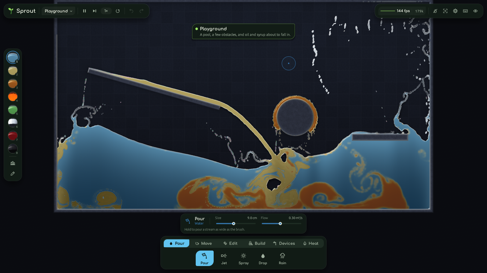

The fluid solver, its tools and maps; see [Look](#look) for how the liquids are drawn,
[Physics](#physics) and [Validation](#validation) for the solver. The code is laid out so
that more simulations can join the same world later (see [Code layout](#code-layout)).

## Build and run

You need:

- Rust 1.88 or newer (the code uses edition 2024 and let-chains; built here with 1.99).
- A GPU and driver with Vulkan 1.1.
- `glslc` on the `PATH` at build time. Fedora: `sudo dnf install glslc`. Debian/Ubuntu:
  `sudo apt install glslc`. Arch: `sudo pacman -S shaderc`. The Vulkan SDK also ships it.
  Set the `GLSLC` environment variable to use a compiler elsewhere.

```bash
cargo run --release
```

A clean build takes under a minute. The window opens on the Playground map; the panel in
the corner has everything, and every control also has a key.

Useful options (run `sprout --help` for all of them):

| Option | Effect |
|---|---|
| `--map <N or name>` | Starting map, e.g. `--map 2` or `--map dam` |
| `--quality low\|medium\|high\|ultra` | Grid of 384x216, 512x288 (default), 768x432 or 1024x576 cells |
| `--no-vsync` | Uncapped frame rate |
| `--min-fps <F>` | Lowest frame rate kept at real time before heavy scenes go into slow motion (default 60) |
| `--set name=value` | Override any parameter, e.g. `--set viscosity_syrup=0.09`, `--set cell_size=0.001` or `--set speed_cap=0` (off); `sprout params` lists them all |
| `--frames N` | Run N frames, print frame timings, exit |

## Controls

| Input | Action |
|---|---|
| Left mouse | Use the selected tool |
| Right mouse | Grab / stir, whatever tool is selected |
| Middle drag, wheel | Pan, zoom about the cursor (with Jet or Current selected the wheel aims; Alt + wheel zooms) |
| Shift + wheel, `[` `]` | Brush size |
| `-` `=` | Flow of the liquid tools, or strength of Grab / Push / Current |
| `1` `2` `3` `4` | Favourite liquids (water, oil, syrup, lava); the *Liquids…* button opens the picker, *Edit* the editor |
| `Q` `B` `J` `C` | Pour, spray, jet, drop |
| `W` `V` `Z` `E` | Grab / stir, push, current, erase |
| `Y` `U` `M` | Heat, cool (brushes), place a magnet (`X` removes it) |
| `A` `S` `D` `X` | Place a circle, box, ramp; remove a solid |
| `T` `G` `F` | Turn the jet, the current or the box / ramp by 15°, flip the ramp |
| `Space` `N` `R` | Pause, single step, reset the map |
| `PgUp` `PgDn` | Previous / next map |
| `Home` `H` `F11` `Esc` | Reset view, hide panel, fullscreen, quit |

Below the tools the panel has three collapsed sections (see [Settings](#settings)):
**Physics** (gravity, the cell size, and per liquid its density, viscosity, tension and
contact angle), **Display** (quality, time scale, wet edge width and tint, vsync) and **Solver** (CFL number, speed
cap, tolerances, and the current substep and iteration counts).

The liquid tools add the selected liquid; all of them stop with the simulation while it is
paused (single steps still emit), except Drop.

- **Pour** runs a stream straight down out of the round brush: it fills the brush circle,
  so its top is round, and falls from there. The flow sets its speed (60 to 400 cells/s:
  whatever carries the flow through the full width of the brush); below the slowest speed
  the stream narrows instead, and above the fastest the brush caps the flow. The stream is
  one fixed lattice at rest density (`brush::Stream`) that moves along at the stream's
  speed and appears as it crosses the back arc of the nozzle, so it has no seams at any
  frame rate and the flow is exact. Inside the brush the nozzle holds the liquid at the
  launch velocity; below it the stream is in free fall, speeds up and narrows. Sweeping
  the brush sideways faster than the stream runs delivers less: the leading side of the
  nozzle overruns liquid it has just emitted, and the surplus is held back.
- **Spray** throws sparse droplets outwards from the brush rim at 260 cells/s (scattered
  by up to 14° and ± 25 % in speed), at 15 % of the flow.
- **Jet** is the same stream aimed anywhere at 320 cells/s; the flow sets its width. Its
  nozzle holds the liquid in it at the jet velocity, so a submerged jet keeps pushing.
- **Drop** stamps a round blob with one click, even while paused.
- **Grab** carries liquid along with the cursor, **Push** drives it radially outwards, and
  **Erase** removes it. Grab and Push have a strength (10–400 %) instead of a flow; the
  strength also applies to right-mouse grabbing.

The brush is shown as a radius in cm (also on the 1 mm tabletop maps, where the default brush
is 0.9 cm) and the flow as the area of liquid added per second (m²/s, or cm²/s on the
tabletop maps: in 2D, per metre of depth);
both are kept in cells and particles internally, and the hover text gives those numbers.
- **Current** is held like Push: while the left button is down, a round zone as large as
  the brush follows the cursor and drives the liquid under it along the arrow, like a
  pump or a fan. It raises the velocity along the heading towards the current's speed
  (150 cells/s at 100 % strength, i.e. 1.5 m/s on 1 cm cells; the panel sets it in m/s,
  from 0.5 to 8 times that and starting at 2, separately from the Grab / Push strength; at
  up to 20 /s in the centre, fading to nothing at the rim) and leaves everything else
  alone: liquid that is already faster is not braked, motion across the current is
  untouched, and no liquid is added or removed. Aim it with `T` / `G`, the wheel or the
  Aim slider; chevrons show where it points and how fast while it is held. Near the top of
  the range the particle speed cap (`speed_cap`, about 750 cells/s in a 288 cell tall tank)
  binds before the current's own speed does. The constants are `CURRENT_SPEED`,
  `CURRENT_RATE` and `CURRENT_STRENGTH` in `src/sim/params.rs`. (Until 2026-11-11 a click
  placed a current that stayed in the world, 0.1 to 4 times the speed at 12 /s; the
  simulation still takes up to 8 placed zones, which `validate current` uses.)

New liquid never packs a cell above rest density, and nothing is added inside a pool:
painted liquid (spray, drop) only goes into cells without liquid, while a stream (pour,
jet) fills the cells it shares with its own earlier liquid, up to 1.5 times rest density
(a lattice that is not aligned to the grid puts 3 to 5 particles in a cell). A submerged
spout is held back the same way: the pool takes what it has room for. The particles per cell are
counted on the GPU (`count.comp`) for just the window around the
brush, and only those counts are read back: 0.3 ms per frame at 512 × 288 and 0.4 ms at
1024 × 576, where reading back every particle cost 1.7 and 34 ms.

Strokes stop at the panel, outside the window, and when the window loses focus. The camera
eases zoom about the cursor (the point under it stays put), pans one to one, and glides
back on Home. The brush cursor takes the tool's colour (the liquid's for liquid tools),
tightens while held and eases to a new size or jet aim; placing or removing a solid and
dropping a blob ring out briefly, and changes of tool, liquid, map or quality are announced
in a short toast.

## Maps

| # | Name | What it shows |
|---|---|---|
| 0 | Playground | A pool, a few obstacles, and oil and syrup about to fall in |
| 1 | Dam Break | A tall column of water collapses across the floor and over a step |
| 2 | Upside Down | Syrup over water over oil: the layers overturn into their stable order |
| 3 | Three Columns | Oil, water and syrup side by side: syrup slides under, oil rides over |
| 4 | Cascade | Three reservoirs drain down a zig-zag of ramps into a shared basin |
| 5 | Empty Tank | Nothing but walls |
| 6 | Terrace Falls | Stepped spill pools and a slow syrup tributary feed a plunge pool |
| 7 | Pinball Garden | Three fluid showers weave through staggered pegs into scalloped pools |
| 8 | Hourglass | A layered reservoir drains through a narrow throat onto a splitting crown |
| 9 | Twin Spillways | Opposing torrents collide and flow around a central island |
| 10 | Canopy | Branching shelves split streams above a pool of stone roots |
| 11 | Sunken Ruins | A dam-break wave threads open passages beneath ruined towers |
| 12 | Oil Drops | A tabletop tank 51 cm wide (1 mm cells): oil beads into round drops and lenses |
| 13 | Lava Meets Water | Lava at 1200 °C runs into a pool and spreads under the water as a molten sheet; water that boils on it turns to steam; the lava crusts and sets over minutes |
| 14 | Density Tower | Mercury, water, oil and molten wax sort themselves by density (13.5 : 1), in a tower kept at 70 °C so the wax stays molten |
| 15 | Glass and Slime | Glass droops in strands and sets as it cools; slime stretches over a peg and springs back |
| 16 | Mud Flats | Mud slumps and settles out, sludge holds its shape, oobleck takes a falling ball of mercury |
| 17 | Ferrofluid | 1 mm cells: a dish of ferrofluid over a magnet heaps up and spikes |
| 18 | Kitchen | Chocolate sets on a cold plate; milk, ink and blood sink through water in plumes |
| 19 | Cold Snap | Air at −15 °C: water freezes over, brine does not; wax on a hot plate stays molten |
| 20 | Gallium | 1 mm cells: gallium's oxide skin holds lumpy shapes |

Maps are written in resolution-independent units in [src/maps.rs](src/maps.rs); the six detailed maps reuse the existing stone shapes and water, oil and syrup materials.
Try `cargo run --release -- --map canopy`, or use the map menu / PgUp and PgDn.

The six new maps in motion (0.8 simulated seconds, low quality grid):

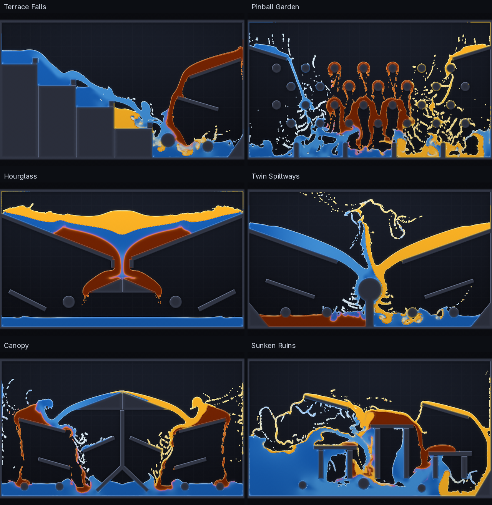

Upside Down six seconds in, and settled after forty:

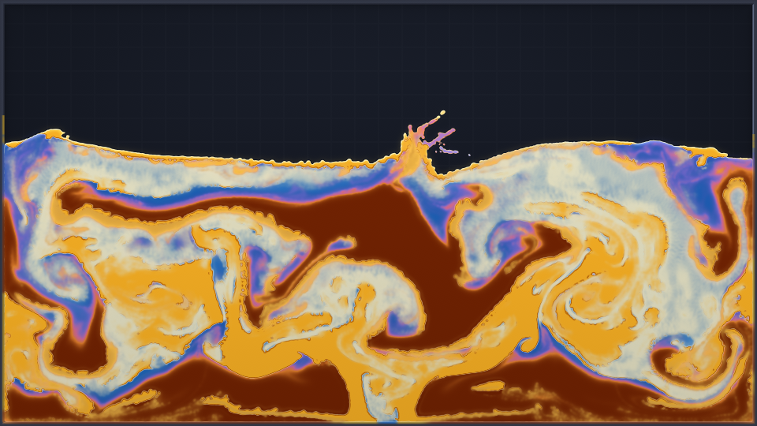
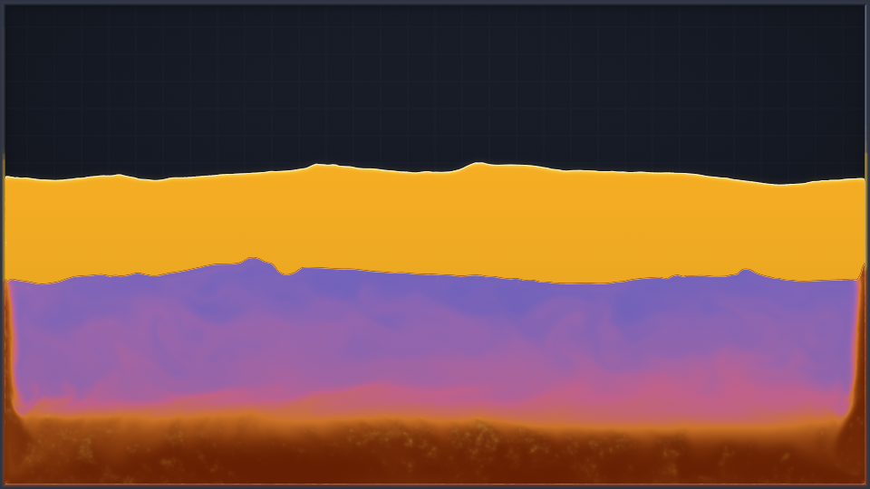

## Other commands

```bash
cargo run --release -- validate          # physics and tool checks, off-screen (under 2 minutes)
cargo run --release -- --selftest        # drives the real window through every tool and key
cargo run --release -- bench             # throughput table (about a minute)
cargo run --release -- shot out.png --map 2 --at 3,10
cargo run --release -- gallery DIR       # reference pictures: every liquid, interaction, tool and zoom
cargo run --release -- params            # every parameter: unit, default, safe range, how to switch it off
cargo test --release                     # CPU-side unit tests
```

`validate` takes a test name (`hydrostatic`, `sealed`, `dam`, `ritter`, `layers`, `viscosity`,
`viscous`, `buoyancy`, `surface`, `settle`, `convergence`, `pour`, `current`, `tools`,
`thermal`, `rheology`, `suspension`, `elastic`, `metals`, `mixing`, and the robustness runs
`maps`, `liquids`, `abuse`, `extremes`, `render`; see Validation, "Bug-fix round") and
`--shots DIR` to save a picture of each scenario. Two debug commands are not in `--help`: `sprout probe [DEPTH]`
prints an energy, step and iteration trace (`--map N` for a map, `--at T` for the duration),
and `sprout profile` splits a frame into CPU recording and GPU time and times every pass of
one substep with GPU timestamps. `sprout lab [SETTLE COOL RADIUS DIR]` drops lava into a
pool of water (`LAB_POUR=1`: pours it; `LAB_MAP=N`: pours lava, water and lava into map N;
`LAB_RELEASE=S`: runs on S seconds after the Cool brush is lifted; `LAB_STEFAN=1`: a closed
ice-and-warm-water box at 1 mm), holds the Cool brush over the lava, and prints temperatures,
phase shares, velocity noise, crowding and the heat budget every half second.
`LAB_DROP=<liquid>` instead lets a pool of water settle, pours the liquid onto one side
(`LAB_POUR_S` seconds, default 1), waits `LAB_WAIT` seconds and prints the motion of the water
far from it; with `LAB_SHAKE=1` it prints the shake (rms of x(t+1) − 2 x(t) + x(t−1) over
consecutive frames, by particle id: smooth motion of any speed has almost none) of far and
near water and of the liquid and frozen poured particles at 0.5 – 30 s; `LAB_FROZEN=1` the
velocity of the frozen poured particles frame by frame, `LAB_BODIES=1` the rigid bodies
substep by substep, `LAB_PACE=1` the simulated time each frame covers under the app's pacing,
`LAB_DIR=D` bursts of rendered frames. `LAB_WATER_T=T` leaves a pool of water at T °C in
the air for SETTLE seconds and prints its mean temperature and the heat it has given the air
(evaporation, Heat). `LAB_LAVA_STEAM=1` pours lava into a pool of water at 20 °C and
prints the steam (how many bubbles, how many lie against the lava, how high the highest
rises), the water's temperature in five bands from floor to surface and the lava's.
`LAB_LAVA_JITTER=1` lets a pool of lava (`LAB_JITTER_MAT=water` or `syrup`) settle under oil
(`LAB_BARE=1`: under air; `LAB_FULL=1`: wall to wall, at rest from the start; `LAB_NOHEAT=1`:
isothermal) for `LAB_SETTLE` seconds, then prints the velocity deep inside it frame by frame
for 2 s: its mean, how much it varies and turns back; `LAB_MAP=1` a map of it in blocks,
`LAB_WALL=1` cell by cell along the left wall and how far the particles there really moved.
`profile` also times the per-frame optics passes (cell optics, light,
smoothing, glow, film, smoke). `shot` renders
any map at the given simulated times, with `--ui` to include the panel. `gallery DIR [SCENE]`
renders a fixed set of deterministic scenes (each liquid alone, each pair meeting, every
tool, liquid on solids, far and close zooms, the coarsest and finest grids, and runs of
consecutive frames); it is how two versions of the renderer are compared picture by picture.

Developer environment variables (also in `--help`): `SPROUT_FRAMES_CSV=path` with
`--frames` writes every frame time; `SPROUT_CASE`, `SPROUT_TRACE` and `SPROUT_RAD` narrow,
trace and resize the oscillating-drop cases of `validate surface`.

## Settings

Every physics and solver parameter lives in one table, `PARAMS` in
[src/sim/params.rs](src/sim/params.rs), with its name, unit, default, safe range and, for a
stabilisation device, the value that switches it off. `--set`, `sprout params` and the panel
all read it, so they cannot disagree; a value given to `--set` is clamped to the range.
Defaults are unchanged from before this overhaul.

| Group | Where | Parameters |
|---|---|---|
| World | Physics panel | `gravity` (m/s²), `cell_size` (m; the panel shows mm and the tank size) |
| Liquids | the liquid editor (per liquid); pair tensions and heat in the Physics panel | every material property as `<property>_<liquid>` or `<liquid>.<property>` (see [Liquids](#liquids); old names such as `density_oil`, `nu_syrup` still work), the six `tension_<group>_<group>` pair tensions, `droplet_cells`; heat: `ambient_temp`, `heat_rate`, `air_cooling`, `contact_heat`, `eddy_heat`, `evaporation`, `heat_power`, `rigid_viscosity`; steam: `steam` (on/off, in the panel), `steam_boil`, `steam_condense`, `steam_mixing`, `steam_rise`, `steam_life`, `steam_swirl`, `steam_eddy` |
| Time step and accuracy | `cfl`, `pressure_tol`, `viscosity_tol` in the Solver panel; the rest `--set` only | `cfl`, `advection_order`, `dt_max`, `fixed_hz`, `pressure_tol`, `pressure_max_iters`, `correction_tol`, `viscosity_tol`, `viscosity_max_iters`, `implicit_viscosity_min` |
| Stabilisation | `speed_cap` in the Solver panel (with an off box); the rest `--set` only | see [Numerical stabilisation](#physics) |

The Physics panel's *Restore defaults* resets world and liquids and returns the cell size to
the map's own (it used to set 1 cm even on the 1 mm Oil Drops map); the Solver panel has its
own. Each map sets its cell size when it loads, so a cell size changed in the panel lasts
until the map reloads; one given with `--set` holds for every map.

Changes in this overhaul, besides the table:

- **Renamed** to say what they are: `nu_*` → `viscosity_*`, `sigma_*` → `tension_*`,
  `contact_*` → `contact_angle_*`, `diffuse` → `mix_rate`, `droplet` → `droplet_cells`,
  `density_tau` / `density_k` → `correction_time` / `correction_max`, `kappa_max` →
  `curvature_max`. The old names still work.
- **Physical units**: densities in kg/m³ (`rho_*`, relative to water, is gone, so an old
  value cannot silently mean something else); the panel shows the cell size in mm, the brush
  in cm or mm, the flow in m²/s and the current's speed in m/s.
- **A bug fixed**: `--set sigma_oil=...` was documented as the oil–water tension but set oil
  against air (the per-material lookup caught the name first), so the interfacial tension
  could not be set at all. It is now `tension_oil_water`; `sigma_oil` is rejected with a hint.
- **Unsafe values refused**: `--set` used to accept a negative mixing rate (which grows
  without bound), zero or negative densities and gravity, and no bound at all on several
  stabilisation constants. Every value is now clamped to a range checked to run (below).
- **Removed**: `rest_phi` and `fluid_thr`, the rest occupancy (1) and the liquid threshold
  (0.5). They define the discretisation rather than tune it, were never changed, and are now
  constants in `shaders/common.glsl`.
- **Now switchable**: six stabilisation devices that were hard-coded (correction step limit,
  correction dead band, crowding jitter, APIC clamp, oil slip cap, sliver substeps) and the
  explicit-viscosity threshold are parameters with an off value.
- **Grab / Push strength and current speed are separate** controls; one slider used to set
  both.
- The Physics panel shows one liquid at a time (15 rows → 8); solver settings moved to their
  own Solver section, away from the liquids.

**How the ranges were checked.** Every parameter was run at its minimum, its maximum and its
off value (`sprout probe`, 2 s of Playground at 512 × 288, or 1 s of Oil Drops for tension,
contact angle, cell size and curvature): none produced a non-finite value or gained energy.
The ends are slow or loose rather than unsafe: 0.5 mm cells need 4140 substeps per simulated
second (the capillary limit), CFL 0.5 needs 2884 in 2 s, `viscosity_max_iters` 20 leaves most
viscosity solves unconverged. `dt_max` was capped at 1/60 s because at 1/40 s the viscosity
residual reached 0.11.

## Liquids

### The 18 liquids

Values at their reference temperature; every one is a field of the definition in
[src/sim/material.rs](src/sim/material.rs), with its source next to it, and editable (see
below). "Sandbox" marks a choice made for the look or the pace of the sandbox, not a
measurement.

| Liquid | Group | Density (kg/m³) | Viscosity | Other | Source |
|---|---|---|---|---|---|
| Water | aqueous | 998 | 1.0 mPa s, VFT in T | freezes 0 °C (334 kJ/kg, ice 917), boils 100 °C | standard data; IAPWS-fit VFT |
| Syrup | aqueous, in water | 1397 | 84 mPa s, Arrhenius B = 10 500 K | mixes with water (1.5 /s) | sandbox (honey-like) |
| Oil | oil-like | 898 | 54 mPa s, Arrhenius B = 3900 K | freezes −8 … −4 °C | olive oil |
| Mud | aqueous, in water | 1500 fresh (silt paste 2000 at 0.5) | Carreau n = 0.6 | 50 µm grains settle ~1 mm/s | Coussot 1997 range; sandbox grain |
| Ink | aqueous, in water | 1050 | 2 mPa s | plumes (mixing 0.25 /s) | India ink density; sandbox mixing |
| Molten chocolate | oil-like | 1250 (solid 1290) | Bingham 6 Pa s, τy 10 Pa at 45 °C, Arrhenius | sets 27–32 °C, 45 kJ/kg | Afoakwa 2007; cocoa butter form V |
| Sludge | aqueous, in water | 1450 | Herschel–Bulkley τy 60 Pa, n 0.5 | dilution collapses it (exponent 2) | Eshtiaghi 2013 range |
| Blood | aqueous, in water | 1060 | Carreau μ0 56, μ∞ 3.45 mPa s, λ 3.313 s, n 0.357 | | Cho & Kensey 1991 |
| Mercury | metal | 13 534 | 1.53 mPa s | 0.485 N/m, 140°, freezes −38.8 °C, boils 357 °C | CRC Handbook |
| Lava | silicate | 2700 (solid 2900) | 135 Pa s at 1200 °C, Arrhenius B = 56 000 K | crystallises 1000–1150 °C, ε 0.95 | Giordano 2008, Harris 2013 |
| Molten glass | silicate | 2450 | VFT B = 10 406 K, C = 536 K (650 Pa s at 1100 °C) | sets by viscosity, no latent heat | soda-lime (Lakatos-type fit) |
| Milk | aqueous, in water | 1030 | 2 mPa s | opaque by scattering; creaming (hours) left out | Fox & McSweeney |
| Slime | aqueous | 1030 | 10 Pa s solvent | Maxwell G = 100 Pa, λ = 1 s | Cassagnau; solvent as thick as white PVA glue (sandbox choice) |
| Ferrofluid | oil-like | 1210 | 6 mPa s | χ = 2.64, μ0Ms = 44 mT | Ferrotec EFH1 datasheet |
| Brine | aqueous, in water | 1200 saturated | 1.9 mPa s | freezing point −21 K × s; boiling leaves salt (14 % by volume) | CRC |
| Molten wax | oil-like | 780 (solid 900) | 3.8 mPa s at 70 °C | melts 52–62 °C, 200 kJ/kg | paraffin, Sharma 2009 |
| Oobleck | aqueous, in water | 1550 | 3 Pa s at rest, thickening (1 + (0.5 γ̇)²), jams above ~45 /s | starch grains settle | sandbox fit to Fall 2008, Brown & Jaeger 2014 |
| Liquid gallium | metal | 6095 (solid 5904: expands) | 1.98 mPa s | melts 29.8 °C, 0.708 N/m, oxide skin 0.5 N/m | CRC; Dickey et al. 2008 |

Salt (2165 kg/m³) is a nineteenth row, only ever left behind by boiling brine; steam
(0.6 kg/m³) a twentieth, only ever made by boiling (Heat, "Steam"). All values of the liquids
lie inside the parameter ranges (`sprout params`). Interfacial tensions between phase
groups are their own table (`tension_oil_water`, `tension_metal_water` 0.375 N/m (CRC),
`tension_metal_oil` 0.36, the melts' sandbox 0.2–0.4).

### Materials as data

A **material definition** (`MatProps`) is saved data: every capability is an opt-in field
with a neutral default (density; viscosity with a rheology model — Newtonian, Carreau,
Herschel–Bulkley/Bingham, shear thickening — and a temperature law, Arrhenius or VFT;
tension, contact angle, phase group; heat capacity, conductivity, melting range, latent
heat, emissivity, boiling point; dissolved or suspended content: mixing rate, grain size,
emitted concentration, freezing-point shift, residue; shear modulus and relaxation time;
magnetic susceptibility and saturation; a surface skin; optics: colour, frozen colour,
mid-blend colour, opacity, scattering, metal, gloss, body, foam, drying time, and the
effects: stain, glint, iridescence, crackle).
**Particle state** is only what evolves: the material's table row, a concentration and an
enthalpy temperature, in the same 48-byte particle as before; viscoelastic stress lives in
a side buffer that exists only while an elastic material is in the tank. Shaders look every
property up in the GPU material table (`GpuMat`) each substep, so editing a liquid moves
every particle of it at once. Each property is a `--set` key, `<property>_<liquid>` or
`<liquid>.<property>` (`density_mercury`, `lava.temp_b`, `mat21.viscosity` for a custom
row); every old name (`density_oil`, `nu_syrup`, …) still works.

**Phase groups** replace the old water/oil kind: aqueous, oil-like, liquid metal, silicate
melt. Liquids of different groups keep an interface (the ghost-fluid pressure jump and the
sub-grid droplet drift now work between any pair, with the pair-tension table); liquids of
one group share cells without one.

**Mixing rules**, so a custom liquid's interactions are predictable:

- A concentrate (a liquid with a diluent, e.g. syrup in water) blends with it through the
  concentration `s`: every particle relaxes towards the local mean of its family at the
  material's mixing rate, with scatter and gather weights equal, so each component is
  conserved to round-off (checked: < 0.001 %). A particle carries one concentrate; pure
  diluent joins whichever family it meets.
- Density blends linearly by volume, viscosity logarithmically, the freezing range shifts
  linearly with `s` (`freeze_shift`), colour follows opacity (a pigment colours clear water
  more than its share) unless the material gives a mid-blend colour.
- Across groups, dynamic viscosities average by volume and nothing exchanges.
- Exceptions are table entries (`MIX_OVERRIDES`), never code: sludge and oobleck blend their
  viscosity with `s²` and `s³`.

### Picker, editor and the liquids file

The panel's *Liquids…* opens a searchable picker grouped by category (Everyday, Earth,
Kitchen, Body, Metal, Hot, Strange, My liquids); every swatch is a small drop rendered by
the real renderer (read back once when its look changes). Number keys 1–4 hold favourites.
*Edit* opens the editor: colour, thickness, density, temperature and opacity first; the rest
(rheology, surface, heat and freezing, mixing and suspension, elastic and magnetic, look,
phase) behind disclosure, with the parameter table's units and ranges.

A liquid exists in three states and the editor always says which one you are changing:
the **draft** (what the editor holds; editing changes only it; its preview is drawn
live), the **live** row (*Apply*: the tank follows at once) and the **saved** file
(*Save*). Built-ins are read-only: editing one makes a duplicate with a new id and row, so
liquid already in the tank keeps its material; rows are never reused within a session.
*Revert* returns the draft to the saved definition; *Delete* takes only that liquid out of
the file.

Custom liquids are saved to `$XDG_CONFIG_HOME/sprout/liquids.json` (else
`~/.config/sprout/liquids.json`; `SPROUT_LIBRARY` overrides it): a versioned JSON file with
a stable id, name, base preset and every field. Loading validates through the same parameter
table: an out-of-range value is clamped, a missing one comes from the base preset, an
unknown version, group or reference is read as far as possible — each with a warning;
built-in ids cannot be taken. The one new dependency is `serde_json` (the format itself is
defined by the parameter table; `serde` was already in the tree).

### Heat, freezing and boiling

Particles carry an **enthalpy temperature** (heat content over heat capacity, equal to the
temperature in the liquid, running the latent heat behind it below the solidus), so melting
and freezing are part of conduction and conserve energy exactly. Heat is scattered to the
grid with the mass, conducted explicitly between cells (harmonic-mean conductivity, energy
form), exchanged with the air at free surfaces (film coefficient `air_cooling` plus
grey-body radiation, through the exposed part of each face so a ragged surface counts
fully) and with solids held at a temperature (hot and cold plates in maps), and handed back
to the particles with their own scatter weights. A ledger counts everything that crosses
the boundary (`sprout probe` prints the budget; through a Stefan melting front it closes to
0.00 %). `heat_rate` speeds conduction relative to real time (1 = physical; conduction over
centimetres takes minutes). The Heat and Cool brushes put in or take out power. A tank that
is isothermal (everything at the air temperature, no heated solids) folds the temperature
laws into the table and carries no heat at all.

**Between the particles of a cell** (2026-11-13). Conduction between cells moves only a
cell's mean, so a drop of lava in water, or a particle chilled by the Cool brush, used to
keep its own temperature for good (a lava particle in water even rose above 1200 °C riding
its cell's warming; frozen water particles stayed as ice specks in warm water). Now the
particles whose position lies in a cell also exchange heat among themselves: each relaxes
towards their heat-capacity-weighted mean at the rate of the slowest conduction mode of a
cylinder of its own size, `5.78 k / (r² ρc)` with `r²` = cell area / (π PPC) (a 2.8 mm
parcel at 1 cm cells: ~10 s for water, ~3 s for lava). The sums are separate per-cell
fixed-point sums by position (`hcell`), not the kernel-weighted scatter: relaxing towards the
3 × 3 kernel-weighted temperature (the first attempt) diffused heat between cells some 17
times faster than conduction (the Stefan front ran 234 % fast). Each particle exchanges
against its own temperature exactly as it entered the sums, so the exchange sums to zero
over the cell whatever the rounding (rounded apart, a block of ice at one temperature put
the mean a constant 1e-3 K off, which created 0.09 % of the heat content of a closed 1 mm
box in 5 s; now 0.0006 %).

**Where two different liquids meet** (`contact_heat`, 3000 W/m²K, 0 = off). Conduction over
two half cells sees a 1 cm boundary layer where convection and boiling make it far thinner;
across a face whose two cells are led by different liquids each half cell conducts at
least as well as this coefficient. That part is taken in a form that cannot overshoot (each
face moves at most a quarter of the way to the pair's common temperature), so it never
shortens the time step. It was 300 W/m²K until the third round of 2026-11-14, the value for
a *stable* vapour film (film boiling, 200 – 500): but water at 20 °C is 80 K below its
boiling point, and a film over a melt in such subcooled water cannot hold; it collapses into
transition boiling, 10³ – 10⁴ W/m²K in quenching experiments on molten material dropped into
water. At 300, lava sat under a pool for minutes without a crust and the pool hardly warmed
(reported). Measured with `sprout lab 30 0` (a 2 m block of lava dropped into a pool 86 cells
deep, 30 s):

| | lava mean | lava frozen | water mean | heat budget |
|---|---|---|---|---|
| 300 W/m²K (before) | 1198 → 1146 °C | 0 % | 20.2 → 31.7 °C | closes (0.000 %) |
| 3000 W/m²K, with eddy mixing (below) | 1198 → 1124 °C | 10 % (its whole surface) | 20.3 → 39.9 °C | closes (0.000 %) |

The block is 2 m across at 1 cm cells: its interior takes hours to set at any coefficient
(lava conducts heat as poorly as brick), as a real one would. What changes is its surface:
the cells against the water now freeze within seconds and stay frozen, and a drop or a
stream of lava sets right through in a few seconds. The face itself sets at once (Look, "The
quenched skin").

**Eddies smaller than a cell** (`eddy_heat`, Smagorinsky constant 0.17, 0 = off; third round,
2026-11-14). Molecular conduction in water is 1.4 × 10⁻⁷ m²/s: one 1 cm cell takes twelve
minutes to even out, and in reality stirred or convecting water carries its heat in eddies
far smaller than a cell. Between two cells of the same liquid (not across an interface, not
in frozen cells) the conductivity gains an eddy diffusivity (C_s Δx)² |S| / Pr_t (Smagorinsky
1963, Lilly's C_s = 0.17, turbulent Prandtl number 0.85), with |S| the strain rate of the
resolved flow between the two cells: √2 times the difference of their centre velocities,
which is the same seen from either side, so a face still moves exactly what one cell loses to
the other (the heat budgets still close to 0.000 %). It vanishes in still liquid, and it does
not speed up with `heat_rate` (the eddies are carried by the flow, which runs in real time;
scaling it with the heat rate first made the Stefan check, run at `heat_rate` 100, 11 % fast).
At most a fifth of a cell² per substep (the explicit step's bound).

**Evaporation** (`evaporation`, 1 = on; third round, 2026-11-14). An aqueous free surface
warmer than the air also loses heat by evaporating, by the Lewis analogy with the air film:
q = h / c_p,air × L × (Y_sat(T) − Y_sat(T_air)), Y the mass fraction of vapour in saturated
air (Tetens' vapour pressure), so it is zero at the air's temperature (the pool is in
equilibrium with its air) and grows steeply towards the boiling point. At 80 °C it is ten
times the film's loss: a pool at 80 °C (`LAB_WATER_T=80 sprout lab 20 0`) gives 1.41 MJ per
metre of depth to the air in 20 s, against 0.16 MJ with `evaporation=0`. Each surface cell
also lays mist into the smoke field (Steam, below) in proportion to its loss, so hot water
steams and a pool warmed by lava shows it; that part is a look (the mist is condensed
droplets, far more visible than the vapour's mass), and is laid only while the tank keeps a
smoke field (it holds steam).

**Each liquid at its own temperature** (2026-11-14). Liquids of different phase groups meet
at a sharp interface and keep their own temperatures across it (they exchange heat through
it, above), so a cell's properties are no longer evaluated at the cell's mean temperature:
each phase group in the tank after the first has its own temperature sum on the grid (one
more accumulator channel; water with lava still fits the stride of 8), and each liquid's
viscosity law, expansion and frozen share use its group's temperature in that cell. Before,
a cell half 1200 °C lava and half 20 °C water sat at ~500 °C, where lava is frozen and past
`rigid_viscosity`: the whole skin of every lava pool or drop in water counted as rigid even
with heat switched off, flickered in and out of rigid bodies every substep, glued water to
the lava through the capped viscosity, and shook the whole pool (the shake measured in
`LAB_SHAKE`, below, fell from 73 to 14 at 30 s; lava 49 → 0.3). It was also what churned
lava into water so fast that the tank boiled (the "fingers" of lava under water): lava
under water now spreads as a smooth sheet and cools only through `contact_heat` (300 W/m²K
until the third round of the day, minutes for a crust; now 3000, seconds, above). Frame times on Lava Meets Water (`--no-vsync --frames 1500`, two runs each): p90
6.1 → 4.5 ms, p99 6.5 – 7.4 → 5.1 ms; Cold Snap p99 4.2 → 3.3 ms; Playground unchanged.

The renderer now takes the same per-group temperatures (`group_temperatures`, common.glsl,
shared with grid_prep.comp): `cell_optics.comp` evaluates each liquid's glow and frozen share
at its own group's temperature. A drop of lava in water used to be drawn dark (its glow came
from the cell's mean with the water, ~500 °C, and it was drawn frozen); it now glows orange.
Flicker over the six `motion_droplets` frames: 0.002 → 0.019 % of pixels, the glowing drops
moving as they sink (bright on blue changes more pixels than dark on blue did).

**Oil and wax in Density Tower** (2026-11-14): the drift within a phase group (Model, "Liquids
of one phase group sort themselves too") separates them. New check (`validate metals`): wax
and oil, and gallium and mercury, laid out on a checkerboard of single cells, each pair at
one temperature where both are liquid. Share of the light one in the upper half after 10 s:
wax 50 → 100 %, gallium 62 → 91 % (without → with the drift). The tower itself is now kept at
70 °C (`MapBuilder::fill_at`): at 20 °C, wax poured in at 75 °C sets into flakes of 900 kg/m³
in oil of 898, which stay suspended as real ones do. The tower now ends in four clean layers
within 12 s; water specks no longer hang in the warm (thinner) oil. `validate` 25 tests, 235
checks, `--selftest`, `cargo test` (42) and clippy pass. Frame times (`--no-vsync --frames
1500`, two interleaved runs, before → after): Playground p90 5.0 – 5.2 → 5.0 – 5.1 ms,
Lava Meets Water p90 4.4 – 4.5 → 4.5 – 4.6 ms, Density Tower p90 5.4 → 5.1 – 5.4 ms (a warm
tower after); simulated speed 0.90 – 0.96 × real time on both builds.

**Thermal expansion** (`expansion` per liquid, 1/K; water 4.0e-4, a linear fit of 998 →
958 kg/m³ over 20 – 100 °C; oil 7e-4, lava 1e-4, mercury 1.8e-4, ...). The density falls
linearly above the liquid's `temp_ref` (where `density` holds), at its own (phase group's)
temperature capped at the boiling point, so heated liquid rises and convection carries heat
away from lava. Frozen liquid takes its solid density as before. An isothermal tank folds it
in at the air temperature.

**Bookkeeping fixed with it.** Boiled liquid was entered in the ledger as `C t` while the heat
content counts `C (t + 273.15)` (273 K short per boiled particle; nothing boiled in the
checks before). A particle whose concentration changes (mixing, settling) now keeps its heat
content `C (t + 273.15)` instead of its temperature. A frozen particle that no rigid body
holds (a fragment of lava quenched in water, too small to form a body) now drifts like the
drop it was instead of staying suspended. The heat budget of the scripted lava runs
(`sprout lab`, below) closes to 0.001 %.

**Solidification.** Frozen liquid stays particles and moves as **rigid bodies**: after each
substep the frozen cells are labelled into connected bodies on the GPU (union-find with
atomics, 8-connected) and the velocity inside each is replaced by the rigid motion with the
same linear and angular momentum (the rigid-fluid method, Carlson et al. 2004), with exact
64-bit fixed-point sums so a run repeats exactly. Particles of a body move with it exactly.
Buoyancy comes from the liquid solve, so ice floats (10.7 % of its height above water
against 8.1 % for Archimedes) and keeps its shape, and remelting is just warming.

**Bodies rest on solids** (`rigid_contact` 1, `rigid_friction` 0.6; 2026-11-14). Contact with
the floor and walls used to come from the liquid solve alone. A body that is not one solid
block (a heap of frozen lumps with water in its pores, a crust) slumps in that solve like the
liquid it is to the solver, and the momentum average of the slump moved the whole body into
the floor at 2 – 8 cells/s; the particle collision pushed it back out, and the body and the
water over it shook every substep. Now the body sums also count its cells that touch a solid
(centre within a cell of the surface): their number, mean normal, centroid and spread. That
support stops motion into it (inelastic), lets the body turn only as far as both ends of the
support stay out of the solid, or about its edge when the centre of mass overhangs it (the
body tips over), and bounds a Coulomb friction along it by the speed it stopped. A cold heap
of frozen lava under water, which moved at 2 – 7 cells/s rms, is now still to 0.000 cells/s. The
alternative, an extremely viscous solid, was measured first: ice at 2 m²/s slumps
centimetres per second and costs 80+ viscosity iterations a substep. The same rigid bodies
hold glass and lava cooled past `rigid_viscosity` (1 m²/s: the cap of the viscosity solve),
so their crusts come out of the thermal model, and unyielded or jammed liquid (below).

**Steam** (2026-11-14). Liquid heated past its boiling point takes up latent heat of
vaporisation in its enthalpy temperature, which runs ahead of the boiling point (the scatter
caps the temperature there); the share of the latent heat a parcel holds is its vapour
quality x. Until this round a particle left the simulation only once it held all of it
(x = 1), wherever it was: no bubbles, a void in the liquid (the voids were behind the old
lava "fingers"), and a heated pool stored the heat as liquid at 100 °C instead of boiling.
Now aqueous liquid turns into **steam**, a twentieth material row (aqueous group, 0.6 kg/m³),
at x = `steam_boil` (0.02): even 1 % quality is ~94 % vapour by volume at 1 atm, so the parcel
is a bubble. A steam particle keeps the parcel's mass and heat (its heat capacity per particle
is the water's), so the heat content is unchanged by boiling and condensing.

- **It rises** by the same drift as unresolved droplets (Model): a bubble of `droplet_cells`
  at its terminal velocity in water (~0.5 m/s at 1 cm cells), in proportion to the water's
  share around it, with the water drifting down by the steam's share so the volume flux
  cancels. Its low density also lightens the cell in the pressure solve, so a column of
  bubbles drives the liquid up with it.
- **It condenses** back into water below x = `steam_condense` (0.005). The particles of a cell
  that holds steam exchange heat at `steam_mixing` (1 /s; 30, then 3, until bubbles were reported popping
  within a cell of leaving hot water) instead of the conduction rate of
  a particle-sized parcel (~0.1 /s): a bubble in colder water collapses within milliseconds,
  and before this it rose 15 – 50 cm through 20 °C water. The exchange is the same zero-sum
  one as before (Heat, "Between the particles of a cell"), only faster, and only in cells of
  aqueous liquid: where lava shares the cell its heat goes through the vapour film at
  `contact_heat` (with the fast rate there, lava under water quenched and churned within
  seconds).
- **It escapes** at the free surface (its cell or the one above holds no liquid): with
  probability x the whole particle leaves, otherwise it gives up its latent heat and stays as
  water at the boiling point. What leaves, on average, is the vapour share x of the parcel's
  mass with its latent heat; the ledger counts exactly what left (`probe`: "boiled"), so the
  heat budget still closes exactly.
- **It is drawn** from a vapour field (`steam.vert`, 2026-11-14 redesign), splatted like the
  liquid into a target of the same layout. *Bubbles* are part of the liquid's body in the
  sharp field, so the liquid stays whole around them, and each also lays a kernel of 0.85
  cells: a lone bubble is drawn 1 cell across, crowded ones merge into one pocket with a
  smooth wall. Inside, vapour is paler and clearer than the liquid, the more so the more
  vapour there is; the wall is a thin bright line, brightest towards the light, with a
  glint just inside it there and a faint second rim opposite; close up, the walls between
  the bubbles of a froth show (a thin ring each bubble lays). Where cells are mostly vapour,
  the cell optics (which hold only liquid) are filled from rings of points 3 and 7 cells
  out, so a pocket keeps the colour of whatever liquid it boiled from. (Until then each
  bubble was a fixed pale ring over the hole it left: a boiling pool read as gravel with the
  dark back wall between the stones. On the gallery's six `motion_steam` frames, pixels
  that jump and come back went from 0.86 % to 0.34 %. A tank without steam uses the
  composite compiled without the vapour field (`HAS_VAPOUR`), at its old cost.)
- **Steam that escaped rides the air** (2026-11-14, second round). Air is not simulated;
  escaped *puffs* (drawn-only, after they have left the tank) are tracers in a procedural
  flow (`shaders/air.glsl`): a buoyant rise at `steam_rise` (0.4 m/s), each puff leaning a
  little, plus eddies of `steam_swirl` (0.1 m/s) and `steam_eddy` (0.2 m) from the curl of
  a drifting, evolving noise stream function. A curl is divergence-free, so the eddies
  stretch the steam into wisps and curl it without bunching it; the stream function is
  ramped to zero towards solids (Bridson et al. 2007, "Curl-noise for procedural fluid
  flow"), so the air flows along walls and around obstacles and never into them, and the
  rise turns along a solid it meets: a plume under a shelf slides along it and spills off
  the high end. Near liquid the air takes the liquid's velocity (a splash or a sinking body
  drags the steam), puffs swallowed by a wave condense, and the mouse stirs, pushes and
  blows the air as it does the liquid (Erase clears it).
- **It is drawn from a smoke field** (`shaders/smoke.comp`, R16F at 2 texels per cell, 1 on
  grids wider than 640). The puffs do not draw themselves: each lays its vapour into the
  field over its first ~0.3 s, spread over a Gaussian of 1.4 cells (a water parcel's vapour
  fills ~1700 times its volume: a billow, not a point). Once a frame the field is carried by
  the same air with MacCormack advection and a min/max limiter (semi-Lagrangian alone blurs a
  wisp away within a second), spreads at 1.5 cells²/s (turbulent mixing below the resolved
  eddies, so wisps soften as they rise), mixes away into the air with a time constant of
  0.8 × `steam_life` (1.6 s), and condenses where liquid is. The composite shades it as a
  scattering cloud that absorbs next to nothing: it adds the light it scatters, cover
1 − e^(−0.32 D) at most 55 %, and dims the backdrop by 0.3 of that (until the third round of
2026-11-14 it was mixed over the backdrop, cover 1 − e^(−0.7 D) up to 75 %: a boiling pot's
plume hid the tank behind it like smoke), and none over solids or past the tank's walls; brightness from the vapour between it
  and the light (four steps towards the upper left), so billows have a lit and a shaded side
  and thin wisps are lit through; hot liquid below lights it from underneath.
  Before, each puff was a wide soft disc (2.2 cells, growing by 6) rising straight up, and
  their sum one cloud: blurry grey puffs that ignored everything they met.
  Cost (`--no-vsync --frames`, interleaved runs; `bench --map 13 --size 1920x1080`): only
  while the tank has steam. Composite with steam at 1080p 0.86 → 0.94 ms a frame (512 x 288
  grid); the smoke pass ~0.06 ms a frame at 512 x 288 and ~0.23 ms at 1024 x 576 (after
  going from RGBA16F with stored velocities, 0.68 ms, to R16F, velocities per cell corner in
  shared memory and tiles with no vapour within reach skipped). Simulation throughput is
  unchanged (Lava Meets Water 0.92x real time both builds); tanks without steam unchanged.

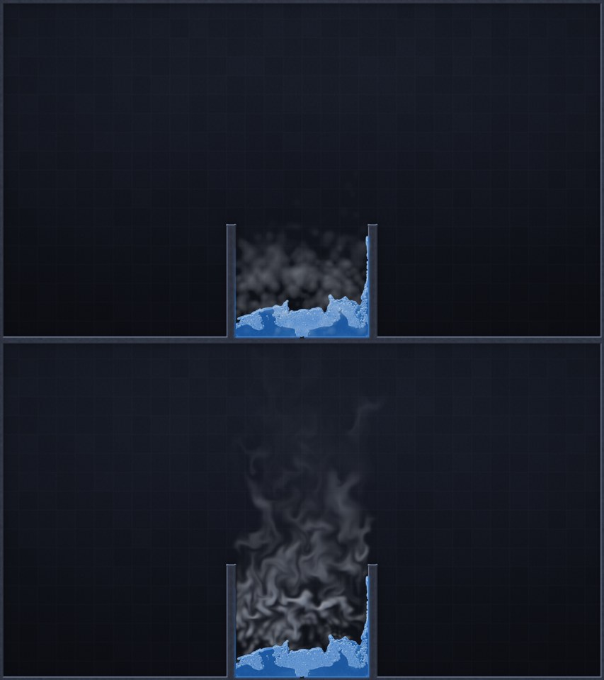

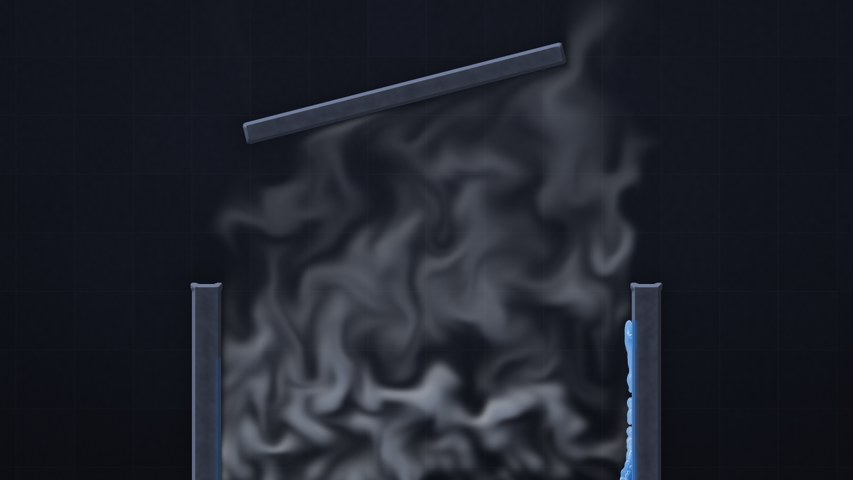

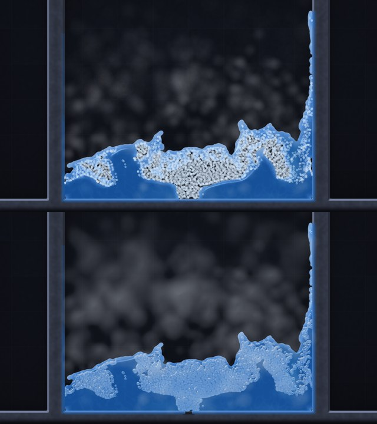

Other liquids (mercury at 357 °C, lava at 2400 °C) still leave at once at x = 1, and so does
everything with `steam=0`. Steam remembers the liquid it boiled from and its concentration
(syrup, brine, milk: bits 8 – 15 of the particle's kind, `KIND_SRC`, and `s`) and condenses
back into it, so a solution does not lose what it has dissolved to bubbles that never leave;
what it had dissolved is left behind only when the vapour escapes (brine leaves one salt
particle per `residue_share` of concentrate, as before; leaving it whenever brine turned to
steam made three times the salt the water that escaped accounts for). Steam switched off
mid-run carries on condensing and escaping; only no new steam forms.

Measured (`validate thermal`, a pool 30 cells deep over the Heat brush, 2 s): at 99 °C 15 300
particles turned to steam, bubbles reached the surface and 505 escaped; 2 s after the brush is
lifted no steam is left; the heat content changed by exactly the brush's heat less what went
to the air and escaped (0.000 %). At 20 °C, 1 884 turned to steam and 33 escaped (1.8 %): the
rest condensed on the cold water near the brush, as subcooled boiling does. Boiling brine
(`validate suspension`): the salt left is 1.04 × the residue share of the dissolved salt that
boiled out (1.00 – 1.06 with water's viscosity changed by ±0.1 %). Lava under 30 cm
of water boils the water against it (at `contact_heat` 3000 W/m²K, 1 cm of water reaches
its boiling point in about a second); the bubbles condense within a cell or two in the cold
water above, which is how most of the lava's heat reaches the pool. Lava poured through a pan of water 12 cells
deep boils a little of it on the way down (gallery `steam_lava_pan`: 564 particles turned to
steam, 34 escaped); the puffs are faint.

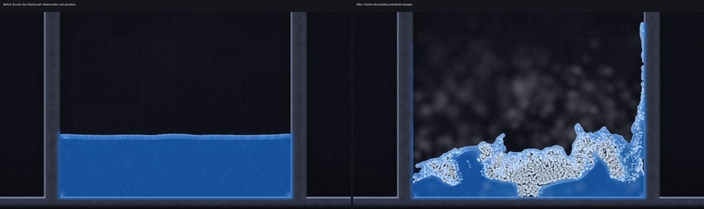

### Rheology

After the grid is built, a pass works out each cell's viscosity from the shear rate of the
velocity before viscosity (Picard-lagged by one solve; this substep's gravity increment is
taken out, or it reads as shear against the floor): Carreau `r + (1 − r)(1 + (λγ̇)²)^((n−1)/2)`,
Herschel–Bulkley `γ̇^(n−1) + τy/(μγ̇)`, thickening `min((1 + (λγ̇)²)^((n−1)/2), ratio)`, applied to
the share of the cell that is that liquid. The solve stops at `rigid_viscosity`; whether a
cell then flows is decided from the stress it carries after the solve: an unyielded plug
(μγ̇ < τy) or jammed shear-thickening liquid is a rigid body (above). A plug under more than
its yield stress creeps at the cap, carries that stress, yields, and its viscosity falls over
the next substeps. A concentrate's yield stress scales with its concentration.

**Viscoelasticity** (slime): an upper-convected Maxwell stress per particle, updated from the
APIC velocity gradient with implicit relaxation, scattered to cell centres by volume (so it
vanishes across a free surface) and applied as its divergence before viscosity. The time
step keeps elastic waves (up to √(1 + cap) times the shear-wave speed) within half a cell.
A particle with less than one cell's worth of liquid in the 3 × 3 cells around it (a droplet
torn off) drops its stress (2026-11-14): scattered alone, the stress pushed on the faces
around it with nothing to balance it, and a slime blob dropped into a cup shattered into a
mist of single droplets. It still splashes (it does with no elasticity at all: 1 Pa s
dropped 40 cm), with fewer, larger droplets.

**Slime holds together** (2026-11-14). The droplets were not a want of cohesion: counted
(pieces of fewer than 40 particles, 8-connected cells), the cup drop above made 330 of them
at 0.9 s with elasticity and 62 without it. A Maxwell liquid with G = 100 Pa over a 1 Pa s
solvent stores the impact elastically and returns it: the sheets it flings up the walls tear
as they recoil (in the Glass and Slime map the slime burst into fragments as it sprang back
off the floor). More stress made it worse (a cap of 50 G: 8 800 particles in droplets at
3.2 s; a cap of 5 G, a shorter relaxation time: fewer). Real slime is far less bouncy than
that: its solvent is thicker (slime made from white PVA glue, itself several Pa s) and its
modulus higher (1 – 3 kPa for PVA-borax gels). A higher modulus holds it together too (2 kPa:
no droplets after 2.4 s), but its elastic waves shorten the time step: Glass and Slime ran at
0.41 × real time instead of 1.36 × (`bench --grid 512x288`; 0.96 × at 300 Pa). A 10 Pa s
solvent costs nothing (1.34 ×), so slime's `viscosity` is now 0.01 m²/s (it was itself a
sandbox choice). New check (`validate elastic`): particles in droplets after the cup drop,
3.2 s: 182 → 0 (most at any sample, every 0.4 s: 631 → 36) of 14 000. Slime still drapes over
the peg and springs back, as strands now. The shear-mode check, whose theory includes the
viscosity: period +2.9 → +6.8 %, decay −8.9 → −5.1 %.

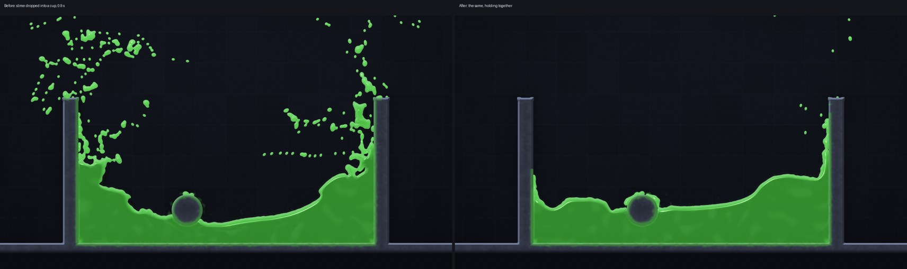
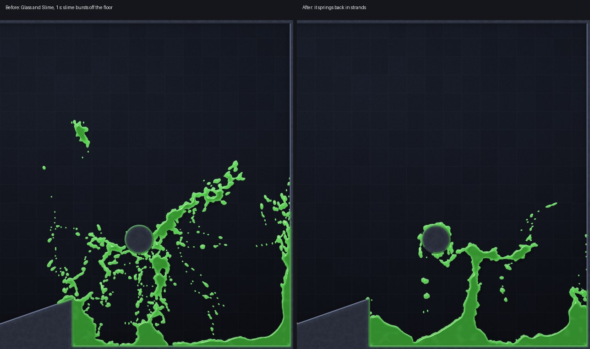

**Suspensions** (mud, sludge, oobleck) settle by the same drag law as the oil droplets
(`C_d = 24/Re + 0.44` at the grain diameter, in the diluent) as a flux of concentration
between vertically adjacent cells, the hindered (Kynch) flux `s(1 − s)v_t`, shared out to
particles by room and content so the concentrate is conserved exactly. Moving particles
instead, as the oil drift does, needs pure grains and pure liquid; at four particles a cell
their density noise drove convection four times faster than the settling (measured), so
the flux form is used.

**Magnetism.** Up to eight magnets (the Magnet tool, or a map) are point dipoles evaluated in
the plane: no field is solved and the liquid does not change the field. A magnetisable liquid
(linear, saturating: `M = χe H / (1 + χe H/Ms)`) gets the force `−∇ψ` of its magnetic energy
density, applied to the face velocities before viscosity and pressure as gravity is, with the
pressure solve's own face density: inside a body of magnetic liquid that is exactly a discrete
gradient, which the pressure takes up, so only the surface and interfaces feel a net force.
(Until 2026-11-14 it was applied per particle, sampled between grid points; that is not a
discrete gradient, the projection could not balance it, and on the Ferrofluid map, at some
75 g near the magnet, the dish was crushed into a film on the floor within a second, with
9 000 particles in one cell and particles racing at the speed cap. Now the dish heaps up over
the magnet.) Demagnetisation is estimated locally from the interface normal (N = 1 facing the
field, 0 along it, 1/3 inside): this pulls liquid into shapes elongated along the field, the
mechanism behind Rosensweig spikes — a qualitative local estimate of a non-local effect, not a
spike model. Spike spacing is ~1 cm (2π√(σ/ρg)): resolved on the 1 mm Ferrofluid map, below
one cell on 1 cm maps.

**Gallium's oxide skin**: a surface yield stress `skin/dx` in free-surface cells, made rigid
(one 8-connected shell) while the inertial stress of the motion across the cell, ρ(γ̇dx)²,
stays below it; an impact or a stir breaks it and it re-forms when the liquid calms. Tension
acts in the pressure step, after viscosity, so a one-cell skin cannot be judged by the stress
the solve gives it; this criterion is the documented approximation. A stretched blob keeps
an aspect ratio of 4.8 (from 5) where clean gallium pulls round (0.6).

**Time-step limits** (capillary, thermal, elastic) consider only the materials in the tank.

## Look

Built so that each liquid and each way two of them meet can be told apart at a glance, and,
since the effects round (below), lit rather than flat: a surface catches the light and
mirrors the tank, clear liquid shows the wall behind it, hot liquid glows and lights what is
around it, and liquids leave their mark. The liquids are
luminous against a dark tank of large tiles; solids are slate stone, so nothing competes
with them.

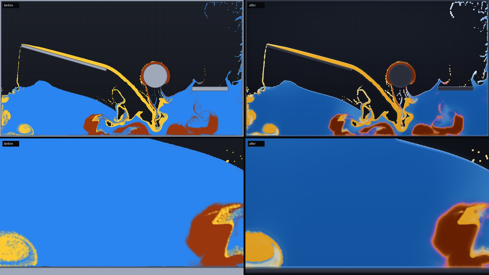

**Light and colour from absorption** (2026-11-14, third round; reported: steam too opaque,
syrup and water turning purple, a stylised texture on every liquid, a look still too
cartoonish; honey should glisten, oil show its colours, blood paint its surroundings).
Each liquid now has an absorption coefficient per colour channel and a scattering
coefficient, worked out from its `color`, `opacity` and `scatter` (`absorption` in
material.rs): a clear liquid (`scatter` 0) absorbs so that `tint_depth` = 0.5 + 30 (1 −
opacity)² cells of it pass `color` (water 30 cells, honey 6.6, oil 17); a scattering one
scatters 3 `scatter` / `tint_depth` per cell and absorbs what makes a deep layer of it
reflect `color` (two-stream: albedo w = 1 − ((1 − R) / (1 + R))²); in between the absorption
blends by `scatter`. Per cell they add up by share, as a dye's absorbance does by
concentration (Beer's law), and the composite works out the colour from them:

- *Mixtures take the colour real ones do.* Syrup in water passes from blue through pale gold
  to amber, blood in water is a red cloud, ink a grey-blue plume, milk a white haze. Until
  now colours were averaged in OKLab with their chroma kept, and a hue between blue and
  amber is violet: syrup and blood in water had a purple and magenta fringe. Water's blue
  is the look of a body of clear water, thirty times its real absorption; kept in
  proportion it turned a little syrup green (a blue and a yellow filter), so it gives way
  far faster than its share, by exp(−24 c), c the concentrate share of the cell's aqueous
  liquid (dissolved, or in particles of their own beside it).
- *Depth.* The key light comes from above and is absorbed on its way down by the liquid in
  each cell above (`light.comp`: one workgroup per column, a scan; spread sideways over a
  6-cell Gaussian, as light from a broad sky; as a share of its brightness only, so each
  liquid keeps its own hue: a coloured one turned syrup under deep water olive). Water is
  pale under its surface and deep blue at the floor; honey is gold where it is thin and
  dark amber in a mass. A body is 16 cells thick along the view (`LV_BODY`), rounding off
  to nothing at its outline as a cylinder's chord does, so the edge of honey glows gold, of
  blood scarlet, of water clear. Light also enters through the nearest surface, within a
  few cells of it.
- *Clear is clear.* A clear liquid sends back only what its slight turbidity scatters
  (`TURBID` 0.06 per cell): a droplet or a film of water is nearly transparent, a body fills
  with its colour, and the back wall shows through by its transmission. Scattering liquids
  (milk, mud, blood, chocolate, lava's rock) show their own colour lit from the front.
- *No painted texture.* The caustic net over every clear liquid, the noise ripples on every
  glinting surface and the shimmer through honey are gone (they read as a stylised
  texture); only lava keeps its churning glow and crust. Flicker fell with them (below).
- *Honey glistens.* Sharp highlights (shininess up to 420 at `gloss` 0.9), broken into a few
  brighter points carried by its flow inside the highlight only, over a broad soft gloss;
  gold light leaving it where its surface faces away from the light (light through the
  body); thin parts glow gold.
- *Oil shows thin-film colours* at its surface and in thin layers: R ~ sin²(2π n t / λ) for
  a film t thick (n 1.47, phase flip at the top face), averaged over a little of the spectrum
  around each primary so thick films go pastel: Newton's sequence. The thickness drifts with
  the flow in broad swirls (180 – 900 nm) and thins towards the edge; not through the body.
- *The quenched skin of lava.* Where lava meets water or air its surface is far colder than
  the cell's mean: with half a cell of melt conducting behind it (g = 2k/Δx), the face
  settles where g (T − T_s) equals what leaves it: `contact_heat` (T_s − T_water), or the air
  film plus radiation (`cell_optics.comp`). Against water that is ~200 °C, against air ~900:
  both below lava's solidus, so it is drawn with a rind of dark glassy rock 1.6 cells wide,
  with a few dim cracks and the melt glowing hot just inside, from the moment it meets either
  (a pillow under water, a skin in the air); the skin also dims its glow. The cells against
  the water then really freeze within seconds (Heat).
- *Stains that run* (`film.comp`, below). *Steam* veils instead of hiding (Heat, "Steam").

**Stains and runs** (`film.comp`, `film_tiles.comp`; 2026-11-14, third round). The stain map
was one texel per cell, laid down as a colour and "run" down walls by drawing streaks of
random length. It is now a film map at 4 texels per cell (2 above the medium grid; 2.4 M
texels at most) on the back wall and the faces of solids, with a thickness (0.1 mm units),
colour, wetness, drying time and mobility per texel, and it is simulated:

- *Laid down.* Liquid that stains coats a solid it lies against towards 0.9 mm × its
  `stain` (in its own colour as a film over a pale wall), and the back wall behind liquid
  resting there towards 0.5 mm (a pool; a stream or a splash going past leaves none).
  Liquid that stains less than 0.15 lays nothing (too faint to see). Airborne drops of a
  staining liquid mark the back wall 0.7 times a second each (× `stain`) and a solid they
  strike 10 times a second: a dot at the drop's own position and colour
  (`particles.comp: film_spatter`), its size drawn as a spray makes them (many fine ones, a
  few large, which are thicker).
- *It runs.* A film thicker than what its surface pins (0.6 mm, varied smoothly from column
  to column as a real wall's roughness: runs start where it holds least) drains as a thin
  viscous film at the lubrication speed u = g h² / (3ν) (Huppert 1982), ν the liquid's. A thin
  coat creeps and a thick run is fast, so the front of a run gathers into a bead that
  outruns the film behind it: a smear turns into drips. Runs stay on their surface: off the
  bottom of a solid's face, or onto the top of a solid, they stop. A little film is shared
  sideways while wet, so a drip has a width.
- *It dries*, each liquid in its drying time: dry, it no longer runs and turns darker and
  browner (blood oxidising), with a darker rim where it was thick. Liquid that does not
  stain washes it off, faster where it moves, and wets it again: a dry stain under running
  water runs again.
- *It is drawn* over the back wall and solids with a cubic B-spline filter (bilinear drew
  drops as diamonds close up), its cover rising over a fraction of its thickness; while
  wet, its slope catches the light, so drips and beads glisten.

Cost is kept to where film is: each frame `cell_optics.comp` marks the 16 × 16-texel tiles
that hold liquid, `film_tiles.comp` (a thread per tile) lists the tiles that need work, and
`film.comp` runs one workgroup per listed tile (indirect dispatch), with the cells it reads
in shared memory. A tile holding only dry film that nothing touches costs nothing once
both copies of the map hold it; a tank that has never held a staining liquid runs none of
it. Per-frame optics passes (cell optics, light, smoothing, glow, film, smoke; `sprout
profile --map N --at 3`, 300 runs each, old and new builds interleaved three times):
Playground 0.296 → 0.284 ms, Lava Meets Water 0.358 → 0.411 ms, Kitchen 0.383 → 0.473 ms.

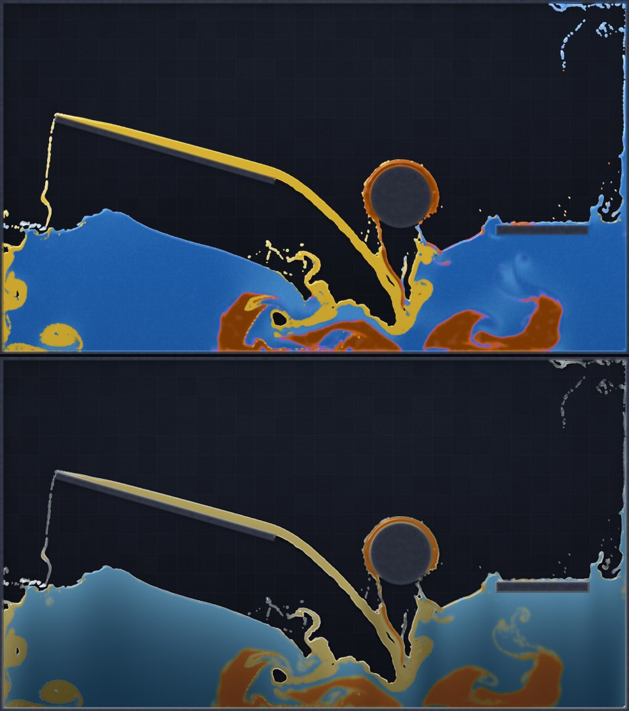
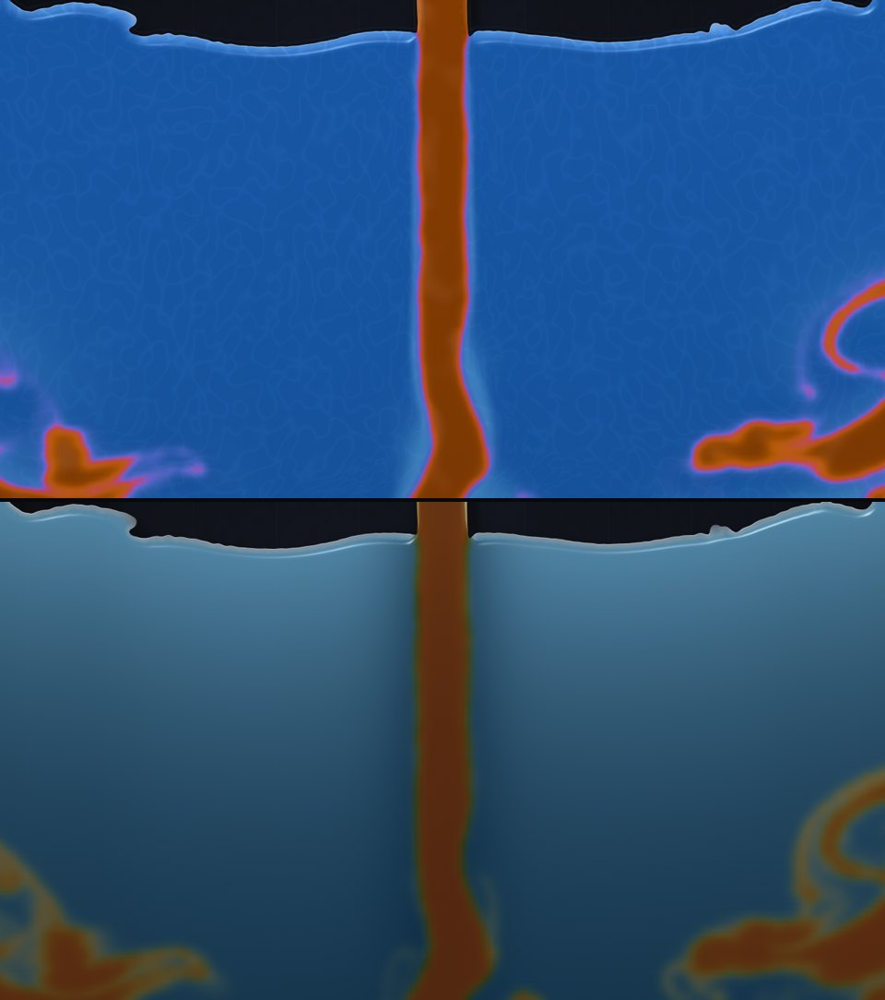
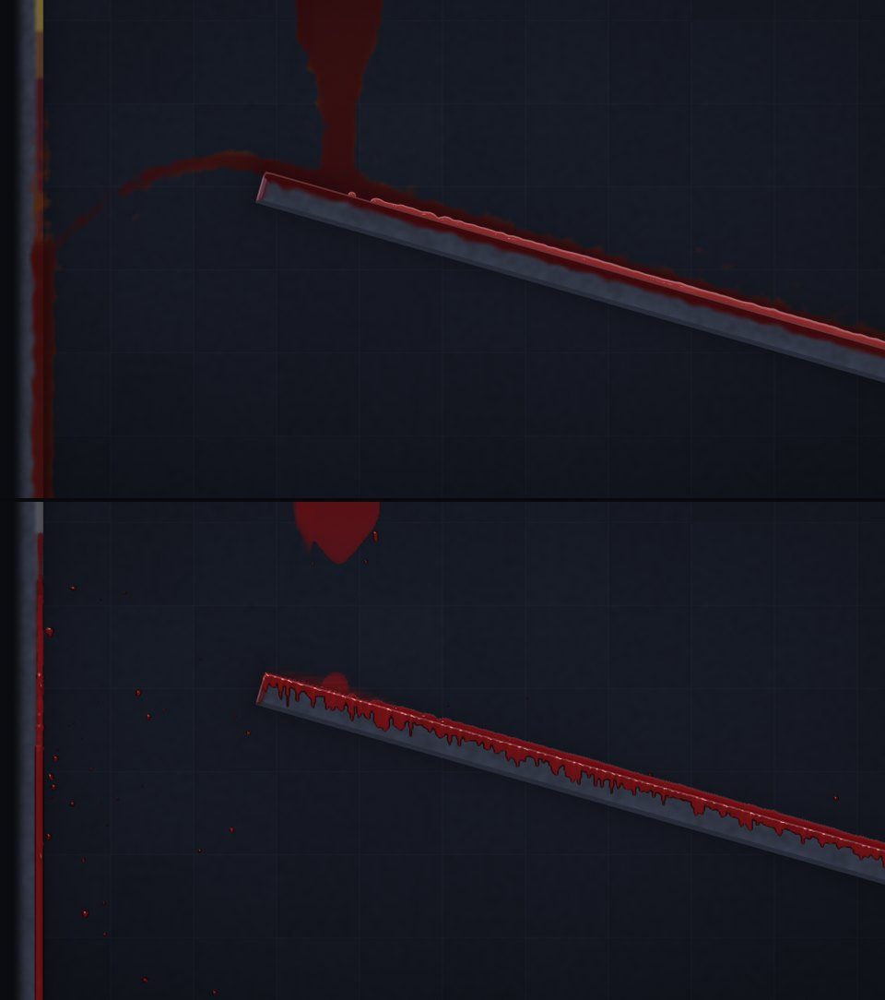
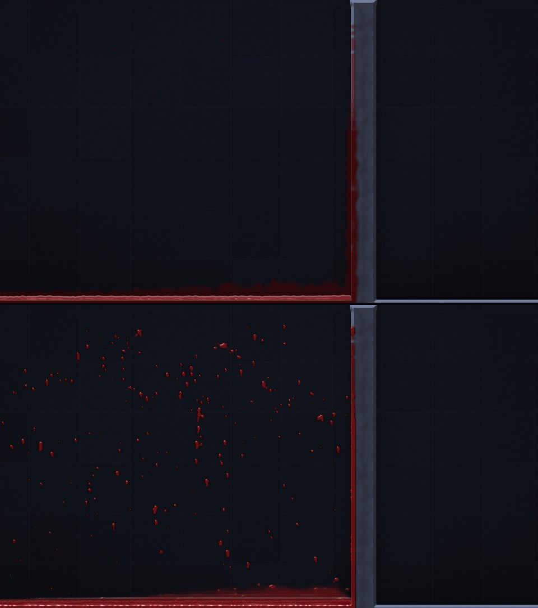
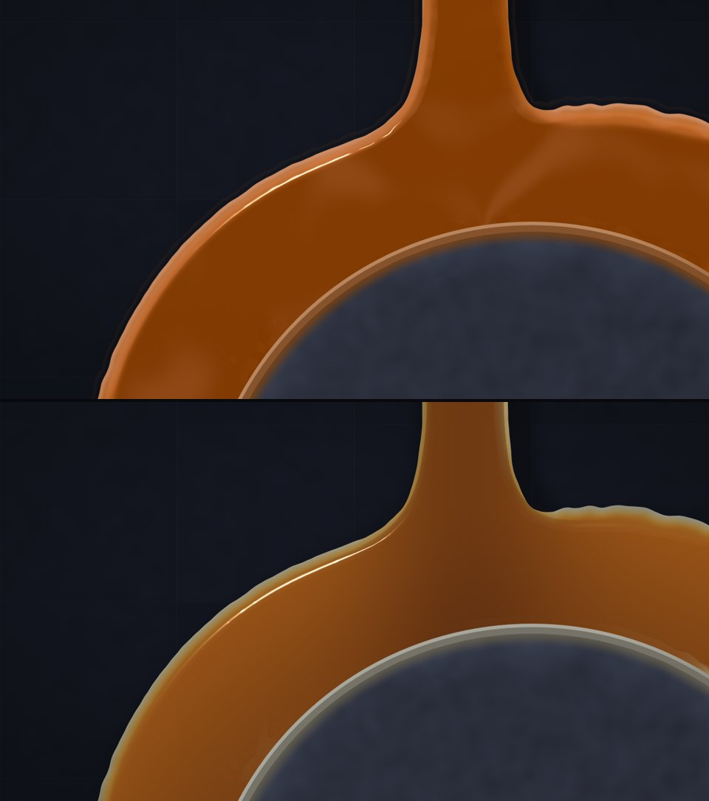
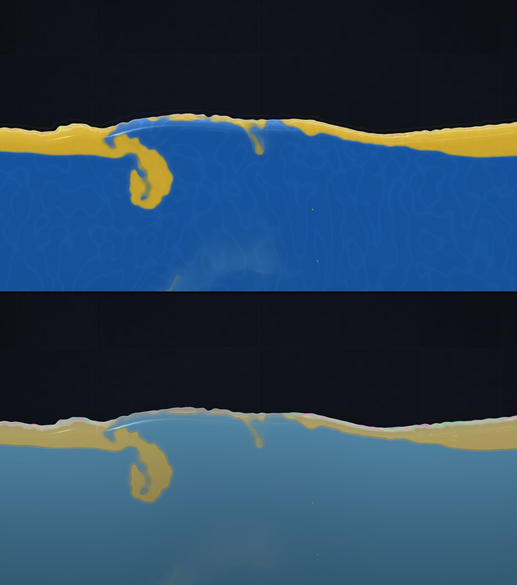
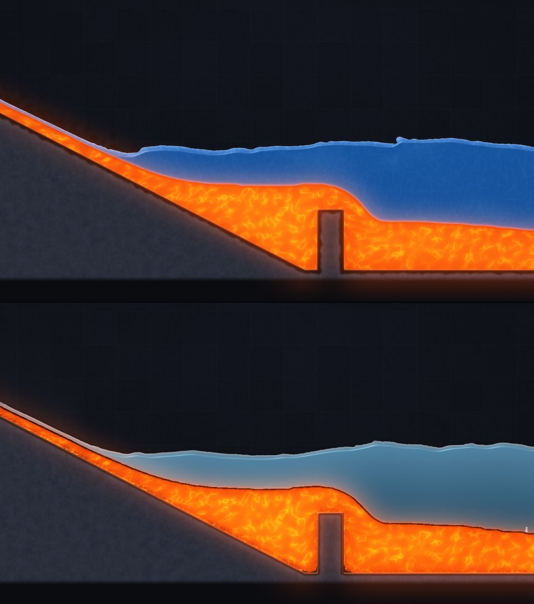
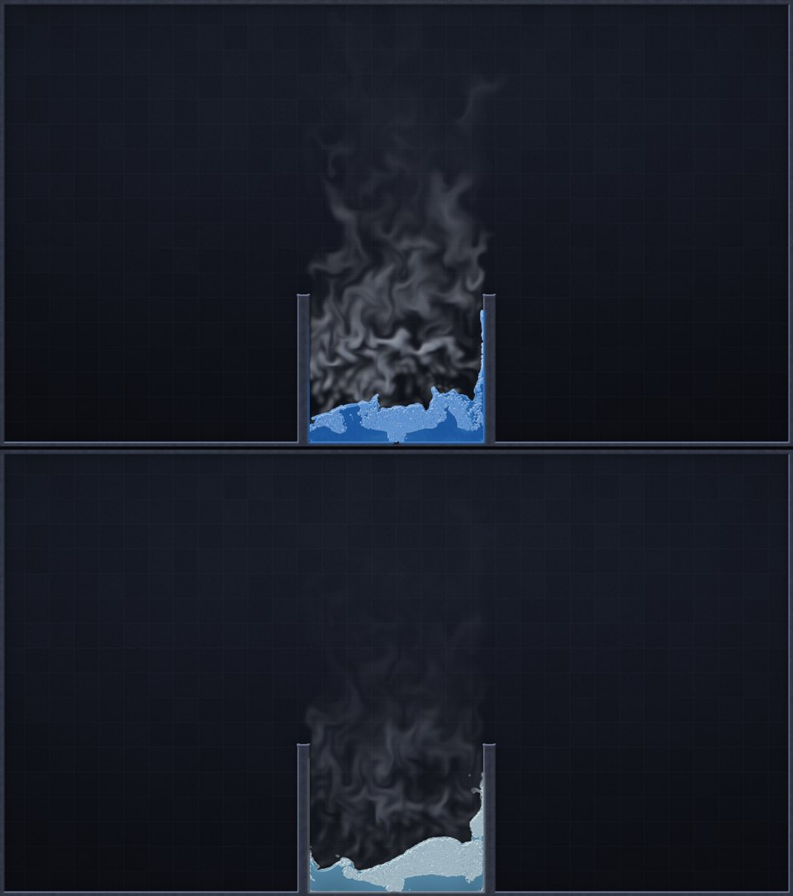
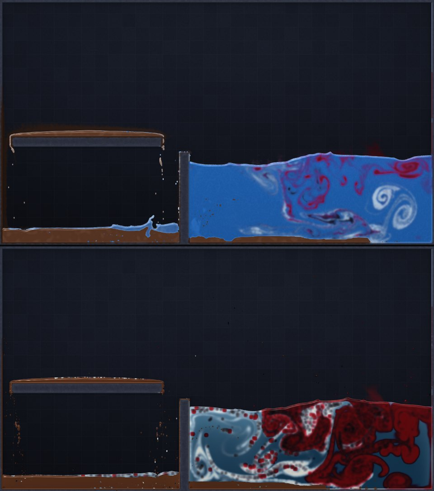

**Optics as data.** Nothing below is written for a particular liquid any more. The
particles splat only the weight of each phase group (one target, as before): its level sets
are the surfaces, and a change of the leading group is an interface, the only other place a
sharp line is drawn. What the liquid looks like is worked out per grid cell once per frame
that ran a substep (`cell_optics.comp`, into a half-float image the composite reads through
the sampler's bilinear filter) from the composition the last substep scattered there and the
optics table: absorption and scattering coefficients (since the third round of 2026-11-14,
above; before, a body colour in OKLab with its chroma), kept apart for aqueous and other
liquids (oil stays gold droplets in clear water, never milky), opacity, scattering, metal,
gloss, body, foam, glow from the temperature (Planck at three wavelengths, brightness on a
log scale from 800 K), and speed. Concentrates blend with their diluent by concentration. The wet map remembers which material
last wetted each solid and when, and dries it at that material's own rate. Every rule below
still holds; the water/syrup/oil look matches the hand-written shader it replaces (side by
side in the gallery), and the flicker metric is equal or lower (Playground 0.29 → 0.19 %,
Upside Down 0.12 → 0.04 %, Dam Break 0.82 → 0.88 %; the new Lava, Ferrofluid and Kitchen
motion sets 0.05, 0.19, 0.04 %).

**Smooth fields, crisp ice** (2026-11-13). A cell's colour comes from the four or so particles
in it, and its frozen share from that cell's mean temperature, so neighbouring cells jump:
filtered bilinearly, ice was drawn as staircases of whole cells (a "maze" where ice and liquid
were mixed) and a dispersing plume of blood as a chain of blotches. `optics_blur.comp` now
smooths every layer over 3 × 3 cells (binomial, σ 0.7 cell) after `cell_optics.comp`; the
layers are premultiplied by occupancy and share and the composite divides by the matching
weight, so nothing bleeds into air and aqueous and other colours stay apart, and a neighbour
behind a solid is left out (no colour through thin walls). A 5 × 5 kernel also blurred
unmixed edges (a syrup stream in water) over two cells, so it was not kept. Ice no longer
fades into the liquid: its colour and frozen share go into layers of their own (5 – 7), and
the composite switches to the frozen colour where the smoothed share passes a half, a step
about 2 px wide at any zoom, along a smooth curve (`iced` in composite.frag). Gallery:
`freeze_pool*` (a cooled, stirred pool) and `mix_blood*`. Cost 0.01 – 0.03 ms per 1080p frame
(render 0.893 → 0.904 ms Playground, 1.509 → 1.534 ms Upside Down at 768 × 432, three
interleaved rounds). Flicker is equal or lower in four of the six motion scenes; Lava Meets
Water (0.052 → 0.074 %) and Kitchen (0.026 → 0.033 %) are higher, at the splashing water
surface, not at ice: those scenes now run differently (the frozen-clump fix below lets lava's
crust keep its volume). One-cell-thin threads of a miscible liquid are a little fainter.

**Effects** (2026-11-13). The look was simple and a little cartoonish: flat colour with a
drawn rim, no light from hot liquid, nothing left behind. What changed, all of it driven by
the optics table and the live fields, with no code for any one liquid:

- *Light from a height field.* The surface is treated as rounding over within about a cell
  of its edge (1.9 cells for thick liquids) and following the body's broad shape further
  in. Lit from the upper left, it gets a highlight whose sharpness follows `gloss`, and a
  Fresnel reflection of the tank: edges that face up mirror its lit top, edges that face
  down its dark floor. The old drawn rim and gloss streak are kept at about half strength.
- *Clear liquid shows the wall behind it* (opacity below 0.5), shifted by the surface's
  slope (at most 0.7 cells) and tinted by the liquid. (Caustics, thin bright lines from two
  noise fields, were drawn over it until the third round of 2026-11-14: a stylised texture.)
- *Glow.* `glow.comp` blurs the emission of hot liquid (σ 3 cells, at half the grid's
  resolution) into a field the composite uses three ways: bloom over everything, light on
  the back wall and solids (most on edges that face the melt), and light on other liquids
  (water beside lava turns orange; a liquid metal mirrors it). A soft shoulder above 0.8
  rolls bright glow off into white instead of clipping each channel. The field is sampled
  with a cubic B-spline (four bilinear taps, one where there is no glow), so its half
  resolution does not show as a lattice of texels in a bright, smooth glow. Beyond the grid
  it falls off over 6 cells, as the blur would have carried on (2026-11-14: the sampler
  clamped to the last texel, so a melt on the floor drew a band of light from the tank's
  floor to the bottom of the screen).
- *No heat haze, no embers* (removed 2026-11-14, reported as low quality and low
  resolution). The haze drew the picture above hot liquid from points displaced by rising
  noise and made the bloom waver with it; the displacement followed the half-resolution
  heat field, and the wavering factor, 1 + 1.25 × noise, went negative, so the "glow" above
  every melt was a dark, streaky, moving band (with the glow on, 0.12 % of the pixels of a
  lava cup were darker than with it off; now 0.00 %, `validate render`). Embers flickered
  over it. The glow above a melt is now a steady, smooth bloom.
- *Molten rock* (`crackle`, lava 1): where the melt rests its glow swells and fades slowly
  (a pattern that evolves in time rather than slides); where it flows, the flow draws it out
  into bright streaks along the flow, as many as the melt has been sheared (the flow map's
  strain, below). In the freezing range (a glow of about 1.2 at lava's liquidus, 0.85 at its
  solidus) a crust forms: dark plates of a cell pattern with glowing seams that are yellower
  and brighter than the plates were. The plates keep their size: where the melt spreads
  (the flow map's areal stretch) the crust tears, its seams opening wider and brighter onto
  the melt; where it is pushed together they close. Not where lava is mixed with another
  liquid: a cell's temperature there jumps with the share of each, and the plates
  flickered (Lava Meets Water 0.144 % of pixels); the quenched skin is drawn as frozen.
- *Stains* (`stain`, blood 1; replaced by the film map in the third round of 2026-11-14,
  above). `stain.comp` kept a map that lasts as long as the tank: each
  frame that simulated, liquid lays down its stain colour at 3 /s per unit `stain` against
  a solid and 1.2 /s against the back wall (by the square root of the occupancy, so
  droplets mark too), and liquid that does not stain washes it off at 0.06 /s, faster
  where it moves. On a solid the stain covers a band of the face about 5 cells deep with a
  ragged inner edge, blotchy where little was laid, and runs down a wall in thin streaks of
  random length; it is drawn in the colour it dries to (darker, a little duller). **Clean**
  under Display wipes them. (2026-11-14: the band on a solid is now 1.3 × the wet film deep
  with a gently wavering inner edge and broad, soft patches; it was 2.4 × the film deep with
  a ragged edge and a fine second noise under a hard threshold, which drew dirt-like
  speckle into every floor under lava, slime or ferrofluid and a dark asterisk into every peg
  a staining liquid touched.)
- *Glints and shimmer* (`glint`, honey 1; until the third round of 2026-11-14, when the
  ripples and shimmer were dropped as a stylised texture and glints were kept inside the
  highlight only): the surface was rippled with noise carried by the flow, which broke its
  highlight into glints that move with the liquid; a slow shimmer of light moved through
  the body. Thick liquids that are not opaque (honey) glow golden
  just inside their lit surface. Syrup is now golden amber (0.74, 0.36, 0.03) rather than
  dark caramel, opacity 0.85 → 0.7.
- *Thin films* (`iridescence`, oil 1): colour bands that follow the surface and drift (Newton's
  colours of a real film since the third round, above).
- *Tank and solids.* Back-wall tiles of 16 cells, each a touch lighter or darker, with a
  faint grain; the liquid casts a soft shadow on it, down and to the right. Solids have a
  stone mottle.
- *A liquid metal without stripes.* The body's normal came from a forward difference of
  the wide field over less than one of its texels; its samples are bilinear, so that was
  constant across each texel, and mercury was drawn in vertical stripes and squares (it
  always had been). It is now a central difference over 1.5 texels.

**Patterns carried by the liquid** (since 2026-11-15; `flow_map.comp`). Every pattern of a
liquid (lava's glow, veins, crust plates, rind and its grain; oil's film colours; honey's
glints) is drawn at x − d, where d is how far the liquid there has moved since the pattern
last restarted: a map of it, one texel per cell, carried along with the liquid every frame
(semi-Lagrangian, from the smoothed cell velocity) and grown by u dt. So the patterns move
exactly as the liquid does, stretched by its shear. Each restarts, or shear would draw it
into ever longer streaks: two copies half a period apart, each faded out as it restarts
(a flow map, Vlachos 2010), with two periods (4 s and 12 s, `FLOW_PERIOD_*`). A copy that
has moved shows a new part of the pattern from its restart on; one that has not shows the
pattern at rest, the same in both copies, so a liquid at rest keeps its pattern (a crust
does not morph every few seconds). From the map's gradient the composite also reads how far
the liquid has been sheared and spread since the restarts (lava's streaks and tears, above).
Before, the patterns were drawn at x − u t from the velocity of the moment, t up to a few
seconds after the restart, at 0.35 of the flow: any wobble of the velocity moved the whole
pattern t times as far, and lava lying in its crust stuttered back and forth (reported
2026-11-15; Validation, "Resting lava"). Patterns fixed to something (back wall, solids)
stay fixed to it. Each fades out where its features would span less than about 2 px, and
highlights are made broader at ordinary zooms, so nothing sparkles from frame to frame
(flicker below). The 3D noise of the evolving patterns uses an integer hash (PCG3D): with a
float hash, cells sharing a corner were now and then given different values and drew seams.

| New material property | Built-in values |
|---|---|
| `stain` | blood 1, ink 0.8, sludge 0.5, chocolate 0.45, wax 0.4, mud 0.35, lava 0.3, slime 0.3, oobleck 0.2, ferrofluid 0.12 |
| `glint` | syrup 1, slime 0.85, glass 0.8, chocolate 0.7, ferrofluid 0.7, mercury and gallium 0.6, blood 0.55, oil 0.5, wax 0.4, water, brine and ink 0.3; default 0.25 |
| `iridescence` | oil 1, ferrofluid 0.15 |
| `crackle` | lava 1 |

They are under *Look* in the editor and are `--set` keys like the rest (`lava.crackle=0`).
Display gains **Glow** (0 – 2) and **Stains** (0 – 1, with **Clean**). (A **Heat haze**
slider, with the embers, was removed on 2026-11-14.)

Flicker (`sprout gallery DIR motion`, the same six frames as below; old → new): Playground
0.182 → 0.177 %, Upside Down 0.073 → 0.069 %, Dam Break 0.772 → 0.763 %, Lava Meets Water
0.022 → 0.019 %, Ferrofluid 0.137 → 0.099 %, Kitchen 0.029 → 0.035 % (the water's moving
surface highlight; the sharper highlight it had at first gave 0.049 %); a lava cup with
the haze and embers it then had (`motion_fx_lava`) 0.000 %. Gallery: `sprout gallery DIR fx` (lava fresh
and cooling, blood sprayed at a wall and drained, honey over a ball, an oil film on water,
mercury beside lava).

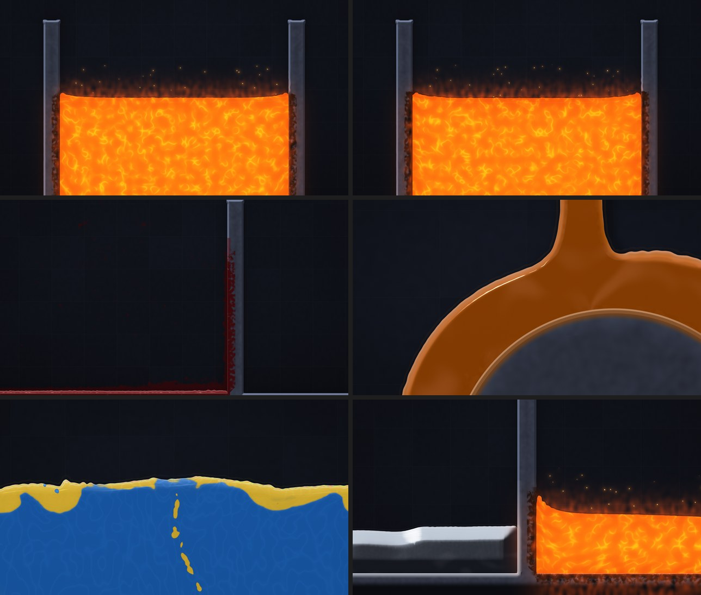
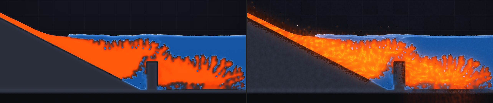
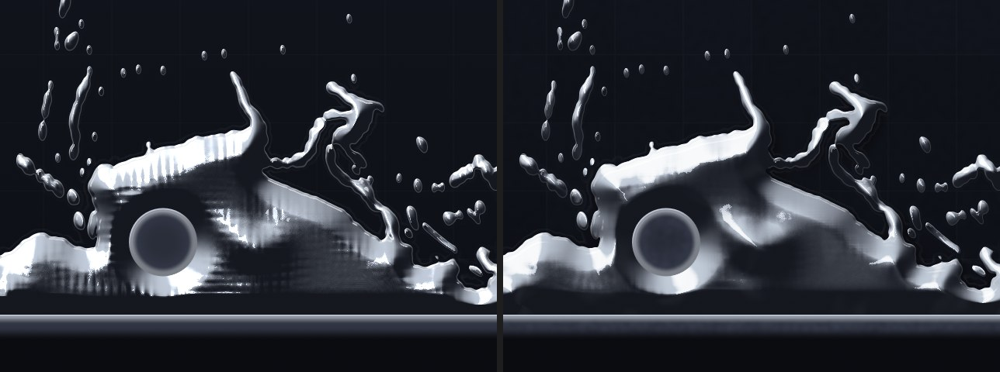
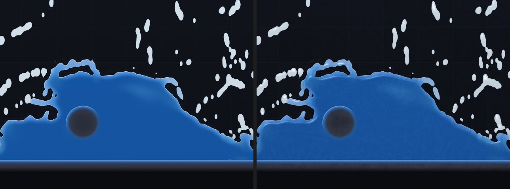
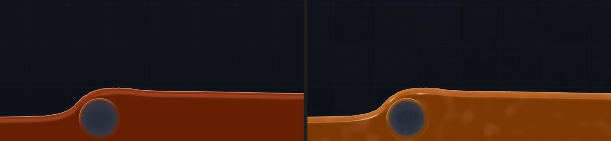
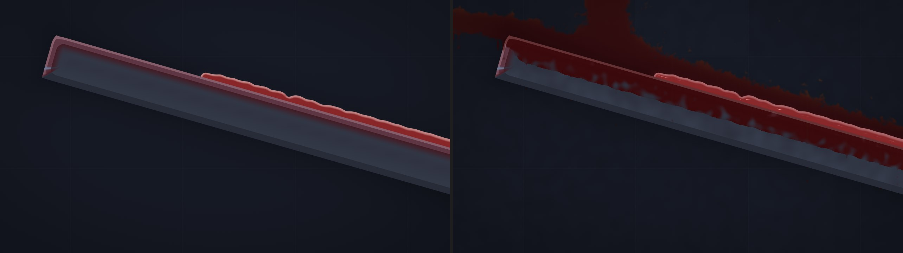

Cost. Off-screen at 1920 × 1080, grid 512 × 288 (`sprout bench --at 2 --size 1920x1080
--grid 512x288 --map N`, "render" column; old and new builds alternated, three rounds, then
the new build again after trimming): Upside Down 0.90 – 0.93 → 1.38 ms, Lava Meets Water
0.46 – 0.47 → 0.77 ms, Kitchen 0.53 → 0.84 ms; at 1024 × 576 the first two went 2.18 – 2.39 →
2.65 ms and 0.78 – 0.79 → 1.14 ms (2.83 and 1.20 before trimming). The
first version cost 0.15 ms more on Upside Down; the trimming kept each effect to where it
shows: ripples only within 2.5 cells of the surface, the shimmer only in thick liquids, no
grain on the wall seen through water, one read of the glow field instead of three, the
haze's further reads only near heat, and the stain runs only where a streak is drawn. Of
what is left on Upside Down, switching each effect off saved: clear liquid (wall behind,
caustics) 0.14 ms, ripples 0.12, back wall 0.09, shimmer 0.07, thin films 0.04 (before
trimming).

In the app (1600 × 900, `--no-vsync --frames 1200`, first 360 frames skipped,
`SPROUT_FRAMES_CSV`; a game launcher kept the GPU about 25 % busy; two rounds each,
interleaved), a frame that only renders (p50) went 0.40 – 0.44 → 0.72 – 0.73 ms (Lava Meets
Water), 0.56 – 0.57 → 0.84 – 0.85 ms (Playground), 0.80 → 1.45 ms (Upside Down). Simulated
time per wall second was not lower: 0.87 – 0.88 → 0.92 – 0.93×, 0.93 → 0.94×, 0.92 → 0.96×.
(These scenes simulate at close to the GPU's capacity, so the app fits more substeps into
each frame when rendering takes longer: frames that simulate (p90) grow from 5.4 to 7.0 ms
on Lava Meets Water and from 6.9 to 8.2 – 14.4 ms on Upside Down, and the runs reach later
points of the scenes, which is part of the higher simulated rate.)

**One rule runs through it: an edge is as sharp as the physics behind it.** Liquid against
air and oil against water are real interfaces and are drawn as crisp lines. Water and syrup
are miscible, so their boundary is a soft gradient of colour and never a line. What the grid
cannot resolve (oil finely stirred through water) only warms the water's colour a little;
clusters of a few oil particles and more are drawn as gold droplets in clear water.

**Small droplets inside a body of the other side** (2026-11-13: lava or oil in water, water
in lava or oil). A drop of one or a few particles never reached the cuts above: the blurred
field hardly sees it and the sharp one peaks below them, so a lava drop sinking through
water was invisible. Where the blurred field says the surroundings are clearly the other
side (others' share below 0.12 – 0.25, or above 0.75 – 0.88) and the drop stands out from
them (its sharp share above `SPECK_CUT` 0.10 and above `SPECK_CONTRAST` 2.5 × its blurred
share), it is drawn from the sharp field alone as a bead of its own colour with a darker rim,
antialiased along the field's gradient so it moves smoothly with its particles. A finely
stirred mixture keeps its soft look (the contrast rule; without it Upside Down turned to
speckle). A drop of water inside hot lava is not covered by the lava's glow. Measured with
`gallery DIR droplets` (clusters of 1, 2, 4, 9 and 16 particles): before, only the 16-particle
lava drop showed faintly; now drops of 2 particles and up show in water, oil and lava (a
lone particle peaks just under the cut). Flicker (motion frames): droplets 0.000 → 0.001 %,
Playground 0.136 → 0.182 %, Upside Down 0.040 → 0.073 % (oil droplets that now show move),
Lava Meets Water 0.054 → 0.024 %, Kitchen 0.014 → 0.013 %.

| | Body | Surface against air | Thick or thin | In motion |
|---|---|---|---|---|
| **Water** | Clear: pale aqua under its surface, deep blue at the floor of a deep pool; the back wall shows through, bent by the surface; a droplet is nearly transparent | A thin bright line where it faces up (light reflected inside it); edges mirror the tank (Fresnel) | Thin: the surface follows fine detail | Fast *and* thin is white: spray, splashes, the lip of a wave. Warm water steams |
| **Oil** | Clear pale gold | A highlight, and Newton's thin-film colours along the surface and in thin layers | Medium | Stays gold: it never foams; its film colours drift with it |
| **Syrup (honey)** | Gold where thin, dark amber in a mass, glowing gold where light leaves it on the far side | Sharp highlights broken into a few glistening points that move with it | Thick: its surface is drawn fuller and rounder, and it coats what it runs over | |
| **Lava** | Molten: a glow that swells slowly at rest and is drawn into bright streaks where it flows; cooling: dark plates with glowing seams that tear open where it spreads | A rind of dark glassy rock with dim cracks where it meets air or water; a steady, soft bloom | Thick | Lights walls and liquids near it (water beside it turns orange); boils the water it meets; scorches what it touches |
| **Blood** | Deep red, opaque, glossy; scarlet where thin | A wet highlight | Medium | Spatters the back wall and what it hits; coats solids, and the coat runs down their faces in drips with beads at their heads; dries darker and browner |
| **Mercury, gallium** | A smooth mirror of the tank (and of any glow nearby) | A hard highlight | Medium | |
| **Ferrofluid** | A dark mirror: glossy black that shows the tank's light in its surface (until 2026-11-14 a black body with a quarter of a mirror, nearly invisible against the dark tank) | A hard highlight | Medium | Heaps up over a magnet |

| Interaction | How it reads |
|---|---|
| Oil – water interface | An ink line on the oil side and a pale meniscus on the water side, as sharp at 20 × zoom as at 1 × |
| Oil dispersed in water | Gold droplets suspended in clear water, which takes a faint warm tint from oil too fine to draw; they gather into drops and layers. (This was a pale "milky" emulsion until 2026-11-11; any stirred tank then looked cloudy white.) |
| A small drop inside another liquid | A bead of its own colour with a darker rim, down to two particles: lava or oil in water, water in lava or oil |
| Water – syrup mixing | No line: from blue through pale gold to amber, as syrup dissolving in water does (until the third round of 2026-11-14 it ran through violet and rose) |
| Spray and droplets | Each lone particle is a droplet, drawn stretched back along its path, so spray is streaks. Far out, where a droplet is smaller than a pixel, spray becomes a haze instead of sparkling. The Spray tool scatters its droplets (up to 14° off straight outwards, speed ± 25 %, positions off its lattice by up to 0.3 of the spacing): launched exactly outwards from a lattice at one speed, every frame's droplets flew along the same rays, a regular sunburst |
| Splashes and impacts | White water: liquid that is both fast and thin |
| Wetting, sliding off solids | The lit bevel of a solid takes the colour of the liquid lying against it, and keeps a film of it after the liquid has run off: water dries in about 2 s, oil in 12 s, syrup in 30 s |
| Stains | What a staining liquid touched stays marked for as long as the tank runs: blood, ink, sludge, chocolate, mud, wax, slime; lava leaves scorch marks. Thick coats and big drops run down in drips; other liquids slowly wash stains off |

**How it is drawn** ([src/render.rs](src/render.rs), nothing read back):

1. *Splat.* Every particle is one triangle around a smooth kernel 1.5 cells in radius,
   added into a half-float target that ends up holding, per pixel, the weight of aqueous
   liquid, of oil, of syrup, and weight × speed. A moving particle is drawn over the path it
   covers in 1/160 s.
2. *The wide field* (three small passes): the same target box-filtered down and blurred to a
   standard deviation of 2 cells. It says how much liquid is *around* a point: 0.5 at a flat
   surface, 1 deep inside, little in a droplet or a film. It is rendered at whatever
   resolution makes the blur 3 texels wide, so it costs the same at every zoom.
3. *The wet map* (one pass at grid resolution): cells where liquid lies against a solid
   record which liquid and the simulated time. It is the only state the renderer keeps.
   A wet solid takes the colour of the liquid read just *outside* its surface (the cells
   inside hold none, and reading them there drew the film black in cell-sized steps); how
   far the film reaches in and how strongly it tints are **Wet edge** and **Wet tint** under
   Display.
4. *Light, glow and stains* (with the per-cell optics): the light from above
   ([shaders/light.comp](shaders/light.comp)), the glow field
   ([shaders/glow.comp](shaders/glow.comp), two passes at half resolution) and the film map
   ([shaders/film.comp](shaders/film.comp)), which lasts as long as the tank.
5. *Shading* ([shaders/composite.frag](shaders/composite.frag)): the liquid surface is a
   level set of the sharp field, antialiased from its gradient; everything else (depth,
   shallows, thin liquid, foam, rims, gloss, the oil line, dispersed droplets) is a continuous
   function of the two fields. Solids and their bevel come from the simulation's own
   signed-distance field.

**Why it holds still.** Nothing in the picture depends on anything but those smooth fields
and the simulated time, so nothing can flicker or pop that the particles themselves do not
do: the noise of the effects is fixed to the world or carried by the liquid, smooth in time,
and faded out below about 2 px; there is no screen-space pattern and no per-frame random
number. Three devices deal with the cases that would otherwise shimmer:

- Against a body of liquid the surface is taken where several kernels overlap (weight 2.8)
  rather than where one does (0.65, a lone droplet), so it is smooth instead of following
  each particle of the outermost layer; well inside the liquid the cut drops again, so a
  spot where particles sit a little apart (as they do along an oil–water interface) does
  not open a hole. The old renderer showed those as black specks.
- When a cell is smaller than a pixel the kernel is widened to 1.5 texels and its weight
  lowered to keep the same total, so the field is an area average, not a sparse sampling.
- The accumulation target is rendered so that the kernel spans 2.8 texels, at most at half
  resolution: zoomed in it is a quarter of the fill, at the finest grid it is full
  resolution and stays crisp.

Measured on runs of six consecutive frames (`sprout gallery DIR motion`), counting pixels
that change by more than 40/255 from one frame to the next and are back the frame after:

| Six frames, 1/60 s apart | Old renderer | New |
|---|---|---|
| Playground at 1.3 s, 3 × zoom on the oil hitting the pool | 0.19 % of pixels | 0.10 % |
| Upside Down at 5 s, 3 × zoom on the overturning layers | 0.50 % | 0.03 % |
| Dam Break at 1.15 s, whole tank | 0.63 % | 0.67 % |

What is left are thin jets crossing a pixel in one frame, which is motion.

**Cost.** The same as the old renderer, which drew flat colour: within 6 % either way.
Off-screen at 1920 × 1080, Upside Down after 2 s (`sprout bench --at 2 --size 1920x1080 --grid G
--map 2`, "render" column; the two builds run alternately, three times each, RTX 3060 Ti):

| Grid, particles | Old renderer | New |
|---|---|---|
| 384 × 216, 206 k | 0.67 – 0.69 ms | 0.64 – 0.65 ms |
| 512 × 288, 369 k | 0.81 – 0.83 ms | 0.75 – 0.76 ms |
| 768 × 432, 840 k | 1.25 – 1.28 ms | 1.32 – 1.36 ms |
| 1024 × 576, 1.5 M | 2.11 – 2.17 ms | 2.08 – 2.12 ms |

In the app (1600 × 900 window, `--no-vsync --frames 1800`, first 360 skipped, two runs of
each build): a frame that only renders, the median frame of a small scene, went from 0.42 to
0.46 – 0.48 ms (Playground 512 × 288) and from 0.62 – 0.63 to 0.68 – 0.71 ms (Dam Break
768 × 432); frames that simulate are unchanged within the spread between runs, and so is the
simulated time per wall second (Playground 512 × 288: 0.95 → 0.96; Playground 1024 × 576:
0.51 – 0.52 → 0.51 – 0.53; Dam Break 768 × 432: 0.97 → 0.97; Upside Down 512 × 288:
0.96 → 0.96). The percentiles are under [Performance](#performance).

The first version of this renderer cost twice as much (1.36 against 0.69 ms on the smallest
grid). All of the difference was fill in the splat pass, none of it the shading: drawing the
accumulation at up to half resolution and each particle as one triangle instead of two
brought it back.

**Changing it.** Each liquid's look is its row of the material table
([src/sim/material.rs](src/sim/material.rs)): `color`, `opacity`, `scatter` (from which its
absorption is worked out), `gloss`, `glint`, `iridescence`, `stain`, `crackle` and the rest,
all `--set` keys and in the editor. The light (`KEY`, `AMB_FRONT`, `IN_SCAT`, `AMB_DEEP`,
`TURBID`, `LV_BODY`) and the geometry of the look (kernel, cuts, blur) are constants at the
top of `composite.frag` and `render.rs`; the film's (coat, pin) at the top of `film.comp`.

More before / after pairs, all from `sprout gallery`:

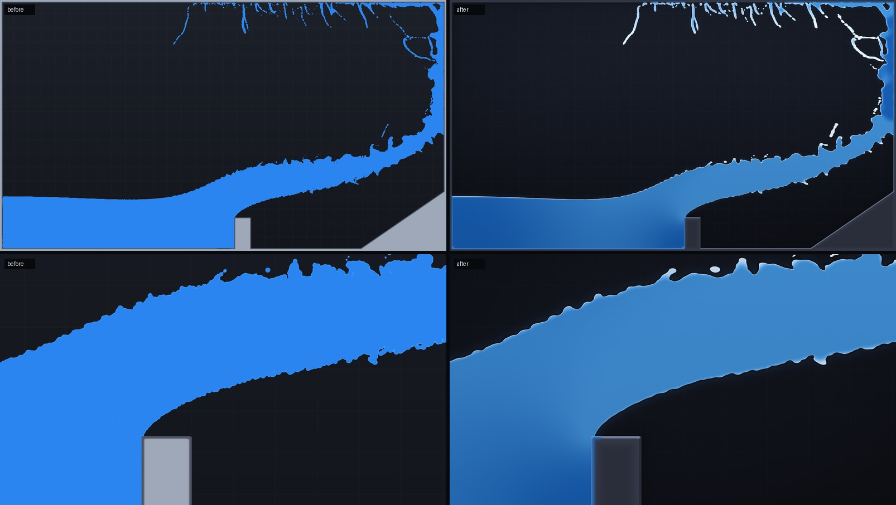
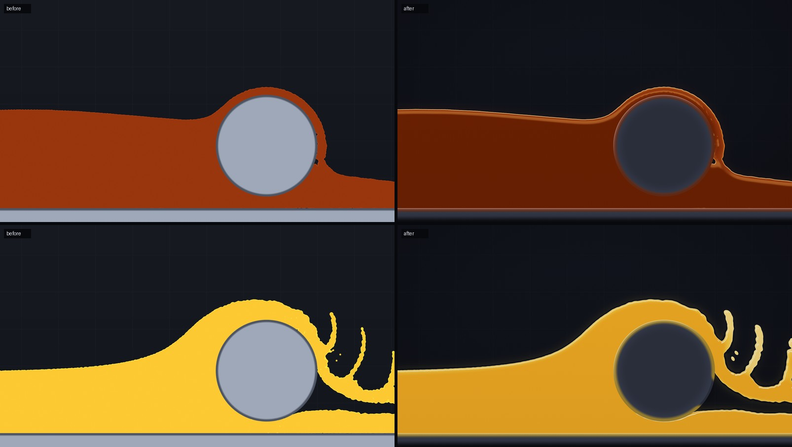
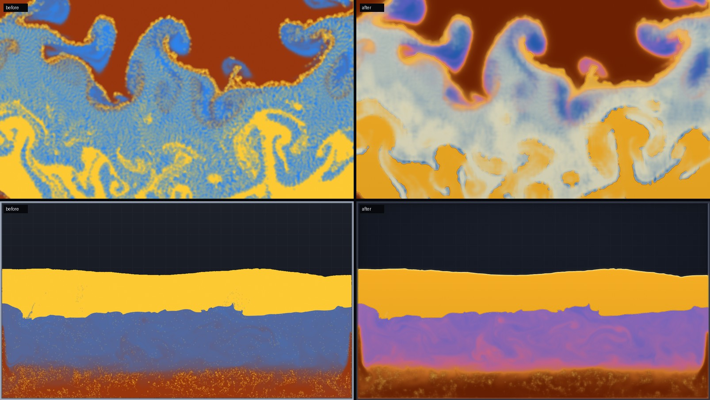
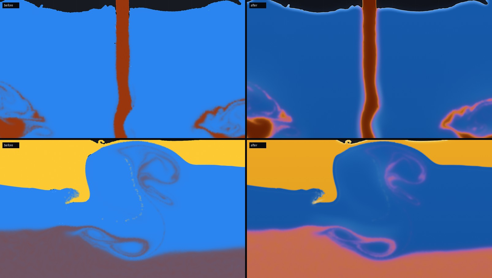
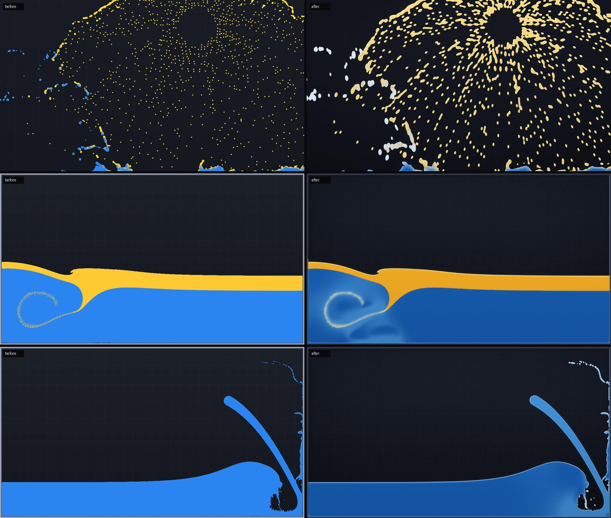
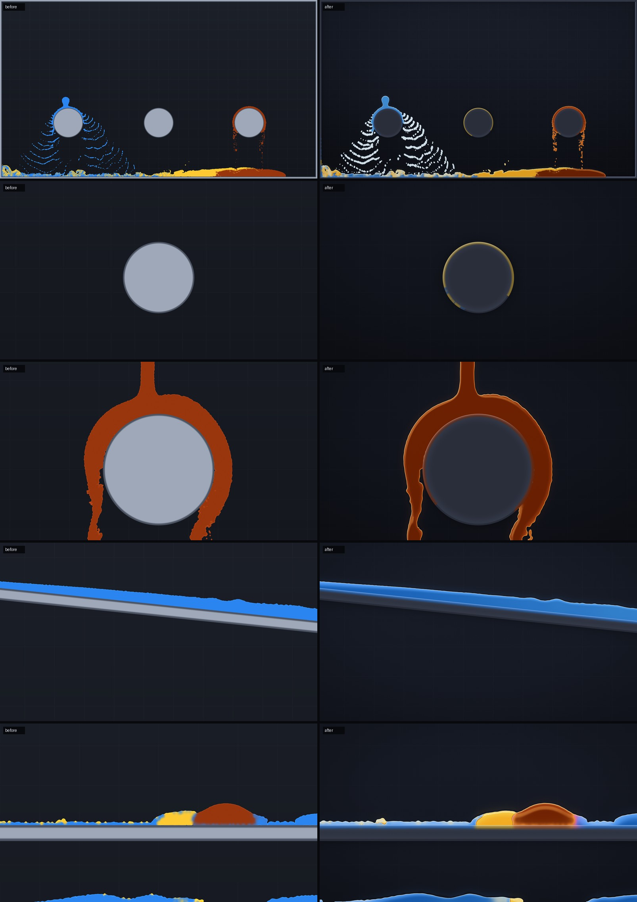
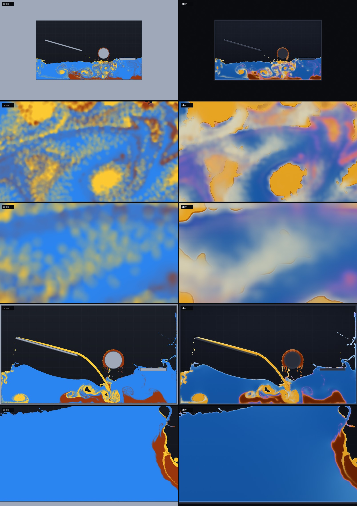

## Physics

**Units and scale.** The solver works in grid units (cells, seconds, densities relative to
water). Everything you can edit is in SI and converted in one place
([src/sim/params.rs](src/sim/params.rs), `SimParams::gpu_units`), together with the physical
size of a cell, `cell_size` (default 1 cm, so gravity is 981 cells/s²). Changing the cell size
changes the physical scale of the whole tank: at 1 mm per cell surface tension matters, at
1 cm it barely does (see below). A map can state the physical width of its tank instead
(`width_m` in [src/maps.rs](src/maps.rs)); **Oil Drops** does, at 51 cm, which is where oil
visibly beads. Every other map keeps 1 cm cells. `--set cell_size=...` overrides both.
On a 1 cm map the tank grows with the quality setting (5.12 m wide at medium, 10.24 m at
ultra), so quality changes the scale of the flow as well as its resolution.

**Method.** Particles carry the fluid and a staggered grid solves the forces (APIC, a
low-dissipation particle-in-cell scheme). Four particles per cell at rest. Each substep:

1. The GPU picks the substep length (`step.comp`) from the CFL condition,
   `dt = cfl / (u_max + sqrt(5 g dx))`, with `cfl` = 4 cells and `u_max` the fastest of: any
   face velocity of the liquid after the last projection, any particle's displacement in the
   last advection (velocity, density correction and oil drift), and what the mouse or a pour
   will impose. Spray in free flight counts a quarter (`spray_cfl`): its path is ballistic.
   The step is also capped at 1/80 s and at the capillary-wave limit of explicit surface
   tension.
2. One pass over the particles gathers velocity from the grid, moves them, collides them
   with solids, and scatters mass and momentum back to the grid; gravity is added on the
   grid. Particles travel with the midpoint rule (the gathered velocity plus the change of
   the grid velocity over half the step), and a path longer than a cell is walked in
   one-cell pieces with a collision test after each, so a 4-cell step does not skip a thin
   solid. A spray particle (no liquid around it) whose midpoint velocity is less than half
   the one it gathered is landing on slower liquid and takes the midpoint velocity
   (2026-11-14). On the surface of liquid that does not move (a yield-stress pile, a crust),
   the midpoint had cancelled such a particle's motion every substep while the gravity of
   each piled up in the velocity it gathered from the air faces around it, which its own
   scatter kept feeding: it sat on the surface at the speed cap (sludge at rest: fastest
   particle 752 cells/s, now 11), was drawn as white water, and launched itself when nudged.
3. Surface tension: curvature of smoothed liquid and oil indicators, turned into pressure
   jumps at liquid–air and oil–aqueous interfaces (below).
4. Pressure: the velocity field is made divergence-free with a variable-density, cut-cell,
   ghost-fluid Poisson solve, by conjugate gradients preconditioned with an aggregation
   multigrid V-cycle (red–black Gauss–Seidel smoothing, Galerkin coarse operators,
   coarse-correction weight 1.8). It stops at a relative residual of 1e-4, so its accuracy
   does not depend on the resolution: a resting pool needs 3 to 5 iterations, the dam
   break 8 to 12.
   A second potential, solved alongside with the same matrix, corrects density errors by
   nudging particle positions only; it never adds momentum.
5. Viscosity, full stress tensor (below), where it is implicit followed by a second
   pressure solve on the same matrix (below).

Both solves need a free surface somewhere in every connected body of liquid: a region
sealed off by solids on all sides has a singular system. Where two shapes touch (the two
ramps that form the crown of the Hourglass map), the rasteriser could leave a crack of a
cell or two, open but sealed on every face. Liquid leaking into it made the
density-correction potential grow without bound until it overflowed, and from then on the
whole tank lost its volume correction and collapsed into a thin, over-dense layer.
`Scene::rasterize` now fills in sealed groups of fewer than 16 open cells, and pushes their
distance field inside the solid so that particles are expelled and the crack is drawn
filled. Larger sealed regions (a box drawn around some liquid) are left open.

Inside the solids the distance field measures to the outline of the union of the shapes
(2026-11-14; `Scene::union_depth`: the nodes next to open ones keep their value, deeper ones
take a chamfer distance from those). The minimum of each shape's own distance, as before,
points at the faces one shape has inside another where they overlap (Canopy's crown of two
wedges, a box placed on a wall), and a particle pushed out along it stopped on that internal
seam a cell or more inside. A collision pushes a particle to the surface and as far beyond
it as it was inside (so liquid covered by a new solid keeps its area); where that carried it
across a narrow gap into another solid it is now pushed once more, to the surface only, if
it is still more than a cell inside (Terrace Falls once held a particle 18 cells deep in a
block).

A larger region that is closed on all sides *and completely full* (a lid drawn over a pool,
a tank filled to the top) used to be "not supported": with no face into air nothing fixes
the level of its pressure, the matrix is singular, and the density correction's right-hand
side is never compatible with it. Both solves then ran to their iteration limit every
substep, the liquid churned (rms speed 1.6 % of √(gh) in a box of still water) and in the end
left through the walls. The rasteriser now numbers the regions of open cells connected
through open faces and marks one cell at the top of each as its vent; each substep the GPU
notes which regions hold any cell without liquid, and in a region that holds none the vent
gets one extra face to air at ambient pressure (`rhs.comp`). That is the gauge a sealed
container physically lacks, placed where hydrostatic pressure is zero anyway. Such a region
takes no density correction (2026-11-14): its surplus liquid has nowhere to go, and the vent,
the one place the correction potential is held at zero, drew every surplus particle of the
region into that single cell (a solid laid over a full pool put 3 996 particles there; now
the fullest cell holds 13). The crowd jitter still separates particles stacked on one spot. A region with
a free surface is never touched, so no other scene changes (every other validation number is
identical to before). It is the parameter `sealed_vent`; `sprout validate sealed` covers it.

The solver is bound by memory traffic on the finest grid level and by the fixed cost of a
dispatch (4.5 µs each on the test machine), so it is built to make few, full passes:

- Each multigrid level takes two dispatches per V-cycle, one down (pre-smoothing and
  restriction fused) and one up (coarse correction and both half-sweeps fused); neighbours
  in another 16 × 16 tile are recomputed rather than read back.
- All levels of at most 1500 cells run inside one dispatch (`mg_tail.comp`).
- The new search direction is formed inside the matrix product.
- Tiles without pressure unknowns (air, mostly) are flagged once per substep and skipped by
  every kernel on every level.

How many Krylov iterations each substep records adapts to what recent solves needed (read
back a frame later, with a margin of half); iterations recorded after convergence are
dispatched indirectly with zero work. A solve that runs out of recorded iterations is
counted and reported (`probe`, `validate`, the panel). Every substep is recorded once into a
raw secondary command buffer with explicit barriers and replayed
([src/sim/raw.rs](src/sim/raw.rs)); vulkano's automatic synchronisation cost several
milliseconds of CPU per substep at this dispatch count.

**Frame pacing.** Each batch of substeps is timed on the GPU (timestamps), and the pacer
([src/pacing.rs](src/pacing.rs)) decides from that cost how many substeps fit in a frame,
with hysteresis. A scene too heavy for real time therefore runs the same number of substeps
every frame and simulated time slows down; it no longer alternates between n and n + 1.
How heavy is too heavy is set by **Real time down to** in the panel (`--min-fps`, default
60 fps): the simulation may take four fifths of a frame at that rate before the app goes
into slow motion instead of lowering the frame rate further. Dam break at high quality on
an RTX 3060 Ti, 165 Hz vsync: at 165 fps (the old fixed budget) 0.71× real time at a
steady 6.07 ms per frame; at 60 fps 0.98× real time, median 6.07 ms, p90 10.6 ms, p99
14.3 ms. A
frame much shorter than a substep (uncapped frame rate) banks its time until a full-length
substep is due.

**Repeatability.** Every particle carries a permanent id that seeds its random numbers, so a
run no longer depends on the order the particle sort leaves in memory. Head-less runs
(`validate`, `probe`, `shot`, `bench`) repeat exactly: three runs of the 40 s overturn give
identical output. The interactive app is not repeatable and cannot be: how simulated time is
cut into substeps follows the wall clock.

**Viscosity** is implicit (backward Euler) in the variational form of Batty & Bridson (2008):
the new velocities minimise kinetic energy change plus `dt * mu * D:D`, D the strain rate.
That is `div(mu (grad u + grad u^T))`, not `mu lap(u)`: it is consistent across viscosity
jumps (water next to syrup), gives traction-free free surfaces and does not slow a rigid
rotation. Solid walls are no-slip, with the wall where it is (half a cell from the first
tangential sample). The system is symmetric positive definite, solved by Jacobi-
preconditioned conjugate gradients to a relative residual of 1e-3, so no viscosity is too
large for the time step. Where the viscous diffusion number `nu dt / dx²` is below 1e-3
(water: about 1e-5 on 1 cm cells) the same operator is applied explicitly instead, which is
stable to about 0.12; in a water-only tank that is the whole tank, in mixed tanks the
implicit solve runs only on 16 × 16 tiles near more viscous fluid.

The implicit viscosity runs between two pressure solves (`viscous_projection` 1, 2026-11-15).
The first takes out what the liquid cannot follow, above all the pull `g dt` of gravity on
a pool at rest, so the no-slip walls of the viscosity see only real motion; the second
removes the divergence the viscosity leaves (`rhs_visc.comp`, `project_visc.comp`). It
reuses the matrix and multigrid hierarchy of the first, solves for the total pressure
starting from the first one's (so its first residual is just the divergence the viscosity
added, and a pool at rest needs no iterations), carries no interface jumps (the first solve
took them) and leaves the density correction alone. With one solve after the viscosity
(`viscous_projection=0`, the order before) the solve held back the whole pull of gravity
along every wall and the pressure pushed that layer up: every resting viscous pool
circulated along its walls at about 6 cells/s. Gravity added after the viscosity instead
stops that but lets gravity-driven flows slip by `g dt` per substep at the walls (the
sludge slump never stopped); the viscosity after a single projection leaves a divergent
velocity (slump 65 cells against 47). The explicit step for water is not affected: it
moves a wall face by `nu dt / dx²` of `g dt`, and a resting water pool shows no wall flow
with either order.

**Surface tension** uses the ghost-fluid method (Kang, Fedkiw & Liu 2000) for both kinds of
interface, so the jump is as sharp as the free surface and is balanced exactly by the
pressure gradient:

- *Liquid–air:* the air side of a surface face takes the Laplace pressure `sigma * kappa` at
  the interface's sub-cell position. `sigma` is that of the liquid there (water, syrup or oil
  against air, blended by composition).
- *Oil–aqueous:* where the oil fraction crosses 1/2 between two cells, the pressure jumps by
  `sigma_oil * kappa` across that face.
- *Water–syrup:* miscible, one aqueous phase, no interfacial tension (the weak transient
  Korteweg stress of a fresh miscible interface is neglected).

Curvature is the divergence of the unit normal of a 5 × 5 binomially smoothed occupancy
field. **Wetting** is the minimal static-contact-angle model (Brackbill, Kothe & Zemach 1992):
at the nodes on a solid's surface (within half a cell of it) the normal is replaced by the
one the material's contact angle prescribes, where the interface meets the wall, i.e. where
the liquid fraction changes along it. Nodes a cell further in keep their own normal, so the
cells along the wall have curvature like any other. (Imposing the angle over a band 1.5 cells
deep, as before, left those cells flat: a drop's own pressure then pushed liquid out along the
wall as a sub-cell film, and the in-wall direction of a normal parallel to the wall, which is
noise, bent the top of every thin layer at random. Non-wetting puddles walked sideways and
fell apart; see "Second fixes round" under Validation.) There is no contact-angle hysteresis
and no contact-line slip model; a contact line moves as fast as the no-slip viscous wall
lets it.

**The three fluids** (all editable; `--set viscosity_oil=8e-5`, `--set tension_water=0.07`,
`--set contact_angle_water=40`, `--set density_oil=850`, ...):

| | Density | Kinematic viscosity | Tension vs air | Contact angle |
|---|---|---|---|---|
| Water | 998 kg/m³ | 1.0e-6 m²/s | 0.072 N/m | 90° |
| Syrup | 1.4 × water | 0.06 m²/s | 0.076 N/m | 90° |
| Oil | 0.9 × water | 6.0e-5 m²/s | 0.032 N/m | 90° |

Oil against water or syrup: 0.025 N/m. Water's values are the standard 20 °C ones; oil's are
typical of olive or sunflower oil (50–90 mPa·s, 0.03 N/m against air, 0.02–0.03 N/m against
water). Syrup is a choice, not a measured product: a thick golden syrup or honey. The
contact angles are a neutral default because the scene does not say what the solids are.
The previous version tuned oil to 50 × and water to zero viscosity "for feel"; water now has
its real viscosity, and it changes almost nothing at this scale (see Validation).

- **Water and syrup are miscible.** Each aqueous particle carries a syrup fraction.
  Neighbours exchange it at a set rate, conserving total syrup exactly. Density blends
  linearly with the fraction and viscosity logarithmically.
- **Oil is a separate phase.** Where oil and water share a cell, below what the grid
  resolves, they would otherwise move as one fluid. Sub-cell droplets therefore drift at
  their terminal velocity: a droplet one cell across (`droplet_cells`) in whichever
  phase leads around the particle (over the same 3 × 3 cells the shares come from, with that
  phase's density and viscosity), with drag `C_d = 24/Re + 0.44`, driven by the difference
  between the local mean densities of the particle's phase and of the others (phases drift,
  not single particles). This follows the cell size and the
  viscosity of the fluids (a droplet barely drifts through syrup). Whether an interface
  sheds such droplets at all depends on the Bond number of one cell, `Δρ g dx² / σ`: 3.9 on
  1 cm cells (buoyancy tears pieces off; the drift acts everywhere), 0.04 on 1 mm cells
  (tension holds the interface together; where the smoothed oil fraction shows a resolved
  interface nothing drifts). Without that, the drift dissolved every rising oil drop on
  1 mm cells into a cloud within half a second. The previous model used a
  fixed relaxation time, which made the drift ten times faster in cells per second at 1 mm
  cells and ignored viscosity; at 1 mm it broke up oil blobs.
- **Liquids of one phase group sort themselves too** (2026-11-14). Oil and molten wax,
  mercury and gallium, lava and glass have no interfacial tension between them, but
  sub-cell blobs of them still rise or sink through each other long before they would
  diffuse into one another (a 1 mm drop of wax rises through oil at ~1 mm/s; paraffin
  needs ~1000 s to diffuse 1 mm). The same drift therefore also acts inside a group,
  against the group's local mean density (in the Stokes regime that is exactly the
  drift-flux slip, and its volume flux cancels). It uses each material's base density,
  without thermal expansion or freezing (grid_prep.comp writes share × base density of each
  group, `gbase`), so particles of one material never drift among themselves whatever
  their temperatures. It does not act in the aqueous group or in any group holding a
  concentrate or a diluent: water's families blend by their exchange instead.

**Liquid and air.** Air is not simulated. A cell is liquid when it holds at least half its
rest density; sparser spray flies ballistically until it lands.

**Numerical stabilisation.** Every device below exists for a stated reason, is a named
parameter in [src/sim/params.rs](src/sim/params.rs) with a value that switches it off
(`sprout params` lists them), and none damps motion globally. "Off" figures are the first
2 s of Playground at 512 × 288 (`sprout probe --map 0 --at 2 --set ...`; with everything on:
376 substeps, 17 unconverged viscosity solves, kinetic energy at 2 s 5436).

| Device (parameter, default; off) | Purpose | Measured effect |
|---|---|---|
| Density correction (position-only potential; `correction_time` 6 ms, `correction_max` 0.5 of the error per substep; off: `correction_max=0`) | Removes the volume drift that particle advection accumulates | Volume −0.29 % after the 40 s overturn; lifts a resting 1 M-particle pool by 0.016 cells (an energy change of 1.5e-4 of its potential energy). A time constant rather than a per-step share, so short substeps do not over-correct; per-step it caused visible jitter. Off: 374 substeps; stable over 2 s (volume drift is what it prevents, a slow effect) |
| Correction displacement limit (`correction_step_max` 0.5 cell per substep; 0 = none) | Keeps one bad cell from throwing particles | Inactive in every validation scene except at impacts. Off: 378 substeps, no other change in 2 s |
| Correction dead band (`correction_deadband` 0.25: buried liquid not under pressure is pushed apart only where a cell is a quarter over-full; 0 = off) | Pushing every over-full cell while under-full ones may not pull rectifies particle noise into expansion | In zero gravity a pool no longer stretches (15 % in 50 ms on 1 mm cells); this is what had made the oil-drop oscillation unmeasurable. No effect under gravity (settle numbers unchanged). Off: 382 substeps; no change under gravity |
| Crowding jitter (`crowd_jitter` 0.5 cell, cells over 1.5 × rest density; 0 = off) | Lets particles stacked on one spot separate (frozen ones too since 2026-11-13; a body at rest occupancy is never shaken) | Off: 383 substeps; no instability in 2 s (it acts only on stacked particles) |
| Brush crowd limit (`tool_crowd_max` 2 × rest occupancy, full drive below 1.5 ×; 0 = off; since 2026-11-14 it also bounds the currents) | Push and Grab set velocities after the pressure solve at up to 2 m/s, far faster than the density correction (0.5 cell per substep) undoes; driven on, liquid against the floor, a wall or a frozen body packed into one cell by the thousand, the fixed-point sums wrapped and the cell drew everything in | Push held against the floor 2 s (`validate tools`): fullest cell 815 → 37 particles; Playground mid-pool push 6635 → 31, against the floor 26 000 → 33. Cavity still opens. Two currents at full speed into the floor and a corner: fullest cell 75 → 21 (`validate abuse`); `validate current` unchanged within a few cells/s. Idle cost none: Playground 2.28 × real time and Cold Snap 2.93 / 2.92 × either way (`bench --grid 512x288`) |
| APIC matrix clamp (`apic_clamp` ‖C‖ ≤ 1/dt; 0 = off) | Bounds the affine velocity of a particle in thin spray | Rarely active. Off: 379 substeps, no instability in 2 s |
| Oil slip cap (`slip_cap` 1: ≤ cfl cells per substep; 0 = off) | The step size already accounts for the slip; this only acts in the substep it appears | Off: no measurable change in 2 s of Playground (376 substeps either way) |
| Curvature limit (`curvature_max` 0.5 / cell; 0 = none) | Radii under two cells are not representable; particle noise there would become huge pressure jumps | Spurious currents around a resting drop 1.2 % of the capillary velocity. Off (Oil Drops, 1 s): same 1460 substeps, no instability |
| Particle speed cap `speed_cap` = 1 × √(2 g H), the free-fall speed across the tank height (0 = off) | The 0.1 % of particles in impact jets otherwise set the time step for everything | 1329 cells/s at 1600 × 900, 752 at 512 × 288. A capped particle can still reach the lid from the floor. Dam Break 768 × 432, first 10 s: 4741 → 1563 substeps together with CFL 4. Energy at first impact −0.75 %; finest convergence front 4.546 → 4.528 at CFL 2. Off: fastest particle 752 → 1655 cells/s, 376 → 440 substeps (+17 %) in 2 s of Playground |
| CFL number `cfl` = 4 (was 2), with midpoint advection `advection_order` = 2 | Half the substeps in fast flow | Dam front at T = 3.33: 4.546 → 4.508 (−0.8 %), still converging (0.007 between the two finest grids); no measurable energy change before impact |
| Spray may travel `spray_cfl` = 4 × further per substep (1 = off) | A handful of free-flying droplets no longer dictates the step | 7 % fewer substeps in Dam Break 1600 × 900; path of spray is ballistic either way. Off: 383 substeps in 2 s of Playground (+2 %) |
| Longest substep `dt_max` = 1/80 s (was 1/60) | At CFL 4 a slow pool otherwise takes 1/60 s steps, in which converging particles travel three cells before the density correction sees them | Fullest cell after refilling a hole: 13–21 particles → 10. Resting 1 M pool: 371 → 486 substeps in 6 s (3.75 → 4.07 s wall) |
| No sliver substeps (`min_substep_share` 0.02: blocking helpers never record a substep shorter than 2 % of a full one; 0 = off) | Momentum travels through the grid as fixed-point displacement per substep; a microsecond step rounds slow flow away | On 1 mm cells such slivers stopped a capillary oscillation dead after 2 s. Sample times are met to 2 % of a substep. Only head-less runs (validate, probe, shot, bench). Off: 394 substeps and 336 of them with an unconverged viscosity solve (residual 0.36), against 17 with it on |
| Vent of a sealed, full region (`sealed_vent` 1; 0 = off) | A pressure reference where there is no free surface (see Method) | Closed box of water, 3 s: 0 unconverged solves of 240 (off: 31 of 248, rms speed 0.016 √(gh), then liquid outside the box); tank filled to the lid: rms 0.00004 (off: 0.018). No effect on any region that holds air: all other validation numbers unchanged |
| Rigid at the viscosity cap (`rigid_viscosity` 1 m²/s; not switchable: it is the regularisation of the yield stress and of solidification) | The viscosity solve stops here; a cell that would need more (frozen, glass or lava cooled past it, an unyielded plug, jammed oobleck) moves as a rigid body | Sludge slump run-out 53 cells against 47 from yield-stress theory; Bingham slot profile 4.3 % (L2); ice keeps its shape (39.4 × 19.5 of 40 × 20 cells after 6 s). No effect on water, syrup or oil (no rigid pass runs: Playground and Dam Break numbers unchanged) |
| Rigid bodies rest on solids (`rigid_contact` 1, `rigid_friction` 0.6; off: `rigid_contact=0`, frictionless: `rigid_friction=0`) | A porous rigid body (a heap of frozen lumps) slumps in the liquid solve; the rigid average turned that into motion into the floor, undone by the collision every substep | Heap of frozen lava under water (`LAB_FROZEN=1 LAB_WAIT=15 LAB_POUR_S=3 LAB_DROP=lava sprout lab --set heat_rate=0 --set spawn_temp_lava=500`): body rms speed 2 – 7 → 0.000 cells/s; water shake (`LAB_SHAKE`) at 30 s 5. Lava cooled ×100 in water: frozen lava shake 65 → 4, water 119 → 19. No effect where no rigid pass runs; thermal checks unchanged (ice floats, keeps shape, melts) |
| Viscoelastic stress cap (`elastic_stress_max` 10 × G; 0 = none, then the time step assumes 50 G) | Upper-convected Maxwell stress grows without bound in strong stretching | Slime shear mode: period 2.00 s against 1.94 s, decay 0.505 /s against 0.555 /s with it on. Halves the elastic time step it implies (√11 G instead of √51 G) |
| Elastic deformation per substep (`elastic_step_max` 0.25; 0 = none) | At an impact the velocity gradient across one cell grows the stress exponentially within a few substeps | Without it a slime blob dropped into a cup exploded into spray (gallery `liquid_slime`); with it, it lands and rings. Inactive in the shear-mode check (0.1 per substep) |
| Explicit viscosity in quiet tiles (`implicit_viscosity_min` 1e-3, the diffusion number below which a tile gets the explicit step; 0 = implicit everywhere) | Skip Krylov work where it changes nothing above tolerance | Viscosity checks unchanged; viscosity cost 5.8 → 2.3 ms per substep on Playground 1024. Off (implicit everywhere): 382 substeps, no change in stability |

Two bounds are part of the method rather than stabilisation, and are not switchable: the
ghost-fluid fraction θ ≥ 0.1 (`THETA_MIN`; at 0 the pressure coefficient 1/θ of a nearly
empty surface cell is infinite, the standard regularisation), and curvature is taken only
where the smoothed indicator's gradient is resolved (`G_MIN` in `surf_curv.comp`; elsewhere
there is no interface to measure).

## Validation

`sprout validate` runs these on the real solver, mostly at 512 × 288, and compares against a
known answer. All 84 checks pass on the machine below; two contact angles are reported without
a pass/fail (see Limitations). Three columns: the original version (commit `572c7c8`), the
solver rewrite as it stood before this round (`3ff62bf`), and now. "—" means not measured or
not applicable to that version.

| Test | Original | Rewrite | Now | Expected |
|---|---|---|---|---|
| Resting pool 1024 × 576, 1 M particles, 6 s: peak KE per particle | 162 | 0.0011 | 0.0005 | 0 |
| Same: mean height | swung by 1.7 cells | +0.016 | +0.017 | constant |
| Same: unconverged pressure solves | — (fixed 30 sweeps) | 0 of 367 | 0 of 486 | 0 |
| Resting pool 512 × 288, 10 s: level, rms / √(gh) | −0.51 %, 0.00007 | −0.57 %, 0.00018 | −0.55 %, 0.00013 | level, still |
| Syrup slump vs Huppert (1982) at 16 s: ratio, exponent | 1.13, 0.192 | 1.02, 0.204 | 1.02, 0.205 | 1.0, 0.2 |
| Shear decay, free slab (traction-free surfaces) | — | −4.4 % | −3.9 % | exact rate |
| Shear decay on a no-slip floor | — | −1.7 % | −1.8 % | exact rate |
| Rigid rotation, ν = 0.01 m²/s, angular momentum after 1 s | 0.919 (Laplacian form) | 1.011 | 0.975 | 1 |
| Resting drop, 1 mm cells: pressure / (σ/R) | no tension | 1.002 | 1.002 | 1 |
| Spurious currents around it / √(σ/ρR) | — | 1.2 % | 1.2 % | small |
| Oil disc in water: pressure jump / (σ_oa/R) | — | 1.002 | 1.002 | 1 |
| Water drop n = 2 oscillation vs Rayleigh | — | +0.6 % | +0.6 % | 0 |
| Oil drop in water, n = 2 oscillation period | — | unmeasurable (see below) | 2.220 s, +6.3 % | 2.087 s (viscous normal mode) |
| Syrup blob in water (miscible): shape change | — | 0.000 | 0.000 | none |
| Contact angle 60° / 90° / 120°, old chord measure | none | 73° / 86° / 132° | 71° / 87° / 132° | as set |
| Same, from cap area and apex height | — | — | 77° / 89° / 144° (before the second fixes round: 76° / 87° / 146°) | as set |
| Oil square in water, 0.5 s: R_max / R_equal-area | — | 0.99 (1.19 without tension) | 1.00 (1.19 without) | 1 = disc |
| Oil beads at default settings | no | no (needs `--set cell_size=0.001`) | yes, on the Oil Drops map | yes |
| Dam break 2:1, front Z at T = 3.33, a = 30 / 60 / 120 cells | — | 4.495 / 4.530 / 4.546 | 4.417 / 4.501 / 4.508 | converging |
| Dam break front speed dZ/dT | 1.47 | 1.47 | 1.46 | experiments 1.14–1.74 |
| Dam break front vs Martin & Moyce table | +8 … +16 % | +8 … +15 % | +8 … +13 % | see below |
| Shallow dam break vs Ritter: depth, speed | 0.463, 0.637 | 0.459, 0.638 | 0.458, 0.635 | 0.444, 0.667 |
| Overturn of three layers, 40 s: mean heights | 151 / 79 / 48 at 30 s | 149 / 83 / 45 | 149 / 83 / 45 | sorted |
| Same: aqueous above the oil floor (tank-wide floor) | — | 0.51 – 1.69 % over 3 runs | — | small |
| Same, strip by strip | — | — | 0.46 %; 0.30 – 0.46 % under 0.1 % changes of water's viscosity | small |
| Same: mechanical energy rise between samples | — | never | +0.04 % of released | none |
| Stir then 10 s of rest: energy above rest | 2072 → 1087 | 2066 → 1072 | 2053 → 1063 | falling |
| Same: particle-scale jitter (cells/s) | 9.1 → 3.1 | 9.3 → 3.0 | 8.4 → 3.0 | decaying |
| Fullest cell after refilling a hole (rest 4) | — | 9 | 10 | < 12 |
| Tools: pour, erase, recycle, grab, solids | all pass | all pass | all pass | |
| Closed box full of water, 3 s: unconverged pressure solves, rms speed / √(gh) | — | 31 of 248, 0.016, then liquid outside the box | 0 of 240, 0.0001 | 0, still |
| Tank filled to the lid, 2 s: the same | — | 18 of 208, 0.018 | 0 of 160, 0.00004 | 0, still |
| Run-to-run spread, layers and overturn | present | trapped share 0.51 – 1.69 % | none (identical output) | none |

The pour and the current were added after that table. They had only been measured on a
software renderer; these are now the numbers from the GPU (RTX 3060 Ti), which differ from
those in the last digit or two. `sprout validate pour` and `sprout validate current`,
512 × 288:

| Check | Measured | Expected |
|---|---|---|
| Pour held 1 s at 12000 /s (18 cells wide, 167 cells/s): particles | 11857 | 11861 (12000 less the corners still to cross the round nozzle) |
| Same: largest gap along the stream, particles outside its width | 0.26 cells, 0.00 % | < 1, < 0.5 % |
| Same: gain of v² between 40 and 130 cells below the spout | 0.993 of 2 g h (288 → 508 cells/s) | 1 |
| Same: width × speed × 4 at those heights | 11558 and 12109 /s | 12000 |
| Same: top of the stream above the brush centre, middle / sides | 6.1 / 1.7 cells | round: about 6.2 (9 less a frame's travel), under 3 |
| Same at 15 frames/s: particles, gap | 11857, 0.31 cells | as at 60 |
| Brush sweeping at 240 cells/s | 9923 | below 12000: the nozzle overruns its own liquid |
| Trickle, 2000 /s (8.3 cells wide at 60 cells/s) | 1969, gap 0.17 cells | 1971 |
| Spout 20 cells under a pool, 1 s | 6486 of 12000, fullest cell 9 | held back, < 12 (rest 4) |
| Current (150 cells/s, radius 14) in a 60 cell pool, 3 s: speed along it in the zone | 75 cells/s mean, 124 fastest (64 / 127 at the earlier 12 /s) | driven, never above 150 |
| Same: particles, flow above and below the zone | 121440 → 121440, −64 cells/s | conserved, returning |
| Same, 3 s after removing it: kinetic energy | 781 → 398 | falling |
| Stream falling through a sideways current: sideways / downward speed below it | 80 / 461 cells/s (without: 0 / 467) | pushed aside, fall unchanged |

Notes on what changed in the checks themselves, so the columns can be compared fairly:

- **Oil drop oscillation.** The earlier "30 % fast inviscid, 27 % slow viscous" figures were
  not a property of the interface. Three defects made the test unmeasurable: with gravity
  and viscosity both zero the drift model divided 0 by 0 and shredded the drop; the density
  correction rectified particle noise into a steady vertical stretch of the whole zero-gravity
  pool; and beyond 2 s of simulated time microsecond sliver substeps rounded the motion away.
  With those fixed the oscillation is clean. The reference is no longer the inviscid formula:
  with olive-oil viscosity on 1 mm cells the boundary layer is a third of the drop radius,
  and the linear normal mode of a viscous cylinder in a viscous fluid
  ([tools/drop_modes.py](tools/drop_modes.py)) is 4.5 % slower than inviscid. Against that the
  solver is 6.3 % slow (check: ± 8 %). The rest is numerical: particle–grid transfers smooth
  the shear layer at the interface once per substep, so the error scales with the number of
  substeps per period (13.5 % at half the step, 5.2 % at 1.7 × the step) and does not fall
  with resolution (R = 10 / 20 / 30 / 40 cells: 12.7 / 6.9 / 5.7 / 5.5 % with both fluids
  inviscid). A water drop in air, which has no such layer, is within 0.6 %.
- **Contact angle** is now measured from the cap's area and apex height, which resolves
  fractions of a cell and works above 90°. The old chord measure read the width off the first
  row of cells and flattered the 120° case (132° where the drop is really at 146°).
- **Layer separation** is measured in 16 vertical strips. The interface between the layers
  keeps sloshing as a slow internal wave, and against one tank-wide floor a tilted interface
  reads as unseparated water (0.3 to 4 % depending on the phase of the wave).
- **Rigid rotation** reads lower because forward-Euler advection let the disc spiral outwards,
  which adds angular momentum and hid a real loss at the free surface (0.992 with 4 ms steps).
  The threshold is 0.95; the Laplacian form it guards against gives 0.919.
- **Jitter** must fall over every 4 s rather than between every two samples: breaking waves
  leave bursts of small eddies, and the rewrite as handed over fails the strict version too.

What the numbers say about the originally reported problems:

- **"Rarely settles at high particle counts"** was the pressure solve: thirty SOR sweeps do
  not converge a 576-cell-tall grid, so the pool compressed under gravity, the density
  correction lifted it back, and the cycle pumped energy in. The solve now stops on its
  residual. Travelling with a bilinear midpoint velocity re-created a slow version of this
  (kinetic energy 0.1 after 6 s); the midpoint rule therefore only adds the *change* of the
  grid velocity along the half step to the gathered velocity.
- **"Syrup front 13 % fast"** was the viscosity solve; it now reads 1.02.
- **"Dam break 8–16 % fast"** is not a solver error: it converges under grid refinement and
  its speed sits inside the spread of published experiments (1.14–1.74, Lobovský et al.
  2014, table 1).
- **"Water sloshes excessively"** after a stir is physical: all three versions lose the same
  energy at the same rate.
- **"Oil does not bead"**: at 1 cm cells the Bond number of any drop the grid can resolve is
  large, so blobs flatten, as real 5 cm blobs would. The **Oil Drops** map is a tank 51 cm
  wide instead (1 mm cells at the default resolution): oil squares of 5 to 8 mm released
  under water round off and rise as drops, and oil dropped on the surface forms lenses. The
  fluids are the same; only the length scale differs. At that scale the capillary time-step
  limit is 0.7 ms, so the map runs well below real time (1.2 simulated seconds take about
  8 s), which suits it: a centimetre drop rises in a fraction of a second.

`sprout --selftest` drives the real window through every tool and key: 30 checks, all pass
on the GPU. One did not before: "a current carries liquid along" failed on any display
faster than 60 Hz, because the script counts frames of 1/60 s while the simulation follows
the wall clock; at 165 Hz each scripted wait covered a third of the simulated time it was
written for, and the blob had not yet fallen into the current when the check looked. The
app now holds its frame rate to 60 while the script runs. `validate tools`' "refilled pool
does not clump" (11 against < 12) passes on the GPU too; both were last reported from a
software renderer, where they failed.
`cargo test` covers the CPU side: 37 tests, all pass. `cargo clippy` is clean. (As of the
bug-fix round, 2026-11-14: `validate` 25 tests, 233 checks, all pass in 9.5 minutes;
`--selftest` 42 checks; `cargo test` 42; clippy clean.)

### Materials (new checks: `validate thermal rheology suspension elastic metals mixing`)

| Check | Measured | Expected |
|---|---|---|
| Stefan melting front (ice on a 40 °C plate, 1 mm cells) | 5.48 / 7.76 / 11.06 cells at 2.5 / 5 / 10 s, melted volume (worst −2.1 %). Before the in-cell exchange: 5.26 / 7.51 / 10.95, particles past half melted (−5.9 %); with it the particles of a front cell melt together, so the check now sums melted shares | similarity solution 5.59 / 7.91 / 11.18 (λ = 0.466), within 10 % |
| Energy through the phase change | content change 1.9163e5 J/m vs heat from the plate 1.9161e5 (+0.01 %); latent share 80 % | equal within 1 %; 1/(1 + St/2) ≈ 80 % |
| Ice block in water | keeps its shape (39.4 × 19.5 of 40 × 20), 10.7 % above water, melts under the heat brush | 8.1 % ± 4 |
| Sludge slump (Herschel–Bulkley, τy 60 Pa) | run-out 53.4, height 5.0 cells, stops | yield-stress theory 47.4 and 6.3 cells (Liu & Mei 1989) |
| Slot flow, Bingham / Carreau | L2 error 4.3 % / 2.6 %, viscosity solves converged | plug + parabola / numerically integrated Carreau profile, < 10 % |
| Sediment settling (mud, 10 %, 50 µm) | 1.18 cells/s (−4.4 %), clear layer, concentrate conserved to 0.0000 % | hindered Stokes 1.23 |
| Brine vs water in air at −15 °C | water 100 % frozen; brine 0 % frozen at −14.9 °C | brine freezes at −21 °C |
| Boiling brine | 2 191 particles escaped as steam; salt 1.04 × the residue share of the dissolved salt that boiled out (2 576 of 5 984 parts) (until the steam round: salt 13.2 % of the boiled volume, against 14.4 % ± 4) | 1 ± 0.15 |
| Steam: water at 99 °C over the Heat brush, 2 s (a pool 30 cells deep) | 15 302 particles turned to steam, 505 escaped; bubbles 50 cells up; none left 2 s after; heat content vs brush in, air and steam out +0.000 % | some escape, bubbles reach the surface, none left, within 0.5 % |
| Steam: the same at 20 °C, 1.5 s | 1 884 turned to steam, 33 escaped (1.8 %) | under 5 % escape (subcooled boiling) |
| Slime (Maxwell, free layer) | period 2.06 s (+6.8 %), decay 0.994 /s (−5.1 %) (with the 1 Pa s solvent: 2.00 s, +2.9 %; 0.505 /s, −8.9 %) | 1.93 s; (1/λ + νk²)/2 = 1.048 /s |
| Slime dropped into a cup with a peg (40 cm, 50 × 70 cm block) | particles in droplets (pieces under 40) at 3.2 s: 0 of 14 000; most at any 0.4 s sample 36 (1 Pa s solvent: 182; 631) | under 0.5 %; under 2 % at any time |
| Layering mercury / water / oil / molten wax | 5 / 14 / 28 / 33 cells; 0 of 2155 pressure solves unconverged | rising in that order |
| Mercury bead (zero gravity, 1 mm) | 159° | 140°, model bias ≈ +12° (accepted 135–160) |
| Ferrofluid towards a magnet | 1491 cells/s² (0.12 without) | 530–1579 (Kelvin force, N between 1 and 0) |
| Gallium oxide skin | aspect 4.77 with skin, 0.64 without (from 5) | > 4, < 3 |
| Mixing ink, mud, blood, milk, syrup, brine into water | every component within 0.0002 %, particles equal | < 0.1 % |

At the end of the materials round two of the original 84 checks failed: the refilled pool's
fullest cell (14 particles, < 12) and the 40 s overturn (3.25 % of the water/syrup above the
oil layer's floor, < 3 %). Both pass after the second fixes round (below). `--selftest` (42
checks, including the liquid workflow: duplicate, edit, apply, save, reload, pour, apply in
place, read-only built-ins, delete; the heat brush; magnets) passes; `cargo test` (41) and
clippy are clean.

### Second fixes round (2026-11-12): the three open regressions

The three limitations the materials round left open, each traced to its cause.

**The overturn left aqueous liquid on the side walls inside the oil** (0.44 % or 3–9 %, bimodal
under 0.1 % changes of water's viscosity; before the round 0.34–0.40 %). Two errors in the
generalised drift between phase groups (particles.comp), both absent from the old
water/oil-only code:
- Its density difference was the particle's own density against the mixture's, divided by
  the share of the other groups. That is right only for a particle as dense as its phase's
  mean: a water particle in syrup-rich water with a trace of oil around it read as far
  lighter than its phase, with a drift amplified by 1 / the trace, so the immiscible drift
  started to unmix water and syrup. It is now the difference between the local mean
  densities of the particle's group and of the others (a new per-cell field of each group's
  share × density, `GroupRhoBuf`, written by grid_prep.comp where groups meet; only
  particles with another group around them gather it, in a second pass over their 3 × 3
  cells, so pure regions pay nothing for it).
- The continuous phase the droplet drifts through was the majority of the particle's own
  cell. For a film or droplet one cell thick that is the droplet itself: syrup-rich water
  inside oil sank as if through syrup, a thousand times too slowly, and stayed on the wall.
  It is now the group that leads over the 3 × 3 cells the shares are gathered from, with
  that group's density and viscosity.

Water/syrup left above the oil floor after 40 s: 0.46 / 0.46 / 0.35 / 0.30 % for water's
viscosity × 1, 1.001, 0.999, 1.0005 (before: 2.24 / 2.20 / 0.49 / 1.43 % with only the first
error fixed, 0.44 % or 3–9 % with neither; before the materials round 0.34 – 0.38 %).

**Non-wetting liquid under gravity crept sideways and shed a sub-cell film.** The
contact-angle normal was imposed on every node within 1.5 cells of a solid (surf_curv.comp):
- Two rows of nodes with the same prescribed normal leave the row of cells along the wall
  without curvature, so nothing there holds back the drop's own Laplace pressure, which
  pushed liquid out along the wall. A half disc of water at 90° in zero gravity, already its
  equilibrium shape, kept only 96.3 % of its liquid in one body after 4 s. The normal is now imposed only
  on the nodes on the wall (`WALL_BAND`, 0.5 cells), as Brackbill's condition has it.
- The in-wall direction was taken from the node's own normal. Where that normal is
  perpendicular to the wall (the top of a layer a few cells thick, whose gradient the 5 × 5
  smoothing carries down to the floor) its in-wall part is noise, and neighbouring nodes got
  opposite normals: a random curvature that pumped energy into thin layers until a resting
  puddle broke up over the whole floor. The angle is now applied only where the liquid
  fraction changes along the wall (a contact line), blended in over 0.025 – 0.05 per cell.

New checks (`validate metals`): the 90° half disc keeps 99.6 % of its liquid in one body
(96.3 % before) and stays within 0.3 cells; slabs of mercury and of water at 140° at their
equilibrium height on 0.3 mm cells keep at least 96.5 % and 98.0 % in one body and their
centres within 4.5 and 14.2 cells over 4 s. Before, the mercury puddle broke up (its largest
piece down to 31 % of the liquid) and the water puddle kept 72 – 78 % and walked 35 – 37
cells. Either change alone is not enough: the narrower band alone still lets the mercury
puddle walk 48 cells. The same changes moved
the contact angles towards their settings: 60° / 90° / 120° settle at 77° / 89° / 144° (were
76° / 87° / 146°) and mercury's 140° at 153° (was 159°).

**Water, syrup and oil scenes were 3–5 % slower per frame.** The particle pass was 12 %
slower on the three-liquid overturn (2.03 → 2.27 ms per substep at 768 × 432) although a
plain tank runs none of the new code: every optional path (heat, rigid bodies, elasticity,
settling, magnetism) was compiled in behind a runtime test, and the registers they hold cost
occupancy. particles.comp and grid_prep.comp are now built once per combination of
capabilities the tank has needed (specialisation constant `SPEC_CAPS`, `has_cap()` in
common.glsl; sim/mod.rs `CapsPass`), and a test of a bit outside the combination is constant
false, so the driver drops that code: 2.10 ms (minimum of eight; median 2.11, where the build
before had 2.07 / 2.38 and the one before the materials round 2.04 / 2.31). A whole substep is
now 11.60 ms against 11.65 before and 11.53 before the materials round (minimum of eight). On the render side (GPU timestamps per pass,
1080p, Upside Down 768 × 432): the per-cell optics are written to a half-float array image
that the composite samples with the hardware's bilinear filter instead of 20 buffer loads,
the optics pass is skipped on frames that ran no substep, and the composite skips the
shading of the non-aqueous liquids (and of metal) where none is within reach of the blur and
the colour resolves where their weight is zero. Optics 0.073 → 0 ms on frames without a
substep, composite 0.33 → 0.29 ms (Dam Break, water only: 0.20 → 0.19 ms). Gallery pictures
differ from the build before these changes in at most 0.005 % of pixels (mean below 0.1/255),
from the recompiled solver; the Density Tower pictures differ that much between two runs of
the same build. Frame times: see Performance.

"Grab: the released pool only loses energy" was reworked. It asked the energy above rest of a
stirred, inviscid pool to fall between single samples 2 s apart, and failed in both builds
under 0.1 % changes of water's viscosity (1042 > 1043 before this round, 1129 > 1143 after).
Sampled every 0.25 s, the total measured from the particles wobbles by about 1 % within each
slosh (it reads higher while the pool moves fast than while it is piled up) and the slosh
lasts about 2 s, so single samples landed on random phases of it. By 6 – 10 s the pool sits
where the density correction's lift balances the slow compression of advection: with the
correction off its energy keeps falling, past rest. The check now averages each 2 s over
eight samples, requires the last mean below the first, and allows a rise between means up to
the potential energy of the lift the stabilisation table gives for the correction on a
resting pool (0.016 cells: 15.7 per particle). Over six runs (water viscosity × 1, 1.001,
0.999, 1.0005, 1.002, 0.998) the worst rise is +11.1 and every run passes. The pool keeps
about 6 % more kinetic energy after 10 s than before the wetting change (987 against 931 per
particle). "Refilled pool does not clump" (< 12), which failed in the materials round, passes
in all four runs (9 – 11 particles).


### Brush clumps and the frozen tank (2026-11-13)

**Reported:** after Cool and then Push in a pool of four liquids, some particles near the
brush "fused" into a point, and a maze-like texture then swept across the whole pool. Traced
with a scripted run (Playground, blood poured in, Cool swept over 120 cells for 20 s, Push
held 4 s at 250 %, then left alone):
1. While Push is held, cells reach 150 – 470 particles (rest: 4), on the floor and against the
   frozen block. In plain liquid, with nothing cooled, the same push packs 6 600 particles
   into one cell mid-pool and 26 000 on the floor. The brush sets velocities after the
   pressure solve, at up to 220 cells/s, against at most half a cell per substep of density
   correction.
2. Liquid clumps spread out once the brush lets go; frozen ones never did. Rigid bodies take
   no density correction (rigid.comp zeroed it on body faces, particles.comp for particles a
   body holds), and the crowd jitter skipped frozen particles. The clumps rode along the floor
   with the ice, merged in a corner and grew: 2 300, 8 200, 12 000 particles in one cell.
3. The scatter sums are 32-bit fixed point (2^20 per unit of weight): past roughly 2 000
   particles in one cell (a few hundred for mercury) they wrap. The cell's mass and momentum
   become garbage that pulls in more particles (the "black hole"), and its temperature reads
   −1.8 × 10^9 °C. Conduction carries that cold out cell by cell, a front along the grid's
   diagonal, and within 15 s every particle in the tank is frozen: the maze is the per-cell
   mix of frozen and liquid colours, the bumpy still surface a frozen wave.

Fixes, at the causes: bodies keep the density correction on faces next to a clump (a cell
over rest occupancy by more than `correction_deadband`, the threshold buried liquid already
uses) and particles a body holds take it there; the crowd jitter (over 1.5 × rest only) now
also shakes frozen particles; and the brushes stop driving particles already in a crowd
(`tool_crowd_max`, see the stabilisation table). A body at rest occupancy is untouched. A side
effect, measured in Lava Meets Water at 8 s: lava's rigid crust had been compressed, and its
drawn area was 10 % below what its volume fills (32 900 px, against about 36 600 for the volume
poured; now 38 200 with the anti-aliased edge); it now runs about 13 % further along the floor.

The same run now: fullest cell 21 – 33 particles while pushing, 13 – 15 after; coldest
particle −170 °C over 90 s, no runaway (before: runaway at 97 s). New checks (`validate
tools`): a push held against the floor packs at most 37 (815 before), the pool released
spreads to under 16, and 400 particles stacked inside a block of ice spread from 404 to 13 in
3 s (225 before) while it stays frozen. `validate` 118 checks, `--selftest`, `cargo test`
and clippy pass; frame times and simulated time per wall second unchanged (Playground and
Cold Snap at 512 × 288, interleaved builds).

### Lava, water and the Cool brush (2026-11-13)

**Reported:** lava and water together jitter; hot and cold liquids hardly exchange heat;
cooling lava with the Cool brush makes it more unstable and white dots flicker everywhere;
small droplets inside another liquid are hard to see. Reproduced with `sprout lab`
(Playground with lava, water and lava poured in from a sweeping brush for 12 s, 20 s
settling, then Cool over the lava; and a lava block or pour into a plain pool):

1. **Heat stayed in each particle.** Lava and water in one cell kept a 1180 °C difference
   indefinitely; lava particles in water warmed *above* 1200 °C on their cell's gain, and
   frozen water particles stayed as specks in warm water. In-cell exchange (Heat, above):
   the mean spread in mixed cells falls from 1176 °C to ~200 °C within 30 s.
2. **Too little transfer at a lava–water interface.** After 8 s under water, the old build's
   lava had cooled 6 K and formed no crust. With `contact_heat`, the exchange and
   expansion, it crusts at the contact, quenched fragments sink (they used to stay
   suspended), and water at the lava heats, rises and boils.
3. **Jitter.** Not from heat (the old build jittered the same with `heat_rate=0`): velocity
   noise of water (rms deviation from its 3 × 3-cell block mean) in the Playground run was
   2–9 cells/s old, 1–2 new, as lava now crusts instead of churning hot through the pool.
4. **Budget.** Boiling and mixing leaked heat (above); the lava runs now close to −0.001 %
   (Playground with boiling, mixing and Cool) and +0.000 % (block into a pool).
5. **Small droplets** are drawn as beads (Look).

`validate` 118 checks pass, `--selftest` passes, `cargo test` 41 pass, `clippy` clean.

### Bug-fix round (2026-11-14)

A round that set out to find what was wrong anywhere, solver, look or interface, before
fixing any of it. The issue list, written first, is
[docs/issues-2026-11-14.md](docs/issues-2026-11-14.md). Most of it was found by five new
groups of checks with no known answer but bounds any healthy run keeps
([src/stress.rs](src/stress.rs)); every picture of the gallery was looked at as well.

**The new checks.** For each scenario: every position, velocity and temperature finite;
nothing more than a cell inside a solid or outside the grid; no cell with more than 64
particles (rest is 4; a stream hitting the floor packs 20 – 50 into its sheet for a moment;
the fixed-point sums wrap near 2 000); particles conserved apart from what boiled away; no
particle above the speed cap; at most 3 % of pressure solves at their iteration limit.

| Test | Scenarios |
|---|---|
| `validate maps` | every built-in map, 4 s at 512 × 288, checked every second |
| `validate liquids` | every liquid dropped into a cup with a peg, 8 s: healthy, nothing racing at 8 s (under half the cap), settling (or still losing energy, for inviscid ones) |
| `validate abuse` | Push at 400 % in a corner; Grab swept wall to wall; solids placed over liquid and removed; a box laid over liquid 2 cells from another; a lid over a full pool; pour, jet, spray and drop at and past the edge of the grid; a whole pool erased and refilled; a fresh pour; Heat until it boils; Cool swept over lava on water; the strongest magnets at the walls; the fastest currents into the floor and a corner; every liquid poured over 30 random solids; maps reloaded over and over |
| `validate extremes` | Playground for 1 s with 20 parameters each at its minimum, maximum and off value |
| `validate render` | every map at 2 s, fit and 4 × zoom: no black pixels; a lava cup: its glow never darkens the picture; flicker over six frames |

**What they found, and the fixes** (old → new; all from those checks unless stated):

| | Found | Cause | Fix | Old → new |
|---|---|---|---|---|
| S1 | Ferrofluid map collapses in a second | Magnetic force applied per particle, sampled between grid points: not a discrete gradient, so the pressure could not balance it (~75 g near the magnet) | Force on the face velocities with the projection's face density (Physics, Magnetism) | fullest cell 9 045 → 12; strongest magnets at a wall 8 360 → 12; the dish heaps up instead of being crushed |
| S2 | A solid laid over a full pool | The sealed region's vent is the only place the correction potential is held: all surplus drained into it | No density correction in a sealed, full region (Physics, Method) | 3 996 → 13 particles in the fullest cell |
| S3 | Currents into the floor pack liquid | Not bounded by `tool_crowd_max` like Push and Grab | Same bound | 75 → 21 |
| S4 | Slime shatters into mist | Detached droplets kept their elastic stress, acting on the faces around them | A particle with less than a cell's worth of liquid around drops its stress | fewer, larger droplets (it still splashes, as it does with no elasticity) |
| S5 | Particles at the speed cap on resting liquid | Midpoint rule cancelled a surface spray particle's motion while it banked gravity | A spray particle stopped by still liquid takes its travelled velocity (Physics, Method) | fastest particle: sludge at rest 752 → 11, slime at rest 70 → 12, Mud Flats 752 → 188, Cold Snap 752 → 255, Lava Meets Water 752 → 245 cells/s (the last three still splashing at 4 s) |
| — | Particles stuck inside solids (seen while fixing S5: 1.3 cells inside Canopy's crown, 18 cells inside a Terrace Falls block) | Minimum of the shapes' distances has internal seams; the push beyond the surface could cross a narrow gap | Distance to the union's outline (`Scene::union_depth`); a final surface-only push for a particle still more than a cell inside | none inside at any check; new unit test |
| V1 | (Reported) Animated glow over hot liquid looks low quality | Haze displaced the picture with noise tied to a half-resolution field; the wavering bloom went negative | Haze and embers removed; bicubic sampling of the glow (Look, Effects) | 0.12 → 0.00 % of a lava cup's pixels darkened by the glow |
| V2 | Stains: speckle in floors, an asterisk in every peg | A band 2.4 × the wet film deep, ragged with fine noise under a hard threshold | 1.3 × the film, broad soft patches (Look, Effects) | see the pictures below |
| V3 | Spray drawn as a sunburst | Lattice positions, exact radial direction and one speed every frame | Scattered direction, speed and position (Controls) | see below |
| V5 | Ferrofluid nearly invisible | Black body with a quarter of a mirror | A dark mirror (metal 0.85, colour 0.10) | see below |
| V6 | (Reported) The glow of lava on the floor extends down forever | The glow field's sampler clamps to the edge: below the grid, its bottom row repeated | Falls off over 6 cells beyond the grid (Look, Effects) | under Lava Meets Water's floor: a constant (70, 29, 18) to the screen's edge → fades to the backdrop |
| V7 | (Reported) Steam and bubbles look bad | One fixed pale ring per bubble over the hole it left (dark gaps between); puffs as separate grey discs | A vapour field: merged bubble pockets with a lit wall in liquid that stays whole, puffs summed into one soft cloud (Steam) | flicker over boiling 0.86 → 0.34 %; render +0.12 ms with steam, ±0 without |
| U1 | Stirring while the view eases flings liquid | Cursor velocity from its world position, which moves with the camera | Both ends of the cursor's motion seen through this frame's view | (by reading `app.rs`) |
| U2 | `--set gravity=nan` accepted | NaN passes `clamp` | Refused, with a unit test | |
| U3 – U5 | `--help` listed 14 of the `validate` tests; the README said the tabletop brush shows mm (it shows cm); `validate mixing` printed a component with no name | | Fixed | |

Not fixed, with the cause found (Limitations): lava under water grows upward fingers (boiling
leaves voids the pressure solve takes for free surfaces, and they pull the lava up); oil and
wax in Density Tower neither separate nor mix (no drift inside a phase group; the wax also
sets at the tower's 20 °C air); a hot lava droplet in water is drawn dark (its glow comes
from its cell's mean temperature; a real one crusts over almost at once anyway). All three were fixed later the same day
("Each liquid at its own temperature" and what follows it).

**A check reworked.** "After the stir: energy above rest falls" compared single samples
2 s apart, as "Grab: the released pool only loses energy" did until the second fixes round,
and has the same flaw: the energy measured from the particles wobbles by about 1 % within
each ~2 s slosh. Over eight runs with water's viscosity changed by 0.05 – 0.2 %, it failed in
1 of 8 on the build before this round and in 2 to 4 of 8 on intermediate builds of this one;
with 2 s means and no tolerance it failed in 3 of 8 on both builds alike (late in the run the
pool's energy levels off where the density correction's lift balances advection's
compression). It now uses 2 s means and the Grab check's bound, a rise of at most the
correction's lift energy (15.7 per particle): all 16 runs pass, largest rise +11.7 on this
build and +15.7 on the one before. With the spray-landing rule left out, this check gives
exactly the old build's numbers, so the rule is what perturbs it; at the threshold used
(motion cancelled to under a tenth), droplets landing on moving water are left alone.

After the round: `validate` (25 tests, 233 checks) all pass in 9.5 minutes; `--selftest`
(42 checks) passes; `cargo test` (42, three new: NaN refused, no internal seam in
overlapping shapes, scattered spray) and clippy are clean. The other numbers in the tables
above are unchanged by this round (the dam-break convergence fronts are 4.441 / 4.502 /
4.516 on both builds; the table's 4.417 / 4.501 / 4.508 are from an earlier round).

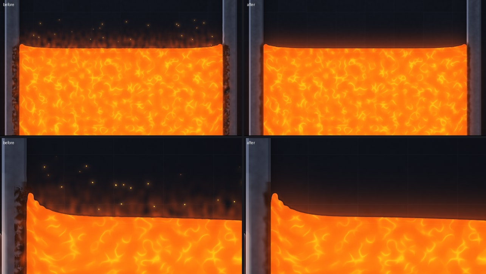
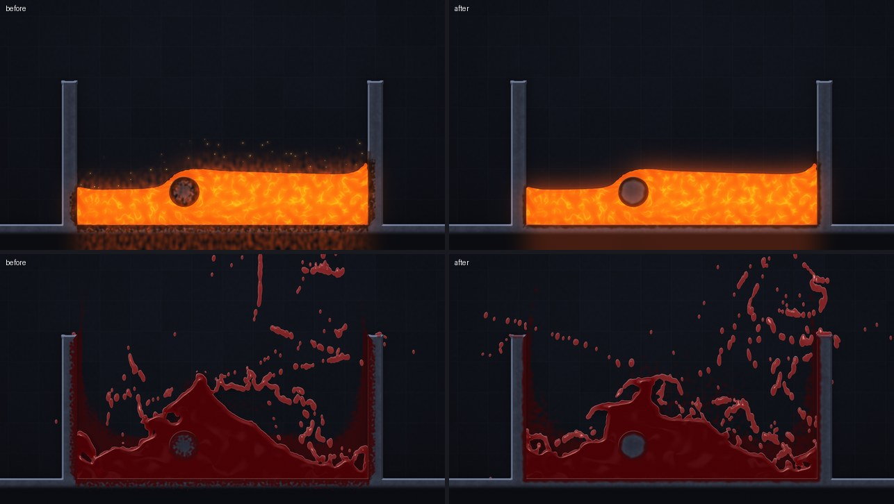
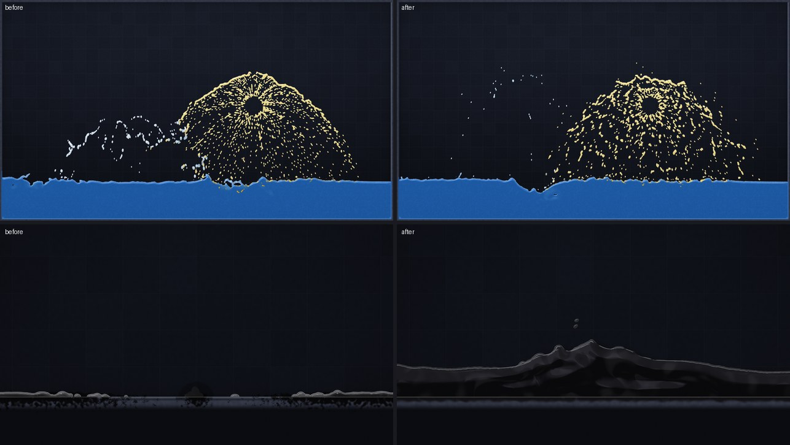

### Light, stains and heat (2026-11-14, third round)

`validate` (25 tests): 239 of 240 checks pass. The one that fails is "2 s after the brush is
lifted the steam is gone": at the default parameters 2 of 15 757 steam bubbles are left,
pressed against the cup's right wall 3 – 9 cells under the surface in water at its boiling
point (so they can neither condense nor escape; the check now prints where they are). It is
the chaotic kind (Validation, "Bug-fix round"): with water's viscosity or density nudged by
0.1 % (4 runs), gravity by 0.01 % (2), `steam_mixing`, `air_cooling`, `heat_power` or
`steam_boil` by 0.1 % (4), it passes in all 10 runs on the new build, as on the old; at the
defaults it also passes with `eddy_heat=0` or `contact_heat=300`. The Stefan front stays
within +1.5 – 1.9 % of the similarity solution (old build +1.7 – 2.1 %). Every heat budget
still closes (`lab`: 0.000 %). `--selftest`, `cargo test` (42) and clippy pass.

### Lava texture (2026-11-15)

Reported: lava lying in its crust or in harder lava had a texture that jittered and
stuttered back and forth. The patterns were drawn at x − u t from the cell velocity of the
moment, t up to a few seconds since the pattern restarted: any wobble of the velocity moved
the whole pattern t times as far. They are now carried by a displacement map (Look,
"Patterns carried by the liquid"). The Playground with lava poured into its pool and left
for 60 s, 30 frames 1/60 s apart, rows inside the lava only (`SPROUT_LAVA_POOL=1 sprout
gallery DIR fx`):

| | Mean change of a pixel channel, frame to frame | Largest | Frame 0 to 29 |
|---|---|---|---|
| before | 0.321 levels | 1.269 | 2.030 |
| after | 0.033 | 0.087 | 0.382 |

The look itself: resting lava glows in slow, evolving swells; flowing lava is drawn out
into streaks along the flow (gallery `fx_lava_pour`); the crust tears where the melt
spreads. In the search, the velocity inside resting lava was measured frame by frame
(`LAB_LAVA_JITTER`): smooth from frame to frame (0.02 – 0.03 cells/s per frame), but the
pool never comes to rest along the walls (Limitations), and the old patterns multiplied
those slow swings of ±0.5 cells/s by seconds. `validate`: all 240 checks pass (the steam
check that failed last round passes since `steam_mixing` 1); `--selftest`, `cargo test` (42)
and clippy pass.

## Performance

Hardware: AMD Ryzen 5 3600, NVIDIA RTX 3060 Ti 8 GB, Fedora 45, Wayland. All three versions
measured the same day with the same command, a 1600 × 900 window, uncapped
(`--no-vsync --frames 1800`, the first 360 frames skipped; `SPROUT_FRAMES_CSV` for the raw
frame times). Frame times in ms; "sim speed" is simulated seconds per wall-clock second.

| Scene | Version | mean | p5 | p25 | p50 | p75 | p95 | p99 | max | sim speed |
|---|---|---|---|---|---|---|---|---|---|---|
| Dam Break 1600 × 900, 1.04 M water | original | 13.3 | 9.7 | 9.9 | 10.2 | 18.3 | 18.7 | 18.9 | 22.6 | 0.43 |
| | rewrite | 15.8 | 10.9 | 11.7 | 12.5 | 21.6 | 23.8 | 25.0 | 27.6 | 0.07 |
| | now | 11.1 | 10.2 | 10.7 | 11.1 | 11.5 | 12.3 | 13.3 | 19.6 | 0.27 |
| Dam Break 768 × 432, 237 k water | original | 0.8 | 0.4 | 0.4 | 0.4 | 0.6 | 2.6 | 2.8 | 3.7 | 0.96 |
| | rewrite | 10.4 | 0.5 | 4.3 | 12.1 | 16.3 | 19.9 | 21.0 | 24.2 | 0.57 |
| | now | 3.0 | 0.3 | 0.4 | 0.6 | 6.4 | 10.4 | 11.5 | 13.7 | 0.97 |
| Playground 1024 × 576, 732 k mixed | original | 17.1 | 12.0 | 17.3 | 17.4 | 17.6 | 17.8 | 19.6 | 19.8 | 0.71 |
| | rewrite | 14.9 | 9.3 | 10.0 | 17.1 | 18.1 | 19.7 | 23.4 | 25.2 | 0.15 |
| | now | 10.9 | 9.9 | 10.4 | 10.8 | 11.4 | 12.3 | 13.0 | 17.0 | 0.49 |
| Upside Down 512 × 288, 369 k mixed | original | 1.4 | 0.6 | 0.6 | 0.8 | 2.6 | 3.0 | 3.2 | 4.1 | 0.98 |
| | rewrite | 7.5 | 0.6 | 0.7 | 6.5 | 12.8 | 18.5 | 19.7 | 24.7 | 0.94 |
| | now | 1.6 | 0.6 | 0.6 | 0.7 | 0.9 | 7.6 | 8.2 | 8.6 | 0.97 |

The frame-count benchmark covers a different stretch of each scene in every version (a
version that simulates more per frame gets further). The same simulated interval, head-less
(`sprout probe --map N --grid WxH --at 8`, wall seconds for 8 simulated seconds; the pool is
`sprout probe 250 --grid 1024x576 --at 6`):

| Scene | original | rewrite | now |
|---|---|---|---|
| Dam Break 1600 × 900, 0 – 8 s | 19.5 s (1920 substeps) | 90.2 s (7762) | 24.2 s (2415) |
| Playground 1024 × 576, 0 – 8 s | 12.8 s (1920) | 84.6 s (10833) | 15.2 s (1490) |
| Resting 1 M pool, 0 – 6 s | 10.3 s (1440) | 3.75 s (371) | 4.07 s (489) |

Reading these honestly:

- **Two of the four speed targets are met** (Dam Break 768 × 432, Upside Down: real time
  again) **and two are not**: Dam Break 1600 × 900 runs at 0.27 against the original's 0.43
  (4 × the rewrite, 0.63 × the original), Playground 1024 × 576 at 0.49 against 0.71. Over the
  same simulated interval the gap is smaller, 1.24 × and 1.19 × the original's wall time.
- **Why the two big scenes stay behind.** A substep now costs about what the original's did
  (9.3 ms against 10.2 ms on the big dam break), with both solves converged. What differs is
  the number of substeps: the original took 240 per simulated second whatever happened and
  clipped every particle to 600 cells/s, which at 1600 × 900 is below the speed of the bulk
  flow (free fall over the column height is 1100 cells/s), so it was simulating a slower
  flow. With the cap at the physically meaningful 1329 cells/s and CFL 4, the violent first
  seconds need about 350 substeps per simulated second. Closing the gap needs CFL 6 (the
  dam front then moves 2.4 % and stops converging cleanly) or a substep of 6.5 ms.
- **Where one substep goes** (Dam Break 1600 × 900, GPU timestamps from `sprout profile`,
  ms): particles 2.4; pressure 4.5 (multigrid down 1.2, up 1.8, coarse levels 0.4, Krylov
  vectors and reductions 1.0); surface tension 0.8; viscosity (explicit, water) 0.5; other
  grid passes 1.1; total 9.3 (rewrite: 10.3 at CFL 2, where the solve needs fewer iterations).
  Playground adds 4.5 ms of implicit viscosity (22 iterations of six dispatches each).
- **What was tried, with its measured effect** (per substep unless stated): one dispatch for
  all coarse multigrid levels, 3.8 → 3.4 ms at 768 × 432; skipping tiles without unknowns,
  −9 % (768) and −13 % (1600); fusing each level's four V-cycle passes into two, 10.0 → 9.3
  ms at 1600 and 3.4 → 3.1 at 768; forming the search direction inside the matrix product,
  one dispatch and one pass fewer per iteration; speed cap + CFL 4 + spray relaxation,
  4741 → 1563 substeps over the first 10 s of Dam Break 768. Not adopted: pressure tolerance
  1e-3 (11 → 8 iterations in a resting pool, all checks pass, but the tolerance was left
  alone); viscosity tolerance 1e-2 (syrup front 1.02 → 1.03). Measured and rejected:
  dropping the barriers between dispatches (the solve diverges), a narrower work group for
  the coarse levels (4 × slower).
- **Frame pacing is even.** Dam Break 1600 × 900 used to alternate between one and two
  substeps per frame (p25 11.9, p75 22.2 ms in the rewrite; 9.9 and 18.3 in the original);
  it now holds one (p25 10.7, p75 11.5). The price is the median: 11.1 ms against the
  original's 10.2.
- **Small scenes are back at the original's median** (0.6 and 0.7 ms against 0.4 and 0.8).
  The rewrite's 60–120 fps was not longer substeps as such: each frame was given a shortened
  substep of its own, so every frame paid for one. Frames now bank time until a full-length
  substep is due. The tails are worse than the original's (p99 11.5 and 8.2 ms against 2.8
  and 3.2): one converged substep costs 3.1 ms at 768 × 432 and 6 ms in Upside Down (most of
  it the implicit viscosity solve), against the original's 2.2 ms of fixed sweeps, and in
  the fast phase of the small dam break a substep costs about as much as it simulates, so
  frames with three substeps sustain themselves.
- **Fixed overhead**: a dispatch with its barrier costs 4.5 µs here whatever it does; a
  substep at 1600 × 900 now issues 15 per Krylov iteration (38 before). Recording a
  frame costs 0.1 ms of CPU.

**The renderer rework**, old against new renderer on the same solver, same command as the
table above (first of two runs each; the second differs by less than the rows do):

| Scene | Renderer | mean | p5 | p25 | p50 | p75 | p95 | p99 | max | sim speed |
|---|---|---|---|---|---|---|---|---|---|---|
| Playground 512 × 288, 179 k mixed | old | 1.52 | 0.35 | 0.37 | 0.42 | 0.65 | 7.63 | 8.26 | 13.45 | 0.95 |
| | new | 1.58 | 0.40 | 0.42 | 0.48 | 0.71 | 7.80 | 8.58 | 8.94 | 0.96 |
| Playground 1024 × 576, 732 k mixed | old | 10.59 | 9.72 | 10.14 | 10.53 | 10.97 | 11.63 | 12.37 | 16.21 | 0.51 |
| | new | 10.60 | 9.74 | 10.17 | 10.59 | 10.99 | 11.54 | 12.15 | 21.79 | 0.53 |
| Dam Break 768 × 432, 237 k water | old | 3.02 | 0.40 | 0.41 | 0.63 | 6.26 | 10.39 | 11.11 | 11.87 | 0.97 |
| | new | 3.10 | 0.47 | 0.49 | 0.71 | 6.42 | 10.54 | 11.32 | 14.08 | 0.97 |
| Upside Down 512 × 288, 369 k mixed | old | 1.57 | 0.61 | 0.63 | 0.69 | 0.89 | 7.40 | 7.99 | 8.45 | 0.96 |
| | new | 1.62 | 0.63 | 0.64 | 0.69 | 0.89 | 7.54 | 8.05 | 13.73 | 0.96 |

A render-only frame costs 0.05 to 0.08 ms more; everything else is inside run-to-run spread.
The solver was not touched, so the three-version table above still stands for it.

**With vsync on a fast display the simulation gets less time than it could use.** The
pacer gives the simulation four fifths of a refresh interval. At 165 Hz that is 4.8 ms, less
than one substep of a mixed scene costs, so the opening second of Playground 512 × 288 runs
at 0.78 × real time with vsync against 0.95 × uncapped. That is the pacer doing what it was
built to do (even frames first); whether a 165 Hz display should instead drop to every
second refresh is a choice, not made here.

### Materials round (2026-11-12)

Identical commands on the baseline (this working tree before the round, built separately)
and the new build, interleaved, three rounds each, 600 frames, `--no-vsync`, window
1600 × 900, RTX 3060 Ti shared with the desktop:

| Scene | Build | p50 ms | p95 ms | p99 ms | simulated s / wall s |
|---|---|---|---|---|---|
| Dam Break, ultra | baseline | 10.41 | 11.46 | 12.27 | 0.67 |
| | new | 10.90 | 11.92 | 12.86 | 0.65 |
| Playground, medium | baseline | 4.31 | 8.86 | 10.21 | 0.95 |
| | new | 4.90 | 9.61 | 11.85 | 0.94 |
| Upside Down, high | baseline | 14.34 | 15.59 | 16.05 | 0.81 |
| | new | 14.96 | 16.13 | 16.76 | 0.77 |
| Lava Meets Water, high | new | 8.04 | 13.53 | 14.75 | 0.79 |
| Density Tower, high | new | 8.69 | 13.67 | 15.25 | 0.56 |
| Glass and Slime, high | new | 11.64 | 13.29 | 13.79 | 0.79 |

Water, syrup and oil scenes are 3–5 % slower per frame (Playground's light frames more).
Per substep the simulation is within 1 % (`profile`, minimum of three: Dam Break 1024 × 576
4.83 → 4.88 ms, Upside Down 768 × 432 11.29 → 11.39 ms; the particle pass is 1 % slower on
the dam break, 13 % on the three-liquid overturn, grid preparation 0.16 → 0.19 ms); the
rest is rendering: 0.89 → 1.17 ms (Dam Break) and 1.38 → 1.75 ms (Upside Down) per 1080p
frame for the per-cell optics pass and the composite that reads it. The first version of the
generalised renderer splatted every optical property per particle into six targets and cost
7.8 ms; a half-resolution second splat still cost 3.2 ms (its cost follows particles ×
targets); computing the soft fields per cell instead brought it to the figures above. Every
new capability is a `CAP_*` flag: heat, rigid bodies, rheology, settling, elasticity and
magnetism cost no dispatches (and the elastic and settling buffers no memory) unless the tank
needs them; nothing new reads back per frame (the swatches read back once when a look
changes).

### Second fixes round (2026-11-12)

The same commands on three builds, interleaved, three rounds each: before the materials round
("pre"), after it ("then") and now (window 1600 × 900, `--no-vsync`, 600 frames; means of the
three rounds; RTX 3060 Ti shared with the desktop):

| Scene | Build | p5 ms | p50 ms | p95 ms | p99 ms | simulated s / wall s |
|---|---|---|---|---|---|---|
| Dam Break, ultra | pre | 9.48 | 10.31 | 11.26 | 12.14 | 0.684 |
| | then | 9.74 | 10.66 | 11.64 | 12.35 | 0.659 |
| | now | 9.73 | 10.62 | 11.62 | 12.39 | 0.662 |
| Playground, medium | pre | 0.42 | 0.67 | 8.66 | 10.45 | 0.942 |
| | then | 0.58 | 0.87 | 9.00 | 10.62 | 0.929 |
| | now | 0.51 | 0.84 | 8.98 | 11.51 | 0.930 |
| Upside Down, high | pre | 11.91 | 14.02 | 15.15 | 15.47 | 0.808 |
| | then | 12.47 | 14.42 | 15.50 | 15.89 | 0.790 |
| | now | 12.41 | 14.31 | 15.42 | 15.85 | 0.791 |

The solver is back to its cost before the materials round (`profile`, Upside Down 768 × 432,
minimum of eight: substep 11.53 / 11.65 / 11.60 ms, particle pass 2.04 / 2.07 / 2.10 ms,
whose median fell from 2.38 to 2.11 ms; see Validation, "Second fixes round", for the
causes). Frames recovered less: they are still 2 – 3 % slower than before the materials
round (3 – 4 % in this run before the fixes). What is left is in the renderer, measured with
GPU timestamps per pass at 1080p: the composite costs 0.19 / 0.23 / 0.29 ms against
0.11 / 0.13 / 0.17 ms before the materials round (Dam Break / Playground / Upside Down at
768 × 432; it was 0.20 / 0.24 / 0.33 ms), spread over the larger shader rather than any one
part of it (taking out the liquid shading, the solids, the optics reads or the colour
conversions each saves 0.01 – 0.03 ms); the per-cell optics pass costs 0.07 ms on frames that
run a substep (none on the others); the splat 0.04 ms more. That accounts for about two
thirds of the remaining frame-time difference. Frames that run no substep (Playground's p5)
gained most: 0.58 → 0.51 ms, against 0.42 ms before the materials round. Playground's p99 is
noisy between rounds (9.0 – 12.8 ms; each build has rounds near both ends).

### Heat round (2026-11-13)

Old (before this round) and new builds, the same commands interleaved, two rounds (window
1600 × 900, `--no-vsync --frames 1200`, `SPROUT_FRAMES_CSV`; the desktop and a game launcher
kept the GPU ~40 % busy):

| Map | Build | p50 / p90 / p99 frame (ms) | simulated / wall |
|---|---|---|---|
| Lava Meets Water | old | 0.44 / 5.65 / 10.30, 0.41 / 5.23 / 10.58 | 0.88×, 0.87× |
| Lava Meets Water | new | 0.43 / 5.50 / 9.82, 0.42 / 5.72 / 9.73 | 0.87×, 0.86× |
| Playground | old | 0.65 / 7.85 / 8.71, 0.61 / 7.90 / 8.79 | 0.93×, 0.93× |
| Playground | new | 0.64 / 7.83 / 8.61, 0.66 / 7.88 / 8.50 | 0.93×, 0.94× |

`sprout profile --grid 512x288 --map 13 --at 6` (one substep of Lava Meets Water, two runs
each): 4.87 / 4.84 ms → 5.74 / 5.49 ms. The heat pass itself goes 0.021 → 0.057 ms and the
per-cell sums add ~0.005 ms to the fill; the rest is more viscosity and pressure work,
because the lava now actually cools and stiffens (the old build's lava was still at
1200 °C under the water at that point). Isothermal scenes run none of the new code.

### Bug-fix round (2026-11-14)

The build before the round and after it, the same commands interleaved, two rounds each
(window 1600 × 900, `--no-vsync --frames 1200`, first fifth skipped, `SPROUT_FRAMES_CSV`;
the game launcher was closed this time, the desktop kept the GPU ~27 % busy):

| Scene | Build | p5 / p50 / p90 / p99 frame (ms), two rounds | simulated / wall |
|---|---|---|---|
| Playground, medium | before | 0.78 / 0.86 / 5.34 / 8.51, 0.78 / 0.85 / 5.09 / 8.40 | 0.94×, 0.94× |
| | after | 0.75 / 0.82 / 5.28 / 8.52, 0.75 / 0.83 / 5.17 / 8.51 | 0.94×, 0.94× |
| Lava Meets Water, high | before | 9.43 / 10.20 / 10.55 / 11.30, 0.84 / 10.01 / 10.40 / 10.75 | 0.85×, 0.83× |
| | after | 0.78 / 8.70 / 9.33 / 9.92, 0.78 / 8.63 / 9.15 / 9.45 | 0.86×, 0.87× |
| Ferrofluid, medium (1 mm cells) | before | 10.82 / 12.25 / 13.32 / 14.28, 10.65 / 11.91 / 13.26 / 14.35 | 0.87×, 0.86× |
| | after | 11.77 / 12.23 / 12.65 / 13.00, 11.82 / 12.28 / 12.73 / 13.08 | 0.82×, 0.82× |
| Dam Break, ultra | before | 0.94 / 10.45 / 11.19 / 12.32, 0.95 / 10.36 / 11.19 / 12.06 | 0.78×, 0.79× |
| | after | 0.91 / 10.29 / 11.13 / 12.18, 0.93 / 10.35 / 11.06 / 12.10 | 0.79×, 0.80× |
| Upside Down, high | before | 13.42 / 14.18 / 15.15 / 15.87, 12.92 / 14.01 / 15.16 / 15.80 | 0.76×, 0.72× |
| | after | 13.44 / 14.12 / 15.02 / 15.81, 13.18 / 13.98 / 15.06 / 15.76 | 0.77×, 0.75× |

Frames that only render (p5) are 0.02 – 0.04 ms cheaper without the haze (Playground, Dam
Break). Lava Meets Water runs 1.4 ms faster at the median: its particles no longer sit at the
speed cap on the crust, so fewer substeps are spent on them. The Ferrofluid map is the one
that lost simulated speed in the app (0.87 → 0.82×) at the same median frame: it now has a
dish of liquid to simulate and draw instead of a crushed film. Head-less the solver is faster
on it, not slower (`probe --map 17 --at 4`: 3 120 substeps either way, the capillary limit;
5.07 → 4.88 s wall; `profile`: 1.45 → 1.40 ms per substep, the particle pass 0.23 → 0.07 ms
without the per-particle field lookups, the magnet passes 0.012 → 0.033 ms for the second
dispatch). Isothermal water, oil and syrup scenes run none of the changed code apart from the
spray-landing test and the collision rescue, which only runs after a second push.

### Steam and slime (2026-11-14)

The `main` build before this round and after it, same commands interleaved, two rounds each
(`--no-vsync --frames 1500`, `SPROUT_FRAMES_CSV`; the desktop kept the GPU ~29 % busy), and
the simulation alone (`bench --at 3 --grid 512x288`):

| Scene | Build | p5 / p50 / p90 / p99 frame (ms), two rounds | simulated / wall | sim alone (× real) |
|---|---|---|---|---|
| Playground | before | 0.75 / 0.81 / 5.16 / 8.40, 0.73 / 0.86 / 5.32 / 8.77 | 0.94×, 0.95× | — |
| | after | 0.75 / 0.83 / 5.51 / 8.52, 0.75 / 0.82 / 5.15 / 8.59 | 0.95×, 0.95× | — |
| Lava Meets Water | before | 0.56 / 0.64 / 4.62 / 5.20, 0.58 / 0.64 / 4.59 / 5.03 | 0.87×, 0.90× | 2.24, 2.23 |
| | after | 0.56 / 0.62 / 4.41 / 5.19, 0.56 / 0.63 / 4.52 / 5.12 | 0.91×, 0.90× | 2.29, 2.28 |
| Glass and Slime | before | 0.58 / 1.55 / 7.19 / 7.69, 0.59 / 4.78 / 7.26 / 7.72 | 0.97×, 0.97× | 1.36, 1.36 |
| | after | 0.58 / 1.38 / 7.21 / 7.63, 0.59 / 1.37 / 7.19 / 7.50 | 0.97×, 0.97× | 1.34, 1.34 |
| Cold Snap | before | 0.51 / 0.53 / 0.83 / 3.33, 0.51 / 0.54 / 0.81 / 3.36 | 0.84×, 0.85× | 3.76, 3.75 |
| | after | 0.49 / 0.52 / 0.77 / 3.28, 0.49 / 0.52 / 0.76 / 3.21 | 0.84×, 0.83× | 3.86, 3.86 |

Unchanged within the noise. A heated tank with water now carries a steam channel in its
scatter (Lava Meets Water, Cold Snap) without measurable cost; the thicker slime makes Glass
and Slime's viscosity solve 1.5 % slower; isothermal scenes run none of the new code. The
puff pass is only recorded while steam can exist. `validate` (25 tests, 240 checks, five new
or reworked: boiling at 99 °C, the steam gone after it, the heat budget with steam, subcooled
boiling, the slime cup drop; the brine check now measures salt against the dissolved salt
that boiled out), `--selftest`, `cargo test` (42) and clippy pass.

### Light, stains and heat (2026-11-14, third round)

The build before this round and after it, same commands interleaved, two rounds each
(`--no-vsync --frames 1500`, first 360 frames skipped, `SPROUT_FRAMES_CSV`; the desktop kept
the GPU ~18 % busy). The new build's first launch compiles its new pipelines, which costs its
first round simulated time (0.64 – 0.82×); the second rounds are the comparison:

| Scene | Build | p5 / p50 / p90 / p99 frame (ms) | simulated / wall |
|---|---|---|---|
| Playground | before | 0.74 / 0.82 / 4.99 / 5.52, 0.70 / 0.82 / 5.04 / 5.65 | 0.94×, 0.94× |
| | after (second round) | 0.76 / 0.84 / 5.01 / 5.53 | 0.94× |
| Lava Meets Water | before | 0.64 / 0.77 / 4.93 / 5.36, 0.66 / 0.77 / 4.85 / 5.36 | 0.91×, 0.91× |
| | after (second round) | 0.74 / 0.83 / 5.18 / 8.50 | 0.92× |
| Kitchen | before | 0.81 / 1.06 / 5.55 / 9.18, 0.81 / 1.04 / 5.61 / 9.74 | 0.93×, 0.94× |
| | after (second round) | 0.77 / 1.03 / 5.67 / 10.26 | 0.93× |

Rendering alone (`bench --at 2 --size 1920x1080 --map 0`, three interleaved rounds): 0.965 –
0.977 → 0.974 – 0.990 ms a frame at 512 × 288; simulation speed 1.85 → 1.84× real time. The
per-frame optics passes are under Look ("Stains and runs"): Playground 0.296 → 0.284 ms,
Lava Meets Water 0.358 → 0.411 ms, Kitchen 0.383 → 0.473 ms. The eddy mixing and evaporation
run inside the heat pass, which runs only in tanks with heat.

### Lava texture (2026-11-15)

The build before (the last commit with this round's steam changes, which are not part of
the comparison) and after, same commands interleaved, two rounds each (`--no-vsync --frames
1500`, first 360 frames skipped, `SPROUT_FRAMES_CSV`):

| Scene | Build | p5 / p50 / p90 / p99 frame (ms) | simulated / wall |
|---|---|---|---|
| Playground | before | 0.78 / 0.84 / 5.04 / 5.55, 0.78 / 0.84 / 5.10 / 5.56 | 0.94×, 0.94× |
| | after | 0.79 / 0.85 / 4.99 / 5.29, 0.80 / 0.84 / 5.07 / 5.35 | 0.94×, 0.94× |
| Lava Meets Water | before | 0.75 / 0.81 / 4.88 / 5.41, 0.75 / 0.81 / 4.93 / 5.42 | 0.92×, 0.92× |
| | after | 1.03 / 1.12 / 5.59 / 5.95, 1.04 / 1.12 / 5.64 / 6.00 | 0.94×, 0.93× |
| Kitchen | before | 0.78 / 1.01 / 5.90 / 8.94, 0.77 / 1.00 / 5.92 / 8.93 | 0.95×, 0.95× |
| | after | 0.98 / 2.29 / 9.56 / 10.57, 1.01 / 1.64 / 6.05 / 9.89 | 0.96×, 0.96× |

Rendering alone (`bench --at 2 --size 1920x1080`, interleaved): Playground 1.006 / 0.999 →
0.991 / 0.973 ms, Lava Meets Water 0.915 / 0.909 → 1.195 / 1.182 ms, Kitchen 0.957 / 0.973
→ 1.194 / 1.202 ms; simulation speed unchanged. The flow map's own pass costs nothing
measurable; the composite costs about 0.25 ms more where liquids with patterns are on
screen. It is not the work done (a resting pool reads one pattern where it read two, and
Kitchen draws only glints) but the size of the shader: returning early from either the
carried noise or the carried seams alone brings Kitchen back to 0.95 ms, while removing the
3D noise, the strain taps or the unrolling does not. Not resolved this round.

## Limitations

- **A resting viscous pool still jitters at its free surface** (2026-11-15). The wall
  circulation it used to have is gone (two pressure solves around the viscosity, Physics,
  Viscosity): a wall-to-wall layer of lava at rest moves 0.02 cells in 2 s next to the
  walls (was 11.6) and below its top cells by under 0.01 cells/s. What is left, about
  0.04 – 0.07 cells/s mean particle speed, sits in the top cells and is the density
  correction (with `correction_max=0` the pool is at 0.001 cells/s), as in the water pool
  below.
- **A still pool of water open to the air slowly gains motion** (found 2026-11-15): wall to
  wall, its mean speed grows from 0.44 to 1.7 cells/s in 24 s, in a circulation that
  converges at the surface. The density correction drives it (with `correction_max=0` it
  stays at 0.1 cells/s); under oil the same water stays still.

- **Liquids of one phase group share one temperature per cell.** Different groups keep their
  own; oil and wax in one cell do not, so hot wax stirred into cold oil meets it at the mean
  and may set there (true of the mixture once it has exchanged heat, too early for the first
  moment). The drift within a group uses base densities, so a small frozen fragment that no
  rigid body holds drifts as if molten (wax: 780 instead of 900 kg/m³).
- **A stream hitting the floor packs 20 – 50 particles per cell** into the thin sheet it
  spreads into, for a fraction of a second (`validate abuse`); the sheet relaxes as it slows.
- **Steam fills one particle's volume, not its own** (Heat, "Steam"). A steam particle carries
  the mass and heat of the water parcel it boiled from, so it is about 1600 times denser than
  real vapour of that volume: bubbles are as large as the parcel (and rise at the terminal
  velocity of a `droplet_cells` bubble), boiling does not swell the pool by the volume of its
  vapour, and a sealed box cannot be pressurised by it. The Heat brush (300 K/s for water at
  its centre, gigawatts per cubic metre) turns a saturated cup into a foam within seconds.
  Escaped steam is drawn as puffs, not simulated: it does not push on anything or follow
  the air. Only aqueous liquids make steam; any other liquid leaves at once when boiled.
- **Water's expansion is linear** (fit over 20 – 100 °C): it misses the density maximum at
  4 °C, so cold meltwater sinks a little more readily than it should.
- **The effects are painted, not traced.** Light comes from a height field guessed from the
  2D fields and from a light depth scanned straight down each column (spread sideways, and
  neutral in colour), the reflection is of a fixed studio tank (not of the scene, except the
  glow), and stains lie on the faces of solids and the back wall, which a side view does not
  really have. The film of a stain is drawn and simulated but is not liquid: it takes no
  mass from the particles that lay it, and drips that run off a solid do not fall as drops.
  Coats are laid at the resolution of the cells (smoothed), spatter at the drops' own. The
  film map lasts while the tank runs; it is not saved with it.
- **Water's blue is stylised**: about thirty times its real absorption, so that a tank of it
  is blue. Mixtures are made to look as if water were clear (its tint gives way to whatever
  is dissolved in it, by exp(−24 c)); a trace of syrup or blood at the very edge of a plume
  can still show a narrow teal fringe.
- **The quenched skin of lava is drawn, not simulated.** Its face temperature comes from a
  steady balance across half a cell, so the rind is drawn from the first moment, while the
  crust that holds the lava (rigid bodies) forms as the cells themselves freeze, within
  seconds at `contact_heat` 3000 W/m²K; the rind does not stiffen the melt before then.
- **Small droplets among the other non-aqueous liquids** (lava in oil, oil on mercury) are
  not drawn as beads; only aqueous-against-other droplets are.
- **Fixed-point scatter sums wrap past about 2 000 particles in one cell** (a few hundred
  for mercury); nothing known reaches that now (see Validation, "Brush clumps"), but a
  wrapped cell still runs away rather than failing safely.

- **Water, syrup and oil scenes are 2–3 % slower per frame than before the materials round**
  (see Performance, "Second fixes round"): the solver is back to its old cost; the
  generalised renderer's composite and per-cell optics are not (about 0.15 ms per 1080p
  frame), and part of the difference is not accounted for.
- **Non-wetting puddles slosh and wander a little**: with no contact-angle hysteresis nothing
  pins them, and mercury is nearly inviscid, so a puddle whose edges are still rounding off
  drifts by up to 14 cells in 4 s (0.3 mm cells; see Validation, "Second fixes round"). A
  heavy splash (mercury) leaves columns of particles with gaps that show.
- **Frozen bodies weld**: touching frozen cells join one rigid body, and a rigid body cannot
  break, only melt. Bodies are found per substep; more than 4096 at once leave the rest liquid.
- **Viscosity solves get expensive above ν dt / dx² ≈ 100** (glass and lava near the cap; 1 mm
  cells): Jacobi-preconditioned CG needs up to the 200-iteration limit. Above the cap liquid
  is rigid instead.
- **Viscoelastic stress does not see wall shear** (the particles' velocity gradient omits it):
  slime is held to walls by its viscosity only.
- **Slime's modulus is low** (100 Pa; PVA-borax gels: 1 – 3 kPa). At 2 kPa it holds together
  by itself, but its elastic waves need substeps 4 times shorter (Viscoelasticity, "Slime
  holds together"); the thicker solvent does the same at no cost. An implicit elastic stress
  would lift that limit; not done in this round.
- **Magnetism has no field solve**: ferrofluid spikes come from a local demagnetisation
  estimate and are qualitative; spacing ~1 cm is below a cell on 1 cm maps.
- **No gas phase** besides steam bubbles: there is no air to push, steam that escapes leaves
  the simulation (reported as boiled); salt residue does not redissolve; suspensions do not cream (milk fat); a particle holds one concentrate, so
  ink in syrup-water mixes with the water only.
- **Fast flows at high resolution are still slower than the original** (see Performance): the
  step follows the fastest liquid, and each substep solves pressure to a tolerance.
- **Contact angles are biased towards non-wetting**: 60° settles at 77°, 120° at 144° (90° at
  89°; mercury's 140° at 153°). The prescribed normal now sits on the wall nodes only, which
  is not what limits 60°: a wedge thinner than half a cell is not liquid to the pressure
  solve, so a wetting contact line cannot advance. A ghost indicator extended into
  the wall along the contact angle is the likely fix. There is no hysteresis and no
  contact-line slip model.
- **Oil–water capillary oscillation is 6 % slow**, from the smoothing of the interfacial shear
  layer by particle–grid transfers (see Validation). It grows with the number of substeps per
  period, so it is larger for small `dt_max`.
- **Free surfaces sit about half a cell off** for viscosity (the free-slab shear decays 3.9 %
  slow, as for a slab one cell thicker). Not addressed in this round.
- **A viscous free surface loses angular momentum**: 2.5 % per second for a disc at
  ν = 0.01 m²/s with 12.5 ms steps.
- **The viscosity solve occasionally stops at its recorded iteration limit** in mixed scenes
  (29 of 1490 substeps in the first 8 s of Playground 1024 × 576, worst residual 4e-3 against
  the tolerance 1e-3; the rewrite: 111 of 10833). The limit follows what recent solves
  needed and catches up a batch later.
- **Tabletop scale is slow in simulated time**: on 1 mm cells explicit surface tension limits
  the step to 0.7 ms (see the Oil Drops map).
- **Surface tension needs small cells to matter**: on the 1 cm maps oil does not bead, as it
  would not in a tank 5 m wide.
- **The interactive app is not repeatable** (substeps follow the wall clock); head-less runs
  are.
- **The brush tools wait for the GPU** each frame they emit, to read back the particle
  counts around the brush (0.3–0.4 ms, see Controls).
- **Air is nothing.** Trapped pockets have no pressure and collapse; there are no bubbles.
  A sealed region that is completely full takes its pressure reference from one vent cell
  (see Physics); with more than 32 separate regions of open cells the last ones share a
  number, and one of them being full while another holds air goes unnoticed.
- **Solids are static**, and a tank is limited to four particles per cell of its area.
- **Tested on one machine.** NVIDIA on Linux only; the solver needs subgroup arithmetic
  (Vulkan 1.1) and relies on buffer writes being visible across `barrier()` within a work
  group (`mg_tail.comp`).
- **A stream thinned to a sheet shows its rows.** The pour lays its particles on a regular
  lattice; where a sheet shed from a solid stretches that lattice several times over, the
  rows separate into arcs of droplets (see the first picture of the "Liquid on solids"
  pair). The renderer draws what is there. Jittering the lattice would hide it and would
  change the pour's validated numbers; not done.
- **The renderer remembers wet solids only for frames it sees.** `shot` and `gallery` note
  them every 1/30 or 1/60 s as the app does; `validate --shots` renders once, at the end.
- No scene save or load, and no undo (custom liquids are saved).

## Code layout

| Path | Role |
|---|---|
| [src/world.rs](src/world.rs) | The sandbox world: solids plus the simulations living in it. New simulations plug in here. |
| [src/scene.rs](src/scene.rs) | Shapes and their rasterisation into the fields the solver and renderer use |
| [src/sim/](src/sim/mod.rs) | The fluid solver: buffers, pipelines, the substep; [params.rs](src/sim/params.rs) holds every parameter and the `PARAMS` table of names, units and ranges; [raw.rs](src/sim/raw.rs) the hand-synchronised substep command buffers |
| [shaders/](shaders/) | All GPU code. `common.glsl` documents the grid layout and every buffer. |
| [src/render.rs](src/render.rs), [src/gui.rs](src/gui.rs) | The renderer (see [Look](#look)): splatting, the wide field, the wet map, shading; a small egui painter |
| `shaders/splat.*`, `down.frag`, `blur.frag`, `wet.frag`, `composite.frag` | The render passes; `composite.frag` holds the whole look |
| [src/app.rs](src/app.rs), [src/ui.rs](src/ui.rs), [src/camera.rs](src/camera.rs), [src/pacing.rs](src/pacing.rs) | Window and input; panel and canvas overlays; eased camera; substep pacing |
| [src/brush.rs](src/brush.rs) | Brush strokes, the stream of the pour and the jet, and the admission of new liquid (CPU only) |
| [src/maps.rs](src/maps.rs) | Built-in maps |
| [src/sim/material.rs](src/sim/material.rs) | Material definitions (`MatProps`), the 18 built-ins with sources, phase groups, pair tensions, mixing overrides, the GPU material and optics tables |
| [src/library.rs](src/library.rs), [src/editor.rs](src/editor.rs) | Custom-liquid file (versioned, validated); liquid picker, editor (draft / live / saved) and swatches |
| [src/checks.rs](src/checks.rs) | The materials' validation scenarios |
| [src/stress.rs](src/stress.rs) | Robustness runs with bounds instead of answers: every map, every liquid, tools at their limits, parameter extremes, the renderer (`validate maps liquids abuse extremes render`) |
| `shaders/heat.comp`, `rigid.comp`, `rheo.comp`, `elastic.comp`, `settle.comp`, `magnet.comp`, `cell_optics.comp`, `optics_blur.comp` | Conduction (with eddy mixing and evaporation), rigid bodies, non-Newtonian viscosity, viscoelastic force, settling, magnetic energy, per-cell optics and their 3 × 3 smoothing |
| `shaders/optics.glsl`, `light.comp`, `film.comp`, `film_tiles.comp`, `flow_map.comp`, `glow.comp`, `smoke.comp` | The render side of the simulation: colour from absorption and scattering, the light from above, the film map of stains and runs (and its list of tiles), how far the liquid has carried its patterns, the glow field, the smoke field |
| [src/validate.rs](src/validate.rs), [src/selftest.rs](src/selftest.rs), [src/headless.rs](src/headless.rs) | Checks, benchmarks, screenshots |
| [tools/drop_modes.py](tools/drop_modes.py) | Reference periods for the oil-drop oscillation check (viscous normal modes; plain Python) |

Shaders are compiled by [build.rs](build.rs) with the system `glslc` rather than
`vulkano-shaders`, which builds the shaderc C++ toolchain from source and fails with
current CMake.
