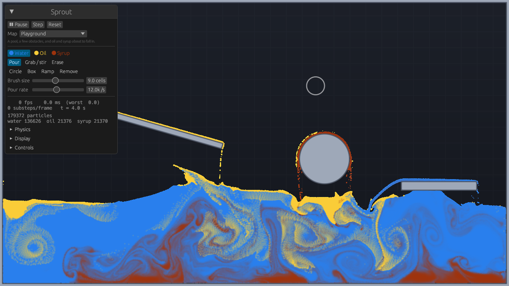
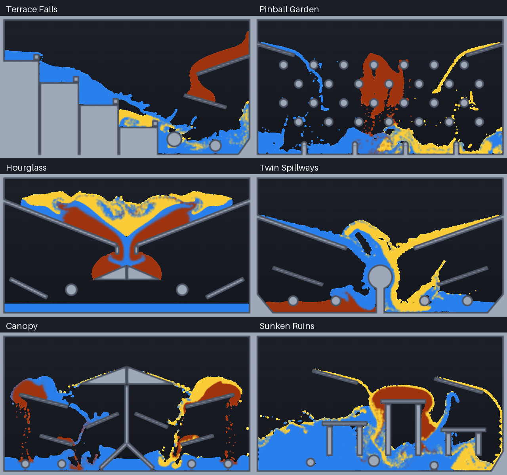
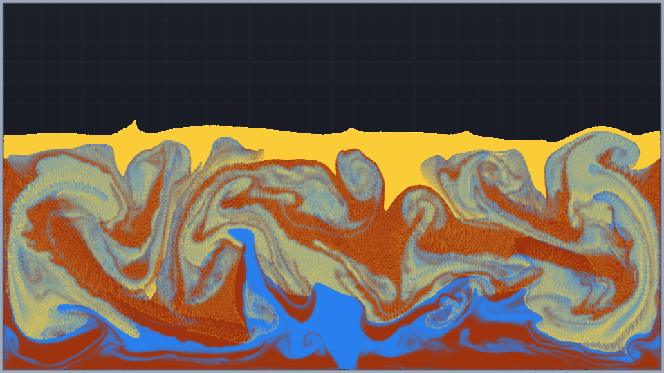
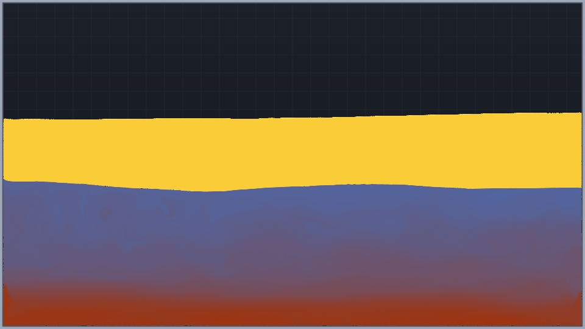

# Sprout

A fast, interactive 2D multi-fluid sandbox in Rust and Vulkan (via Vulkano). Pour water,
oil and syrup, stir them with the mouse, drop obstacles in, and watch them splash, layer
and blend. The whole simulation runs in compute shaders on the GPU.



The fluid solver, its tools and maps; see [Physics](#physics) and [Validation](#validation) for what changed in the second round. The code is laid out so
that more simulations can join the same world later (see [Code layout](#code-layout)).

## Build and run

You need:

- Rust 1.88 or newer (the code uses edition 2024 and let-chains; built here with 1.99).
- A GPU and driver with Vulkan 1.1.
- `glslc` on the `PATH` at build time. Fedora: `sudo dnf install glslc`. Debian/Ubuntu:
  `sudo apt install glslc`. Arch: `sudo pacman -S shaderc`. The Vulkan SDK also ships it.
  Set the `GLSLC` environment variable to use a compiler elsewhere.

```bash
cargo run --release
```

A clean build takes under a minute. The window opens on the Playground map; the panel in
the corner has everything, and every control also has a key.

Useful options (run `sprout --help` for all of them):

| Option | Effect |
|---|---|
| `--map <N or name>` | Starting map, e.g. `--map 2` or `--map dam` |
| `--quality low\|medium\|high\|ultra` | Grid of 384x216, 512x288 (default), 768x432 or 1024x576 cells |
| `--no-vsync` | Uncapped frame rate |
| `--set name=value` | Override a physics parameter (SI units), e.g. `--set nu_syrup=0.09` or `--set cell_size=0.001` |
| `--frames N` | Run N frames, print frame timings, exit |

## Controls

| Input | Action |
|---|---|
| Left mouse | Use the selected tool |
| Right mouse | Grab / stir, whatever tool is selected |
| Middle drag, wheel | Pan, zoom about the cursor (with Jet or Current selected the wheel aims; Alt + wheel zooms) |
| Shift + wheel, `[` `]` | Brush size |
| `-` `=` | Flow of the liquid tools, or strength of Grab / Push / Current |
| `1` `2` `3` | Water, oil, syrup |
| `Q` `B` `J` `C` | Pour, spray, jet, drop |
| `W` `V` `Z` `E` | Grab / stir, push, place a current, erase |
| `A` `S` `D` `X` | Place a circle, box, ramp; remove a solid or a current |
| `T` `G` `F` | Turn the jet, the current or the box / ramp by 15°, flip the ramp |
| `Space` `N` `R` | Pause, single step, reset the map |
| `PgUp` `PgDn` | Previous / next map |
| `Home` `H` `F11` `Esc` | Reset view, hide panel, fullscreen, quit |

The panel also has sliders for the fluid properties (viscosities, surface tensions, contact
angles, densities, cell size), the solver (CFL number, tolerances; it also shows the current
substep and iteration counts), the grid resolution and slow motion.

The liquid tools add the selected liquid; all of them stop with the simulation while it is
paused (single steps still emit), except Drop.

- **Pour** runs a stream straight down out of the round brush: it fills the brush circle,
  so its top is round, and falls from there. The flow sets its speed (60 to 400 cells/s:
  whatever carries the flow through the full width of the brush); below the slowest speed
  the stream narrows instead, and above the fastest the brush caps the flow. The stream is
  one fixed lattice at rest density (`brush::Stream`) that moves along at the stream's
  speed and appears as it crosses the back arc of the nozzle, so it has no seams at any
  frame rate and the flow is exact. Inside the brush the nozzle holds the liquid at the
  launch velocity; below it the stream is in free fall, speeds up and narrows. Sweeping
  the brush sideways faster than the stream runs delivers less: the leading side of the
  nozzle overruns liquid it has just emitted, and the surplus is held back.
- **Spray** throws sparse droplets outwards from the brush rim at 260 cells/s, at 15 % of
  the flow.
- **Jet** is the same stream aimed anywhere at 320 cells/s; the flow sets its width. Its
  nozzle holds the liquid in it at the jet velocity, so a submerged jet keeps pushing.
- **Drop** stamps a round blob with one click, even while paused.
- **Grab** carries liquid along with the cursor, **Push** drives it radially outwards, and
  **Erase** removes it. Grab and Push have a strength (10–400 %) instead of a flow; the
  strength also applies to right-mouse grabbing.
- **Current** places a round zone, as large as the brush, that stays in the world and
  drives the liquid passing through it along its heading, like a pump or a fan. It raises
  the velocity along the heading towards the current's speed (150 cells/s at 100 %
  strength, at up to 12 /s in the centre, fading to nothing at the rim) and leaves
  everything else alone: liquid that is already faster is not braked, motion across the
  current is untouched, and no liquid is added or removed. Aim it with `T` / `G`, the
  wheel or the Aim slider before placing; chevrons on the canvas show where it points and
  how fast. Up to 8 at a time; **Remove** (`X`) deletes the one under the cursor, and
  resetting or changing the map clears them. The constants are `CURRENT_SPEED` and
  `CURRENT_RATE` in `src/sim/params.rs`.

New liquid never packs a cell above rest density, and nothing is added inside a pool:
painted liquid (spray, drop) only goes into cells without liquid, while a stream (pour,
jet) fills the cells it shares with its own earlier liquid, up to 1.5 times rest density
(a lattice that is not aligned to the grid puts 3 to 5 particles in a cell). A submerged
spout is held back the same way: the pool takes what it has room for. The particles per cell are
counted on the GPU (`count.comp`) for just the window around the
brush, and only those counts are read back: 0.3 ms per frame at 512 × 288 and 0.4 ms at
1024 × 576, where reading back every particle cost 1.7 and 34 ms.

Strokes stop at the panel, outside the window, and when the window loses focus. The camera
eases zoom about the cursor (the point under it stays put), pans one to one, and glides
back on Home. The brush cursor takes the tool's colour (the liquid's for liquid tools),
tightens while held and eases to a new size or jet aim; placing or removing a solid and
dropping a blob ring out briefly, and changes of tool, liquid, map or quality are announced
in a short toast.

## Maps

| # | Name | What it shows |
|---|---|---|
| 0 | Playground | A pool, a few obstacles, and oil and syrup about to fall in |
| 1 | Dam Break | A tall column of water collapses across the floor and over a step |
| 2 | Upside Down | Syrup over water over oil: the layers overturn into their stable order |
| 3 | Three Columns | Oil, water and syrup side by side: syrup slides under, oil rides over |
| 4 | Cascade | Three reservoirs drain down a zig-zag of ramps into a shared basin |
| 5 | Empty Tank | Nothing but walls |
| 6 | Terrace Falls | Stepped spill pools and a slow syrup tributary feed a plunge pool |
| 7 | Pinball Garden | Three fluid showers weave through staggered pegs into scalloped pools |
| 8 | Hourglass | A layered reservoir drains through a narrow throat onto a splitting crown |
| 9 | Twin Spillways | Opposing torrents collide and flow around a central island |
| 10 | Canopy | Branching shelves split streams above a pool of stone roots |
| 11 | Sunken Ruins | A dam-break wave threads open passages beneath ruined towers |
| 12 | Oil Drops | A tabletop tank 51 cm wide (1 mm cells): oil beads into round drops and lenses |

Maps are written in resolution-independent units in [src/maps.rs](src/maps.rs); the six detailed maps reuse the existing stone shapes and water, oil and syrup materials.
Try `cargo run --release -- --map canopy`, or use the map menu / PgUp and PgDn.

The six new maps in motion (0.8 simulated seconds, preview grid):



Upside Down six seconds in, and settled after forty:




## Other commands

```bash
cargo run --release -- validate          # physics and tool checks, off-screen (about 100 s)
cargo run --release -- --selftest        # drives the real window through every tool and key
cargo run --release -- bench             # throughput table (about a minute)
cargo run --release -- shot out.png --map 2 --at 3,10
cargo test --release                     # CPU-side unit tests
```

`validate` takes a test name (`hydrostatic`, `dam`, `ritter`, `layers`, `viscosity`,
`viscous`, `buoyancy`, `surface`, `settle`, `convergence`, `pour`, `current`, `tools`) and `--shots DIR` to save a
picture of each scenario. Two debug commands are not in `--help`: `sprout probe [DEPTH]`
prints an energy, step and iteration trace (`--map N` for a map, `--at T` for the duration),
and `sprout profile` splits a frame into CPU recording and GPU time and times every pass of
one substep with GPU timestamps. `shot` renders
any map at the given simulated times, with `--ui` to include the panel.

## Physics

**Units and scale.** The solver works in grid units (cells, seconds, densities relative to
water). Everything you can edit is in SI and converted in one place
([src/sim/params.rs](src/sim/params.rs), `SimParams::gpu_units`), together with the physical
size of a cell, `cell_size` (default 1 cm, so gravity is 981 cells/s²). Changing the cell size
changes the physical scale of the whole tank: at 1 mm per cell surface tension matters, at
1 cm it barely does (see below). A map can state the physical width of its tank instead
(`width_m` in [src/maps.rs](src/maps.rs)); **Oil Drops** does, at 51 cm, which is where oil
visibly beads. Every other map keeps 1 cm cells. `--set cell_size=...` overrides both.

**Method.** Particles carry the fluid and a staggered grid solves the forces (APIC, a
low-dissipation particle-in-cell scheme). Four particles per cell at rest. Each substep:

1. The GPU picks the substep length (`step.comp`) from the CFL condition,
   `dt = cfl / (u_max + sqrt(5 g dx))`, with `cfl` = 4 cells and `u_max` the fastest of: any
   face velocity of the liquid after the last projection, any particle's displacement in the
   last advection (velocity, density correction and oil drift), and what the mouse or a pour
   will impose. Spray in free flight counts a quarter (`spray_cfl`): its path is ballistic.
   The step is also capped at 1/80 s and at the capillary-wave limit of explicit surface
   tension.
2. One pass over the particles gathers velocity from the grid, moves them, collides them
   with solids, and scatters mass and momentum back to the grid; gravity is added on the
   grid. Particles travel with the midpoint rule (the gathered velocity plus the change of
   the grid velocity over half the step), and a path longer than a cell is walked in
   one-cell pieces with a collision test after each, so a 4-cell step does not skip a thin
   solid.
3. Surface tension: curvature of smoothed liquid and oil indicators, turned into pressure
   jumps at liquid–air and oil–aqueous interfaces (below).
4. Viscosity, full stress tensor (below).
5. Pressure: the velocity field is made divergence-free with a variable-density, cut-cell,
   ghost-fluid Poisson solve, by conjugate gradients preconditioned with an aggregation
   multigrid V-cycle (red–black Gauss–Seidel smoothing, Galerkin coarse operators,
   coarse-correction weight 1.8). It stops at a relative residual of 1e-4, so its accuracy
   does not depend on the resolution: a resting pool needs 3 to 5 iterations, the dam
   break 8 to 12.
6. A second solve with the same matrix corrects density errors by nudging particle
   positions only; it never adds momentum.

Both solves need a free surface somewhere in every connected body of liquid: a region
sealed off by solids on all sides has a singular system. Where two shapes touch (the two
ramps that form the crown of the Hourglass map), the rasteriser could leave a crack of a
cell or two, open but sealed on every face. Liquid leaking into it made the
density-correction potential grow without bound until it overflowed, and from then on the
whole tank lost its volume correction and collapsed into a thin, over-dense layer.
`Scene::rasterize` now fills in sealed groups of fewer than 16 open cells, and pushes their
distance field inside the solid so that particles are expelled and the crack is drawn
filled. Larger sealed regions (a box drawn around some liquid) are left open.

The solver is bound by memory traffic on the finest grid level and by the fixed cost of a
dispatch (4.5 µs each on the test machine), so it is built to make few, full passes:

- Each multigrid level takes two dispatches per V-cycle, one down (pre-smoothing and
  restriction fused) and one up (coarse correction and both half-sweeps fused); neighbours
  in another 16 × 16 tile are recomputed rather than read back.
- All levels of at most 1500 cells run inside one dispatch (`mg_tail.comp`).
- The new search direction is formed inside the matrix product.
- Tiles without pressure unknowns (air, mostly) are flagged once per substep and skipped by
  every kernel on every level.

How many Krylov iterations each substep records adapts to what recent solves needed (read
back a frame later, with a margin of half); iterations recorded after convergence are
dispatched indirectly with zero work. A solve that runs out of recorded iterations is
counted and reported (`probe`, `validate`, the panel). Every substep is recorded once into a
raw secondary command buffer with explicit barriers and replayed
([src/sim/raw.rs](src/sim/raw.rs)); vulkano's automatic synchronisation cost several
milliseconds of CPU per substep at this dispatch count.

**Frame pacing.** Each batch of substeps is timed on the GPU (timestamps), and the pacer
([src/pacing.rs](src/pacing.rs)) decides from that cost how many substeps fit in a frame,
with hysteresis. A scene too heavy for real time therefore runs the same number of substeps
every frame and simulated time slows down; it no longer alternates between n and n + 1. A
frame much shorter than a substep (uncapped frame rate) banks its time until a full-length
substep is due.

**Repeatability.** Every particle carries a permanent id that seeds its random numbers, so a
run no longer depends on the order the particle sort leaves in memory. Head-less runs
(`validate`, `probe`, `shot`, `bench`) repeat exactly: three runs of the 40 s overturn give
identical output. The interactive app is not repeatable and cannot be: how simulated time is
cut into substeps follows the wall clock.

**Viscosity** is implicit (backward Euler) in the variational form of Batty & Bridson (2008):
the new velocities minimise kinetic energy change plus `dt * mu * D:D`, D the strain rate.
That is `div(mu (grad u + grad u^T))`, not `mu lap(u)`: it is consistent across viscosity
jumps (water next to syrup), gives traction-free free surfaces and does not slow a rigid
rotation. Solid walls are no-slip, with the wall where it is (half a cell from the first
tangential sample). The system is symmetric positive definite, solved by Jacobi-
preconditioned conjugate gradients to a relative residual of 1e-3, so no viscosity is too
large for the time step. Where the viscous diffusion number `nu dt / dx²` is below 1e-3
(water: about 1e-5 on 1 cm cells) the same operator is applied explicitly instead, which is
stable to about 0.12; in a water-only tank that is the whole tank, in mixed tanks the
implicit solve runs only on 16 × 16 tiles near more viscous fluid.

**Surface tension** uses the ghost-fluid method (Kang, Fedkiw & Liu 2000) for both kinds of
interface, so the jump is as sharp as the free surface and is balanced exactly by the
pressure gradient:

- *Liquid–air:* the air side of a surface face takes the Laplace pressure `sigma * kappa` at
  the interface's sub-cell position. `sigma` is that of the liquid there (water, syrup or oil
  against air, blended by composition).
- *Oil–aqueous:* where the oil fraction crosses 1/2 between two cells, the pressure jumps by
  `sigma_oil * kappa` across that face.
- *Water–syrup:* miscible, one aqueous phase, no interfacial tension (the weak transient
  Korteweg stress of a fresh miscible interface is neglected).

Curvature is the divergence of the unit normal of a 5 × 5 binomially smoothed occupancy
field. **Wetting** is the minimal static-contact-angle model (Brackbill, Kothe & Zemach 1992):
within 1.5 cells of a solid the normal is replaced by the one the material's contact angle
prescribes. There is no contact-angle hysteresis and no contact-line slip model; a contact
line moves as fast as the no-slip viscous wall lets it.

**The three fluids** (all editable; `--set nu_oil=8e-5`, `--set sigma_water=0.07`,
`--set contact_water=40`, ...):

| | Density | Kinematic viscosity | Tension vs air | Contact angle |
|---|---|---|---|---|
| Water | 998 kg/m³ | 1.0e-6 m²/s | 0.072 N/m | 90° |
| Syrup | 1.4 × water | 0.06 m²/s | 0.076 N/m | 90° |
| Oil | 0.9 × water | 6.0e-5 m²/s | 0.032 N/m | 90° |

Oil against water or syrup: 0.025 N/m. Water's values are the standard 20 °C ones; oil's are
typical of olive or sunflower oil (50–90 mPa·s, 0.03 N/m against air, 0.02–0.03 N/m against
water). Syrup is a choice, not a measured product: a thick golden syrup or honey. The
contact angles are a neutral default because the scene does not say what the solids are.
The previous version tuned oil to 50 × and water to zero viscosity "for feel"; water now has
its real viscosity, and it changes almost nothing at this scale (see Validation).

- **Water and syrup are miscible.** Each aqueous particle carries a syrup fraction.
  Neighbours exchange it at a set rate, conserving total syrup exactly. Density blends
  linearly with the fraction and viscosity logarithmically.
- **Oil is a separate phase.** Where oil and water share a cell, below what the grid
  resolves, they would otherwise move as one fluid. Sub-cell droplets therefore drift at
  their terminal velocity: a droplet one cell across (`droplet`, in cells) in whichever
  phase is the majority, with drag `C_d = 24/Re + 0.44`. This follows the cell size and the
  viscosity of the fluids (a droplet barely drifts through syrup). Whether an interface
  sheds such droplets at all depends on the Bond number of one cell, `Δρ g dx² / σ`: 3.9 on
  1 cm cells (buoyancy tears pieces off; the drift acts everywhere), 0.04 on 1 mm cells
  (tension holds the interface together; where the smoothed oil fraction shows a resolved
  interface nothing drifts). Without that, the drift dissolved every rising oil drop on
  1 mm cells into a cloud within half a second. The previous model used a
  fixed relaxation time, which made the drift ten times faster in cells per second at 1 mm
  cells and ignored viscosity; at 1 mm it broke up oil blobs.

**Liquid and air.** Air is not simulated. A cell is liquid when it holds at least half its
rest density; sparser spray flies ballistically until it lands.

**Numerical stabilisation.** Every device below exists for a stated reason, is a named
parameter in [src/sim/params.rs](src/sim/params.rs) where it can be switched off, and none
damps motion globally.

| Device | Purpose | Measured effect |
|---|---|---|
| Density correction (position-only potential, 1 − exp(−dt/6 ms) of the error per substep, at most 0.5) | Removes the volume drift that particle advection accumulates | Volume −0.29 % after the 40 s overturn; lifts a resting 1 M-particle pool by 0.016 cells (an energy change of 1.5e-4 of its potential energy). A time constant rather than a per-step share, so short substeps do not over-correct; per-step it caused visible jitter |
| Correction displacement ≤ 0.5 cell per substep | Keeps one bad cell from throwing particles | Inactive in every validation scene except at impacts |
| Crowding jitter (cells over 1.5 × rest density) | Lets particles stacked on one spot separate | Unchanged from before |
| APIC matrix clamp ‖C‖ ≤ 1/dt | Bounds the affine velocity of a particle in thin spray | Rarely active |
| Oil slip ≤ cfl cells per substep | The step size already accounts for the slip; this only acts in the substep it appears | — |
| Ghost-fluid fraction θ ≥ 0.1 | Bounds the pressure coefficient of a nearly empty surface cell | Standard; unchanged |
| Curvature only where the smoothed indicator's gradient is resolved; ‖κ‖ ≤ 0.5 / cell | Radii under two cells are not representable; particle noise there would become huge pressure jumps | Spurious currents around a resting drop 1.2 % of the capillary velocity |
| Particle speed cap `speed_cap` = 1 × √(2 g H), the free-fall speed across the tank height (0 = off) | The 0.1 % of particles in impact jets otherwise set the time step for everything | 1329 cells/s at 1600 × 900, 752 at 512 × 288. A capped particle can still reach the lid from the floor. Dam Break 768 × 432, first 10 s: 4741 → 1563 substeps together with CFL 4. Energy at first impact −0.75 %; finest convergence front 4.546 → 4.528 at CFL 2 |
| CFL number `cfl` = 4 (was 2), with midpoint advection `advection_order` = 2 | Half the substeps in fast flow | Dam front at T = 3.33: 4.546 → 4.508 (−0.8 %), still converging (0.007 between the two finest grids); no measurable energy change before impact |
| Spray may travel `spray_cfl` = 4 × further per substep (1 = off) | A handful of free-flying droplets no longer dictates the step | 7 % fewer substeps in Dam Break 1600 × 900; path of spray is ballistic either way |
| Longest substep `dt_max` = 1/80 s (was 1/60) | At CFL 4 a slow pool otherwise takes 1/60 s steps, in which converging particles travel three cells before the density correction sees them | Fullest cell after refilling a hole: 13–21 particles → 10. Resting 1 M pool: 371 → 486 substeps in 6 s (3.75 → 4.07 s wall) |
| Density correction leaves buried liquid that is not under pressure alone unless a cell is a quarter over-full | Pushing every over-full cell while under-full ones may not pull rectified particle noise into expansion | In zero gravity a pool no longer stretches (15 % in 50 ms on 1 mm cells); this is what had made the oil-drop oscillation unmeasurable. No effect under gravity (settle numbers unchanged) |
| Blocking helpers never record a substep shorter than 2 % of a full one | Momentum travels through the grid as fixed-point displacement per substep; a microsecond step rounds slow flow away | On 1 mm cells such slivers stopped a capillary oscillation dead after 2 s. Sample times are met to 2 % of a substep |
| Implicit-viscosity tiles (diffusion number ≥ 1e-3) | Skip Krylov work where it changes nothing above tolerance; those tiles get the explicit step | Viscosity checks unchanged; viscosity cost 5.8 → 2.3 ms per substep on Playground 1024 |

## Validation

`sprout validate` runs these on the real solver, mostly at 512 × 288, and compares against a
known answer. All checks pass on the machine below; two contact angles are reported without
a pass/fail (see Limitations). Three columns: the original version (commit `572c7c8`), the
solver rewrite as it stood before this round (`3ff62bf`), and now. "—" means not measured or
not applicable to that version.

| Test | Original | Rewrite | Now | Expected |
|---|---|---|---|---|
| Resting pool 1024 × 576, 1 M particles, 6 s: peak KE per particle | 162 | 0.0011 | 0.0005 | 0 |
| Same: mean height | swung by 1.7 cells | +0.016 | +0.017 | constant |
| Same: unconverged pressure solves | — (fixed 30 sweeps) | 0 of 367 | 0 of 486 | 0 |
| Resting pool 512 × 288, 10 s: level, rms / √(gh) | −0.51 %, 0.00007 | −0.57 %, 0.00018 | −0.55 %, 0.00013 | level, still |
| Syrup slump vs Huppert (1982) at 16 s: ratio, exponent | 1.13, 0.192 | 1.02, 0.204 | 1.02, 0.205 | 1.0, 0.2 |
| Shear decay, free slab (traction-free surfaces) | — | −4.4 % | −3.9 % | exact rate |
| Shear decay on a no-slip floor | — | −1.7 % | −1.8 % | exact rate |
| Rigid rotation, ν = 0.01 m²/s, angular momentum after 1 s | 0.919 (Laplacian form) | 1.011 | 0.975 | 1 |
| Resting drop, 1 mm cells: pressure / (σ/R) | no tension | 1.002 | 1.002 | 1 |
| Spurious currents around it / √(σ/ρR) | — | 1.2 % | 1.2 % | small |
| Oil disc in water: pressure jump / (σ_oa/R) | — | 1.002 | 1.002 | 1 |
| Water drop n = 2 oscillation vs Rayleigh | — | +0.6 % | +0.6 % | 0 |
| Oil drop in water, n = 2 oscillation period | — | unmeasurable (see below) | 2.220 s, +6.3 % | 2.087 s (viscous normal mode) |
| Syrup blob in water (miscible): shape change | — | 0.000 | 0.000 | none |
| Contact angle 60° / 90° / 120°, old chord measure | none | 73° / 86° / 132° | 71° / 87° / 132° | as set |
| Same, from cap area and apex height | — | — | 76° / 87° / 146° | as set |
| Oil square in water, 0.5 s: R_max / R_equal-area | — | 0.99 (1.19 without tension) | 1.00 (1.19 without) | 1 = disc |
| Oil beads at default settings | no | no (needs `--set cell_size=0.001`) | yes, on the Oil Drops map | yes |
| Dam break 2:1, front Z at T = 3.33, a = 30 / 60 / 120 cells | — | 4.495 / 4.530 / 4.546 | 4.417 / 4.501 / 4.508 | converging |
| Dam break front speed dZ/dT | 1.47 | 1.47 | 1.46 | experiments 1.14–1.74 |
| Dam break front vs Martin & Moyce table | +8 … +16 % | +8 … +15 % | +8 … +13 % | see below |
| Shallow dam break vs Ritter: depth, speed | 0.463, 0.637 | 0.459, 0.638 | 0.458, 0.635 | 0.444, 0.667 |
| Overturn of three layers, 40 s: mean heights | 151 / 79 / 48 at 30 s | 149 / 83 / 45 | 149 / 83 / 45 | sorted |
| Same: aqueous above the oil floor (tank-wide floor) | — | 0.51 – 1.69 % over 3 runs | — | small |
| Same, strip by strip | — | — | 0.34 %, identical over 3 runs | small |
| Same: mechanical energy rise between samples | — | never | +0.04 % of released | none |
| Stir then 10 s of rest: energy above rest | 2072 → 1087 | 2066 → 1072 | 2053 → 1063 | falling |
| Same: particle-scale jitter (cells/s) | 9.1 → 3.1 | 9.3 → 3.0 | 8.4 → 3.0 | decaying |
| Fullest cell after refilling a hole (rest 4) | — | 9 | 10 | < 12 |
| Tools: pour, erase, recycle, grab, solids | all pass | all pass | all pass | |
| Run-to-run spread, layers and overturn | present | trapped share 0.51 – 1.69 % | none (identical output) | none |

The pour and the current were added after that table and have only been measured on a
software renderer (llvmpipe, no GPU); the GPU columns above were not re-measured, and
neither was performance. `sprout validate pour` and `sprout validate current`, 512 × 288:

| Check | Measured | Expected |
|---|---|---|
| Pour held 1 s at 12000 /s (18 cells wide, 167 cells/s): particles | 11857 | 11861 (12000 less the corners still to cross the round nozzle) |
| Same: largest gap along the stream, particles outside its width | 0.26 cells, 0.00 % | < 1, < 0.5 % |
| Same: gain of v² between 40 and 130 cells below the spout | 0.993 of 2 g h (288 → 508 cells/s) | 1 |
| Same: width × speed × 4 at those heights | 11558 and 12109 /s | 12000 |
| Same: top of the stream above the brush centre, middle / sides | 6.1 / 1.7 cells | round: about 6.2 (9 less a frame's travel), under 3 |
| Same at 15 frames/s: particles, gap | 11857, 0.33 cells | as at 60 |
| Brush sweeping at 240 cells/s | 9924 | below 12000: the nozzle overruns its own liquid |
| Trickle, 2000 /s (8.3 cells wide at 60 cells/s) | 1969, gap 0.17 cells | 1971 |
| Spout 20 cells under a pool, 1 s | 6516 of 12000, fullest cell 10 | held back, < 12 (rest 4) |
| Current (150 cells/s, radius 14) in a 60 cell pool, 3 s: speed along it in the zone | 63 cells/s mean, 126 fastest | driven, never above 150 |
| Same: particles, flow above and below the zone | 121440 → 121440, −64 cells/s | conserved, returning |
| Same, 3 s after removing it: kinetic energy | 611 → 326 | falling |
| Stream falling through a sideways current: sideways / downward speed below it | 56 / 463 cells/s (without: 0 / 462) | pushed aside, fall unchanged |

Notes on what changed in the checks themselves, so the columns can be compared fairly:

- **Oil drop oscillation.** The earlier "30 % fast inviscid, 27 % slow viscous" figures were
  not a property of the interface. Three defects made the test unmeasurable: with gravity
  and viscosity both zero the drift model divided 0 by 0 and shredded the drop; the density
  correction rectified particle noise into a steady vertical stretch of the whole zero-gravity
  pool; and beyond 2 s of simulated time microsecond sliver substeps rounded the motion away.
  With those fixed the oscillation is clean. The reference is no longer the inviscid formula:
  with olive-oil viscosity on 1 mm cells the boundary layer is a third of the drop radius,
  and the linear normal mode of a viscous cylinder in a viscous fluid
  ([tools/drop_modes.py](tools/drop_modes.py)) is 4.5 % slower than inviscid. Against that the
  solver is 6.3 % slow (check: ± 8 %). The rest is numerical: particle–grid transfers smooth
  the shear layer at the interface once per substep, so the error scales with the number of
  substeps per period (13.5 % at half the step, 5.2 % at 1.7 × the step) and does not fall
  with resolution (R = 10 / 20 / 30 / 40 cells: 12.7 / 6.9 / 5.7 / 5.5 % with both fluids
  inviscid). A water drop in air, which has no such layer, is within 0.6 %.
- **Contact angle** is now measured from the cap's area and apex height, which resolves
  fractions of a cell and works above 90°. The old chord measure read the width off the first
  row of cells and flattered the 120° case (132° where the drop is really at 146°).
- **Layer separation** is measured in 16 vertical strips. The interface between the layers
  keeps sloshing as a slow internal wave, and against one tank-wide floor a tilted interface
  reads as unseparated water (0.3 to 4 % depending on the phase of the wave).
- **Rigid rotation** reads lower because forward-Euler advection let the disc spiral outwards,
  which adds angular momentum and hid a real loss at the free surface (0.992 with 4 ms steps).
  The threshold is 0.95; the Laplacian form it guards against gives 0.919.
- **Jitter** must fall over every 4 s rather than between every two samples: breaking waves
  leave bursts of small eddies, and the rewrite as handed over fails the strict version too.

What the numbers say about the originally reported problems:

- **"Rarely settles at high particle counts"** was the pressure solve: thirty SOR sweeps do
  not converge a 576-cell-tall grid, so the pool compressed under gravity, the density
  correction lifted it back, and the cycle pumped energy in. The solve now stops on its
  residual. Travelling with a bilinear midpoint velocity re-created a slow version of this
  (kinetic energy 0.1 after 6 s); the midpoint rule therefore only adds the *change* of the
  grid velocity along the half step to the gathered velocity.
- **"Syrup front 13 % fast"** was the viscosity solve; it now reads 1.02.
- **"Dam break 8–16 % fast"** is not a solver error: it converges under grid refinement and
  its speed sits inside the spread of published experiments (1.14–1.74, Lobovský et al.
  2014, table 1).
- **"Water sloshes excessively"** after a stir is physical: all three versions lose the same
  energy at the same rate.
- **"Oil does not bead"**: at 1 cm cells the Bond number of any drop the grid can resolve is
  large, so blobs flatten, as real 5 cm blobs would. The **Oil Drops** map is a tank 51 cm
  wide instead (1 mm cells at the default resolution): oil squares of 5 to 8 mm released
  under water round off and rise as drops, and oil dropped on the surface forms lenses. The
  fluids are the same; only the length scale differs. At that scale the capillary time-step
  limit is 0.7 ms, so the map runs well below real time (1.2 simulated seconds take about
  8 s), which suits it: a centimetre drop rises in a fraction of a second.

`sprout --selftest` drives the real window through every tool and key (27 checks, all pass).
`cargo test` covers the CPU side: 23 tests, all pass. `cargo clippy` is clean.

## Performance

Hardware: AMD Ryzen 5 3600, NVIDIA RTX 3060 Ti 8 GB, Fedora 45, Wayland. All three versions
measured the same day with the same command, a 1600 × 900 window, uncapped
(`--no-vsync --frames 1800`, the first 360 frames skipped; `SPROUT_FRAMES_CSV` for the raw
frame times). Frame times in ms; "sim speed" is simulated seconds per wall-clock second.

| Scene | Version | mean | p5 | p25 | p50 | p75 | p95 | p99 | max | sim speed |
|---|---|---|---|---|---|---|---|---|---|---|
| Dam Break 1600 × 900, 1.04 M water | original | 13.3 | 9.7 | 9.9 | 10.2 | 18.3 | 18.7 | 18.9 | 22.6 | 0.43 |
| | rewrite | 15.8 | 10.9 | 11.7 | 12.5 | 21.6 | 23.8 | 25.0 | 27.6 | 0.07 |
| | now | 11.1 | 10.2 | 10.7 | 11.1 | 11.5 | 12.3 | 13.3 | 19.6 | 0.27 |
| Dam Break 768 × 432, 237 k water | original | 0.8 | 0.4 | 0.4 | 0.4 | 0.6 | 2.6 | 2.8 | 3.7 | 0.96 |
| | rewrite | 10.4 | 0.5 | 4.3 | 12.1 | 16.3 | 19.9 | 21.0 | 24.2 | 0.57 |
| | now | 3.0 | 0.3 | 0.4 | 0.6 | 6.4 | 10.4 | 11.5 | 13.7 | 0.97 |
| Playground 1024 × 576, 732 k mixed | original | 17.1 | 12.0 | 17.3 | 17.4 | 17.6 | 17.8 | 19.6 | 19.8 | 0.71 |
| | rewrite | 14.9 | 9.3 | 10.0 | 17.1 | 18.1 | 19.7 | 23.4 | 25.2 | 0.15 |
| | now | 10.9 | 9.9 | 10.4 | 10.8 | 11.4 | 12.3 | 13.0 | 17.0 | 0.49 |
| Upside Down 512 × 288, 369 k mixed | original | 1.4 | 0.6 | 0.6 | 0.8 | 2.6 | 3.0 | 3.2 | 4.1 | 0.98 |
| | rewrite | 7.5 | 0.6 | 0.7 | 6.5 | 12.8 | 18.5 | 19.7 | 24.7 | 0.94 |
| | now | 1.6 | 0.6 | 0.6 | 0.7 | 0.9 | 7.6 | 8.2 | 8.6 | 0.97 |

The frame-count benchmark covers a different stretch of each scene in every version (a
version that simulates more per frame gets further). The same simulated interval, head-less
(`sprout probe --map N --grid WxH --at 8`, wall seconds for 8 simulated seconds; the pool is
`sprout probe 250 --grid 1024x576 --at 6`):

| Scene | original | rewrite | now |
|---|---|---|---|
| Dam Break 1600 × 900, 0 – 8 s | 19.5 s (1920 substeps) | 90.2 s (7762) | 24.2 s (2415) |
| Playground 1024 × 576, 0 – 8 s | 12.8 s (1920) | 84.6 s (10833) | 15.2 s (1490) |
| Resting 1 M pool, 0 – 6 s | 10.3 s (1440) | 3.75 s (371) | 4.07 s (489) |

Reading these honestly:

- **Two of the four speed targets are met** (Dam Break 768 × 432, Upside Down: real time
  again) **and two are not**: Dam Break 1600 × 900 runs at 0.27 against the original's 0.43
  (4 × the rewrite, 0.63 × the original), Playground 1024 × 576 at 0.49 against 0.71. Over the
  same simulated interval the gap is smaller, 1.24 × and 1.19 × the original's wall time.
- **Why the two big scenes stay behind.** A substep now costs about what the original's did
  (9.3 ms against 10.2 ms on the big dam break), with both solves converged. What differs is
  the number of substeps: the original took 240 per simulated second whatever happened and
  clipped every particle to 600 cells/s, which at 1600 × 900 is below the speed of the bulk
  flow (free fall over the column height is 1100 cells/s), so it was simulating a slower
  flow. With the cap at the physically meaningful 1329 cells/s and CFL 4, the violent first
  seconds need about 350 substeps per simulated second. Closing the gap needs CFL 6 (the
  dam front then moves 2.4 % and stops converging cleanly) or a substep of 6.5 ms.
- **Where one substep goes** (Dam Break 1600 × 900, GPU timestamps from `sprout profile`,
  ms): particles 2.4; pressure 4.5 (multigrid down 1.2, up 1.8, coarse levels 0.4, Krylov
  vectors and reductions 1.0); surface tension 0.8; viscosity (explicit, water) 0.5; other
  grid passes 1.1; total 9.3 (rewrite: 10.3 at CFL 2, where the solve needs fewer iterations).
  Playground adds 4.5 ms of implicit viscosity (22 iterations of six dispatches each).
- **What was tried, with its measured effect** (per substep unless stated): one dispatch for
  all coarse multigrid levels, 3.8 → 3.4 ms at 768 × 432; skipping tiles without unknowns,
  −9 % (768) and −13 % (1600); fusing each level's four V-cycle passes into two, 10.0 → 9.3
  ms at 1600 and 3.4 → 3.1 at 768; forming the search direction inside the matrix product,
  one dispatch and one pass fewer per iteration; speed cap + CFL 4 + spray relaxation,
  4741 → 1563 substeps over the first 10 s of Dam Break 768. Not adopted: pressure tolerance
  1e-3 (11 → 8 iterations in a resting pool, all checks pass, but the tolerance was left
  alone); viscosity tolerance 1e-2 (syrup front 1.02 → 1.03). Measured and rejected:
  dropping the barriers between dispatches (the solve diverges), a narrower work group for
  the coarse levels (4 × slower).
- **Frame pacing is even.** Dam Break 1600 × 900 used to alternate between one and two
  substeps per frame (p25 11.9, p75 22.2 ms in the rewrite; 9.9 and 18.3 in the original);
  it now holds one (p25 10.7, p75 11.5). The price is the median: 11.1 ms against the
  original's 10.2.
- **Small scenes are back at the original's median** (0.6 and 0.7 ms against 0.4 and 0.8).
  The rewrite's 60–120 fps was not longer substeps as such: each frame was given a shortened
  substep of its own, so every frame paid for one. Frames now bank time until a full-length
  substep is due. The tails are worse than the original's (p99 11.5 and 8.2 ms against 2.8
  and 3.2): one converged substep costs 3.1 ms at 768 × 432 and 6 ms in Upside Down (most of
  it the implicit viscosity solve), against the original's 2.2 ms of fixed sweeps, and in
  the fast phase of the small dam break a substep costs about as much as it simulates, so
  frames with three substeps sustain themselves.
- **Fixed overhead**: a dispatch with its barrier costs 4.5 µs here whatever it does; a
  substep at 1600 × 900 now issues 15 per Krylov iteration (38 before). Recording a
  frame costs 0.1 ms of CPU.

## Limitations

- **Fast flows at high resolution are still slower than the original** (see Performance): the
  step follows the fastest liquid, and each substep solves pressure to a tolerance.
- **Contact angles are biased towards non-wetting and not fixed**: 60° settles at 76°, 120°
  at 146° (90° at 87°). Narrowing the band of wall nodes that take the prescribed normal
  from 1.5 cells to 0.5 makes 90° exact (90.4°) but 60° worse (83°), which points at the
  model rather than its tuning: a wedge thinner than half a cell is not liquid to the
  pressure solve, so a wetting contact line cannot advance. A ghost indicator extended into
  the wall along the contact angle is the likely fix. There is no hysteresis and no
  contact-line slip model.
- **Oil–water capillary oscillation is 6 % slow**, from the smoothing of the interfacial shear
  layer by particle–grid transfers (see Validation). It grows with the number of substeps per
  period, so it is larger for small `dt_max`.
- **Free surfaces sit about half a cell off** for viscosity (the free-slab shear decays 3.9 %
  slow, as for a slab one cell thicker). Not addressed in this round.
- **A viscous free surface loses angular momentum**: 2.5 % per second for a disc at
  ν = 0.01 m²/s with 12.5 ms steps.
- **The viscosity solve occasionally stops at its recorded iteration limit** in mixed scenes
  (29 of 1490 substeps in the first 8 s of Playground 1024 × 576, worst residual 4e-3 against
  the tolerance 1e-3; the rewrite: 111 of 10833). The limit follows what recent solves
  needed and catches up a batch later.
- **Tabletop scale is slow in simulated time**: on 1 mm cells explicit surface tension limits
  the step to 0.7 ms (see the Oil Drops map).
- **Surface tension needs small cells to matter**: on the 1 cm maps oil does not bead, as it
  would not in a tank 5 m wide.
- **The interactive app is not repeatable** (substeps follow the wall clock); head-less runs
  are.
- **The brush tools wait for the GPU** each frame they emit, to read back the particle
  counts around the brush (0.3–0.4 ms, see Controls).
- **Air is nothing.** Trapped pockets have no pressure and collapse; there are no bubbles.
  A tank filled to the lid has no pressure reference and is not supported.
- **Solids are static**, and a tank is limited to four particles per cell of its area.
- **Tested on one machine.** NVIDIA on Linux only; the solver needs subgroup arithmetic
  (Vulkan 1.1) and relies on buffer writes being visible across `barrier()` within a work
  group (`mg_tail.comp`).
- No save or load, and no undo.

## Code layout

| Path | Role |
|---|---|
| [src/world.rs](src/world.rs) | The sandbox world: solids plus the simulations living in it. New simulations plug in here. |
| [src/scene.rs](src/scene.rs) | Shapes and their rasterisation into the fields the solver and renderer use |
| [src/sim/](src/sim/mod.rs) | The fluid solver: buffers, pipelines, the substep; [params.rs](src/sim/params.rs) holds every material property; [raw.rs](src/sim/raw.rs) the hand-synchronised substep command buffers |
| [shaders/](shaders/) | All GPU code. `common.glsl` documents the grid layout and every buffer. |
| [src/render.rs](src/render.rs), [src/gui.rs](src/gui.rs) | Particle splatting and compositing; a small egui painter |
| [src/app.rs](src/app.rs), [src/ui.rs](src/ui.rs), [src/camera.rs](src/camera.rs), [src/pacing.rs](src/pacing.rs) | Window and input; panel and canvas overlays; eased camera; substep pacing |
| [src/brush.rs](src/brush.rs) | Brush strokes and the admission of new liquid (CPU only) |
| [src/maps.rs](src/maps.rs) | Built-in maps |
| [src/validate.rs](src/validate.rs), [src/selftest.rs](src/selftest.rs), [src/headless.rs](src/headless.rs) | Checks, benchmarks, screenshots |
| [tools/drop_modes.py](tools/drop_modes.py) | Reference periods for the oil-drop oscillation check (viscous normal modes; plain Python) |

Shaders are compiled by [build.rs](build.rs) with the system `glslc` rather than
`vulkano-shaders`, which builds the shaderc C++ toolchain from source and fails with
current CMake.
